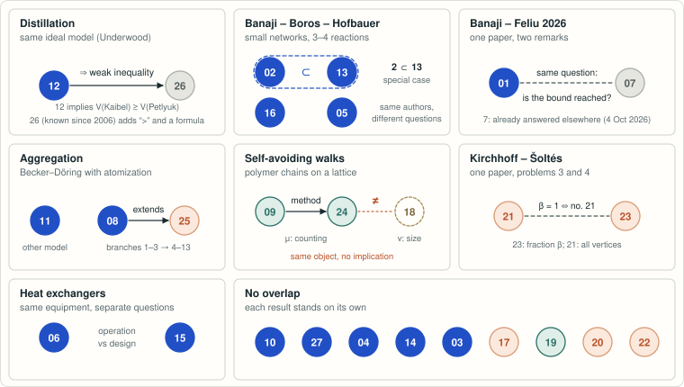

# Open problems in chemistry: manuscripts and certificates

<!-- plain-words:start -->
**New to these topics?** See the guided reading: [basedpolymer.eu/chemistry-open-problems](https://basedpolymer.eu/chemistry-open-problems) ([en français](https://basedpolymer.eu/chemistry-open-problems/fr)).

<!-- plain-words:end -->

This repository collects solutions, produced with AI agents, to **problems explicitly left open in recent
chemistry papers**: questions stated as "we leave open", "we conjecture" or "it remains an open question" in
reaction-network theory, polymer physics and chemical engineering. It follows the model of OpenAI's
[mathematics collection](https://github.com/openai/math): each result comes with the verbatim statement it answers, a
manuscript, and scripts that re-check every computational claim.

## Models

- **Claude Opus 5.5** (Anthropic), effort *xhigh*: orchestration; results 1–3, 5–9, 11–25 and 27; editing and
  verification of results 4 and 10.
- **GPT-6-Astra** (OpenAI), effort *xhigh* (*High* for result 26): results 4, 10 and 26; contributions to results 8,
  11, 12, 17, 20 and 25.

> **Status of this collection.** Every result has been checked by a second AI agent with a fresh context, except
> those marked *not yet verified*; none has been refereed by humans. Statuses follow [PROTOCOL.md](PROTOCOL.md);
> corrections are recorded in [history.md](history.md).

## Results

| # | Problem (source) | Field | Answer | Status |
|---|---|---|---|---|
| 1 | [Sharpness of the (n, n, n−1) equilibrium bound](problems/banaji-feliu-remark-4-23/) (Banaji–Feliu, J. Math. Biol. 2026, Rem. 4.23) | Reaction networks | Bound attained for every n; minimum source molecularity is 3 | [**solved**](problems/banaji-feliu-remark-4-23/paper.pdf) |
| 2 | [Limit cycle in a three-reaction example](problems/bbh-three-reaction-no-limit-cycle/) (Banaji–Boros–Hofbauer, Stud. Appl. Math. 2024, §6) | Reaction networks | No periodic orbit for any rates; extends to a subfamily | [**solved**](problems/bbh-three-reaction-no-limit-cycle/paper.pdf) |
| 3 | [Algebraic limit cycle in a cubic weakly reversible system](problems/craciun-erban-cubic-wr-algebraic-cycle/) (Craciun–Erban, J. Math. Biol. 2025) | Reaction networks | Yes: 10-reaction network with integer rates, W^a(3) ≥ 1 | [**solved**](problems/craciun-erban-cubic-wr-algebraic-cycle/paper.pdf) |
| 4 | [Critical temperature of the DGH charged di-block polymer](problems/dgh-charged-polymer-diblock/) (Poisat, arXiv:2502.18964, question (3)) | Polymer physics | β_c is the root of Σ_{ℓ≥1} e^{−βℓ²/2} = 1 (value predicted by Derrida–Griffiths–Higgs 1992) | [**solved**](problems/dgh-charged-polymer-diblock/paper.pdf) |
| 5 | [Four limit cycles with three reactions](problems/boros-hofbauer-four-limit-cycles/) (Boros–Hofbauer, J. Dyn. Diff. Equat. 2024, §5.1, conjecture) | Reaction networks | Conjecture true: stable focus surrounded by four limit cycles | [**solved**](problems/boros-hofbauer-four-limit-cycles/paper.pdf) |
| 6 | [Jäschke–Skogestad temperature conjecture](problems/jaschke-skogestad-temperature-conjecture/) (Comput. Chem. Eng. 2014, heat-exchanger networks with stream splits) | Chemical engineering | Conjecture false for every branch with ≥ 3 exchangers; corrected recursion proved for all sizes | [**solved**](problems/jaschke-skogestad-temperature-conjecture/paper.pdf) |
| 7 | [Quadratic (n, n+2, n) networks with n+1 equilibria](problems/banaji-feliu-remark-5-8/) (Banaji–Feliu, J. Math. Biol. 2026, Rem. 5.8) | Reaction networks | Bound attained for every n; already answered on 4 Oct 2026 (Zenodo 10.5281/zenodo.23146115) | [already solved](problems/banaji-feliu-remark-5-8/paper.pdf) (rediscovered) |
| 8 | [Hopf criticality in Becker–Döring equations with atomization](problems/becker-doring-atomization-hopf/) (Pego–Velázquez, Nonlinearity 2020) | Nucleation kinetics | Complete for branches 1–3, every M: exact onsets 15, 44, 87; first branch stable and supercritical for M ≥ 16, subcritical at 15; branches 2–3 supercritical with unstable orbits | [**solved**](problems/becker-doring-atomization-hopf/paper.pdf) |
| 9 | [Upper bound for the connective constant of self-avoiding walks on Z³](problems/cubic-saw-upper-bound/) (Pönitz–Tittmann, Electron. J. Combin. 2000: 4.7387) | Polymer physics | μ(Z³) ≤ 4.722048 by an exact certificate; new bounds for d = 4, 5, 6 | [**record**](problems/cubic-saw-upper-bound/paper.pdf) |
| 10 | [Critical parameter of the perturbed Gelfand equation on the disk](problems/perturbed-gelfand-2d-critical-epsilon/) (Korman–Li–Ouyang, J. Differential Equations 2017, conjecture) | Combustion theory | Conjecture true: unique ε₀ = 0.2421061655952…, exactly S-shaped below, monotone above | [**solved**](problems/perturbed-gelfand-2d-critical-epsilon/paper.pdf) |
| 11 | [Discrete critical coagulation–fragmentation](problems/jang-tran-discrete-coagulation-fragmentation/) (Jang–Tran, Adv. Contin. Discrete Models 2025, Conjecture 2) | Aggregation kinetics | Conjecture true for kernels ij and 1: unique stationary state for every mass 0 < m < 1, unique global mass-conserving solution for 0 < m ≤ 1, without second moment | [**solved**](problems/jang-tran-discrete-coagulation-fragmentation/paper.pdf) |
| 12 | [The generalized Petlyuk arrangement minimizes vapor](problems/halvorsen-skogestad-petlyuk-minimum-vapor/) (Halvorsen–Skogestad, Ind. Eng. Chem. Res. 2003, conjecture) | Chemical engineering (distillation) | Conjecture true for every number of components, for any network of constant-molar-overflow equilibrium stages: every arrangement needs at least max_j H_j, attained by the Petlyuk arrangement with finitely many stages | [**solved**](problems/halvorsen-skogestad-petlyuk-minimum-vapor/paper.pdf) |
| 13 | [Cases 9 and 10 without Andronov–Hopf bifurcation](problems/bbh-cases-9-10-limit-cycles/) (Banaji–Boros–Hofbauer, Stud. Appl. Math. 2024, §6) | Reaction networks | No: such a network has no periodic orbit for any rate constants (generalizes result 2) | [**solved**](problems/bbh-cases-9-10-limit-cycles/paper.pdf) |
| 14 | [Sign of solute skewness in regular-polygon ducts](problems/taylor-dispersion-polygon-skewness/) (Aminian–Camassa–McLaughlin, Stud. Appl. Math. 2018) | Chemical engineering (transport) | Long-time skewness negative for the equilateral triangle and positive for every regular n-gon with n ≥ 4; short-time skewness positive for every n ≥ 3; "at all times" only on certified windows | [solved](problems/taylor-dispersion-polygon-skewness/result.md) for long and short times, *not yet verified* |
| 15 | [Minimum number of matches in heat-recovery networks](problems/hen-minimum-matches/) (Letsios–Kouyialis–Misener, Comput. Chem. Eng. 2018, §9.2) | Chemical engineering (heat integration) | Four benchmark instances closed: 37sp-yfyv = 36, 20sp1 = 19, 23sp1 = 22, unbalanced10 = 25; lower bound 32 for the balanced15 family | [**solved**](problems/hen-minimum-matches/paper.pdf) for four instances |
| 16 | [Bimolecular (2, 4, 2) networks with two stable equilibria](problems/bbh-242-bimolecular-multistability/) (Banaji–Boros–Hofbauer, Nonlinear Dyn. 2024, §7) | Reaction networks | No further networks: the ten found by the authors are the only ones, boundary equilibria included; at most two equilibria are stable, the origin and a positive one | [**solved**](problems/bbh-242-bimolecular-multistability/paper.pdf) |
| 17 | [Duality between preclusters, invariant polyhedral supports and siphons](problems/iosif-siphon-precluster-duality/) (Iosif, [arXiv:2603.08767](https://arxiv.org/abs/2603.08767), 2026, conjecture) | Reaction networks | Every precise form is false, with exact criteria and counterexamples such as the 3-cycle X₁→X₂→X₃→X₁. The duality is the Petri-net reverse dual. Under the self-dual cluster rank equation it transfers siphon structure and persistence, and for proportional-conflict networks uniqueness and stability. Outside that class it transfers neither persistence nor convergence: a weakly reversible deficiency-zero network has a dual that is persistent for all rates but has a periodic orbit. Persistence dichotomy in rank two open | [partial result](problems/iosif-siphon-precluster-duality/paper.pdf) |
| 18 | [Swelling exponent of self-avoiding walks on Z³](problems/saw-3d-swelling-exponent/) (open since Flory; Madras–Slade 1993) | Polymer physics | Known bounds not improved; two conditional theorems | [conditional results](problems/saw-3d-swelling-exponent/upper-bound/result.md), *not yet verified* |
| 19 | [Knotting probability of equilateral hexagons](problems/equilateral-hexagon-knot-probability/) (Hake, J. Knot Theory Ramif. 2019: p₆ ≤ 0.0238) | Polymer physics (ring polymers) | Certified 3.0675·10⁻⁵ < p₆ < 8.4945·10⁻⁴; two lemmas of Hake's proof are false | [record](problems/equilateral-hexagon-knot-probability/result.md), *not yet verified* |
| 20 | [Frank–Kasper tilings in the diblock foam model](problems/frank-kasper-dfm-screening/) (Reddy et al., PNAS 2018) | Polymer physics (block copolymers) | σ lowest numerically; certified enclosure 1.00000025 ≤ inf 𝓕 ≤ 1.068575909; global ordering unresolved | [partial result](problems/frank-kasper-dfm-screening/paper.pdf), *not yet verified* |
| 21 | [Kirchhoff analogue of Šoltés's problem](problems/kirchhoff-soltes-problem/) (Gottwald–Majstorović Ergotić–Došlić, Appl. Math. Comput. 2026, Problem 3) | Mathematical chemistry | C₅ still the only solution: exhaustive for n ≤ 11 and for vertex-transitive graphs with n ≤ 39; several classes excluded | [partial result](problems/kirchhoff-soltes-problem/paper.pdf), *not yet verified* |
| 22 | [Spectral conjecture on fullerene duals](problems/fullerene-dual-cospectral/) (Bille–Buchstaber–Spodarev, J. Math. Chem. 2021) | Mathematical chemistry | arXiv-v1 Conjecture 1(a) false (already corrected by the authors); published 1(b) proved for two residue classes mod 24; 1(c), 1(d) verified for n ≤ 138 | [partial result](problems/fullerene-dual-cospectral/result.md), *not yet verified* |
| 23 | [Infinite families of β-Kirchhoff Šoltés graphs](problems/kirchhoff-soltes-beta-families/) (Gottwald–Majstorović Ergotić–Došlić 2026, Problem 4) | Mathematical chemistry | The source settles β < 2/3; every rational β < 2/3 is also an exact proportion; limiting proportions of splices with branches of at most 9 vertices cannot exceed 2/3; open for β ≥ 2/3 | [partial result](problems/kirchhoff-soltes-beta-families/paper.pdf), *not yet verified* |
| 24 | [Connective constants of the diamond and face-centred cubic lattices](problems/saw-diamond-fcc-upper-bounds/) (Alm, Combin. Probab. Comput. 1993: 2.90940 and 10.27777; follow-up of result 9) | Polymer physics | μ(diamond) ≤ 2.8958880 and μ(fcc) ≤ 10.1630815 by exact certificates (previous best 2.90940, and 10.240586 from the 2017 exact counts) | [record](problems/saw-diamond-fcc-upper-bounds/paper.pdf), *not yet verified* |
| 25 | [Becker–Döring with atomization, Hopf branches j ≥ 4](problems/becker-doring-atomization-hopf/higher-branches/) (Pego–Velázquez, Nonlinearity 2020, §3.3; follow-up of result 8) | Nucleation kinetics | Branches 4–13 for every M: one Hopf point from M_j = 142, 210, …, 1135 on, supercritical on the centre manifold with unstable orbits, except the subcritical onsets M = 142 (j = 4) and M = 1135 (j = 13); every branch supercritical for large M; open for j ≥ 14 below a non-explicit M | [partial result](problems/becker-doring-atomization-hopf/higher-branches/paper.pdf), *not yet verified* |
| 26 | [Kaibel–Petlyuk vapour penalty](problems/kaibel-petlyuk-energy-gap/) (Halvorsen–Skogestad, AIChE 2006, paper 216d) | Chemical engineering (distillation) | Strictly positive for four positive feed fractions and distinct volatilities in the ideal infinite-stage Underwood model; algebraic gap formula; source equation (7) corrected from min to max | [already solved](problems/kaibel-petlyuk-energy-gap/paper.pdf) (literature audit) |
| 27 | [Absolute concentration robustness with multistability](problems/kaihnsa-acr-multistability/) (Kaihnsa–Nguyen–Shiu, Eur. J. Appl. Math. 2024, [arXiv:2307.04186](https://arxiv.org/abs/2307.04186), §6, conjecture) | Reaction networks | Conjecture true for dimension (≥ 3), reactant complexes (≥ 4) and complexes (≥ 6), false for species: a 3-species, 6-complex network has ACR for all rate constants and two stable steady states. Dimension-two systems with ACR have at most one stable positive steady state per class | [**solved**](problems/kaihnsa-acr-multistability/paper.pdf) |

<!-- overlaps:start -->
**Results that overlap.** The 27 results form 21 separate pieces of work ([details](https://basedpolymer.eu/chemistry-open-problems#overlaps)):

<p align="center"></p>

<!-- overlaps:end -->

## Candidate problems

Shortlisted, no result yet; statements checked against the sources and the literature on 27 Oct 2026.

| Problem (source) | Field | What is open |
|---|---|---|
| [Uniqueness of the Brownian coagulation similarity profile](problems/brownian-coagulation-profile-uniqueness/) (Smoluchowski equation, full Brownian kernel) | Aggregation kinetics | Uniqueness at fixed mass of the self-similar profile for K(x,y) = 2 + (x/y)^(1/3) + (y/x)^(1/3) |
| Knotting probability of random-jump heptagons (Geisz–Peterson–Shonkwiler, [arXiv:2609.24860](https://arxiv.org/abs/2609.24860), §5) | Polymer physics (ring polymers) | Exact knot probabilities for seven uniform points on the sphere joined cyclically; unlike n = 6, the convex hull no longer determines the knot type |
| Conjectures 1(c) and 1(d) on fullerene duals for every n (Bille–Buchstaber–Spodarev 2021) | Mathematical chemistry | Verified for n ≤ 138 only |

## Layout

Each problem lives in `problems/<slug>/`:

| File | Content |
|---|---|
| `README.md` | Verbatim open statement and source, result, status, credits, how to reproduce |
| `paper.tex`, `references.bib`, `paper.pdf` | The manuscript (preamble `templates/textured-cr/chemop-preamble.tex`) |
| `scripts/` | Deterministic scripts; each prints `PASS`/`FAIL` for every claim |
| `certificates/` | Exact data checked by the scripts, logs |
| `references.md` | Sources read and novelty check |
| `verification.md` | Report of the verifying agent |

Every problem follows [PROTOCOL.md](PROTOCOL.md): novelty check, exact or interval arithmetic, deliverables, then
verification by a second agent with a fresh context.

## Reproducing

Scripts were run under Fedora 44 (WSL) with Python 3.12 and sympy 1.14, mpmath, python-flint 0.9, numpy/scipy,
pyscipopt/HiGHS. PDFs are built with latexmk, pdflatex and biber (MiKTeX or TeX Live):

```bash
python templates/build_tex.py problems/<slug>/paper.tex
```

## License

- **Code** (`scripts/`, `verification/`, `templates/*.py` and the LaTeX preamble code in `templates/`): [MIT](LICENSE).
- **Manuscripts, reports, documentation and certificate data** (`paper.tex`, `paper.pdf`, `*.md`, `certificates/`):
  [CC BY 4.0](LICENSE-CC-BY-4.0). Please cite the repository and the problem folder.
- **Exceptions.** Verbatim quotations of the source papers remain the property of their authors and are reproduced
  for citation only. The PDF template is derived from [TeXtured](https://github.com/jdujava/TeXtured), which is
  CC0 (`templates/textured-cr/LICENSE-TeXtured`).
