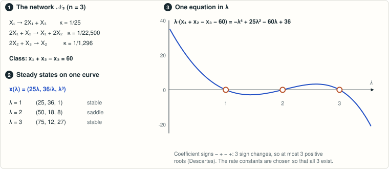

# Banaji–Feliu, Remark 5.8: can quadratic (n, n+2, n) networks reach n + 1 equilibria?

<!-- plain-words:start -->
**The question.** Can quadratic networks with n species, n + 2 reactions and rank n reach their ceiling of n + 1 steady states?

**The answer.** Yes, for every n, but an anonymous preprint (Zenodo, 4 October 2026) had already answered. This folder is a rediscovery with a different short proof.

**How.** Steady states correspond to the roots of an explicit one-variable function; geometrically separated rate constants give n + 1 roots.

**Overlaps.** Same paper and same kind of question as [result 1](../banaji-feliu-remark-4-23/).

<p align="center"></p>

<p align="center"><sub>The construction of result 1; result 7 rests on the same principle: steady states correspond to roots of a one-variable function.</sub></p>

<!-- plain-words:end -->

**Status: already solved. The proof here is correct and verified (see `verification.md`), but the
question had already been answered.** An unrefereed manuscript posted on Zenodo and GitHub on 4 October 2026 answered
it for every n ≥ 2 (doi:10.5281/zenodo.23146115). Its underlying polynomial system is the extremal fewnomial chain of
Phillipson–Rojas (2013, Theorem 1.6). The present folder is an apparent rediscovery with a different short
proof.

**Attribution.** Construction, proof and manuscript: Claude Opus 5.5 (effort xhigh), orchestrating agent.
Verification, prior-art identification and corrections: Claude Opus 5.5 (effort xhigh).

## Problem

M. Banaji and E. Feliu, *Positive equilibria in mass action networks: geometry and bounds*, J. Math. Biol. 93
(2026), doi:10.1007/s00285-026-02429-8, arXiv:2409.06877v5. Theorem 5.5 says that quadratic (n, n+k, n) networks
(k ≥ 2) with n + 2 distinct sources, dynamically nontrivial and not source deficient, have at most n + 1 positive
nondegenerate equilibria. Here "quadratic" means that all *sources* have molecularity ≤ 2; products are unrestricted
(BF, Sect. 2). Remark 5.8 (p. 41):

> "However, we were not able to find a quadratic (3, 5, 3) network admitting four positive nondegenerate equilibria,
> and thus achieving the bound in Theorem 5.5. We leave open the question of whether the bound in Theorem 5.5 can be
> achieved by quadratic (n, n + 2, n) networks for n ≥ 3."

## Result

**Yes, for every n ≥ 1.** The network 𝒩ₙ has sources 0, 2X₁, X₁+X₂, …, Xₙ₋₁+Xₙ, Xₙ and reactions

  0 → Σ αᵢ₊₁Xᵢ, 2X₁ → 2X₁ + Σ βᵢ₊₁Xᵢ, Xᵢ + Xᵢ₊₁ → Xᵢ₊₁, Xₙ → 0.

Its kernel is exactly span(α, β), so the kernel can be prescribed. Equilibria then correspond to the roots of an
explicit one-variable function. With geometrically separated ratios αⱼ/βⱼ = 64^(j−1) and κ₁ = 2^∓(6n+3) (all other
rate constants 1), there are exactly n + 1 positive nondegenerate equilibria. The proof is a short estimate that is
uniform in n.

Small example (n = 3, products of molecularity ≤ 20): 0 → X₁+3X₂+16X₃, 2X₁ → 16X₁+3X₂+X₃, X₁+X₂ → X₂,
X₂+X₃ → X₃, X₃ → 0 has four positive nondegenerate equilibria for κ(2X₁ → …) = 1/1600, all other rate constants 1.

**Side remark.** For n = 1 the family gives 0 → X, X → 0, 2X → 3X, with two positive nondegenerate equilibria. This
contradicts Remark 5.6 of the same paper, which misquotes Lemma 20 of Banaji–Boros–Hofbauer (Nonlinear Dyn. 2024): the
lemma lists exactly this network as the basic quadratic rank-one network with multiple equilibria. The negative
statement holds for *bimolecular* rank-one networks (their Corollary 19). The prior-art notes of the 2026 manuscript
below point out the same discrepancy.

## Prior work (found during verification)

- F. Bihan, J. London Math. Soc. 75 (2007): n + 1 is the sharp bound on nondegenerate positive solutions for polynomial
  systems supported on a circuit (n + 2 monomials in n variables).
- K. Phillipson, J. M. Rojas, Contemp. Math. 605 (2013), Theorem 1.6. Their system
  G_ε: x₁x₂ = ε + x₁², xᵢxᵢ₊₁ = 1 + ε^(2i−3)x₁², xₙ = 1 + ε^(2n−3)x₁² has n + 1 positive nondegenerate roots
  (ε = 1/4). This is exactly the equilibrium system of 𝒩ₙ with ratio R = 16 and suitable rate constants. The R = 64
  networks used here, with the rate constants of the proof, have the same Gale data as G_{1/8}.
- Anonymous (maintained by I. Pitchford), *Sharp positive-equilibrium counts in quadratic mass-action networks with two
  more reactions than species*, unrefereed, Zenodo doi:10.5281/zenodo.23146115 and
  github.com/ipitchford/quadratic-mass-action-sharpness, 4 Oct 2026. It realizes the Phillipson–Rojas chain as quadratic
  (n, n+2, n) networks for all n ≥ 2 and explicitly answers Remark 5.8. It also gives a (3,5,3) example with product
  molecularity 10: X → 0, Y → 6X+4Z, 2X → 6Y+4Z, 2Z → 4Y (rate constant 2/3137), Y+Z → 0, other rate constants 1.
  Its explicit networks were re-checked exactly here (`verification/prior_art_check.py`).

## Reproduce

```bash
python scripts/certify_family.py     # exact checks for the n = 3 example, n = 1, and the R = 64 family n = 1..8 (~10 s)
python scripts/other_example_n3.py   # an unrelated (3,5,3) example found by computer search
# verification (WSL: msolve, Singular, PARI/GP, python-flint)
cd verification && python direct_check.py && python prior_art_check.py && python uniform_signs_arb.py
```

## Files

| File | Content |
|---|---|
| `paper.tex`, `paper.pdf`, `references.bib` | Manuscript: theorem for all n, proof, examples, prior work |
| `scripts/certify_family.py` | Exact (sympy) + 80-digit checks of the family (Gale-dual polynomial) |
| `scripts/other_example_n3.py` | Exact check of the computer-found example (Gale-dual polynomial) |
| `certificates/*.log` | Outputs of the solver's scripts (all PASS) |
| `verification.md` | Verification report |
| `verification/direct_check.py` | Direct exact solution of the mass-action equations (msolve, Singular, PARI), n = 1..10 and both (3,5,3) examples |
| `verification/prior_art_check.py` | Same pipeline on the earlier networks and on the realizations of Phillipson–Rojas G_{1/4}, G_{1/8} |
| `verification/uniform_signs_arb.py` | Ball-arithmetic check of the sign pattern of the main proposition, n ≤ 300 |
| `verification/*.log` | Outputs (all PASS) |
| `references.md` | Sources and novelty check |
