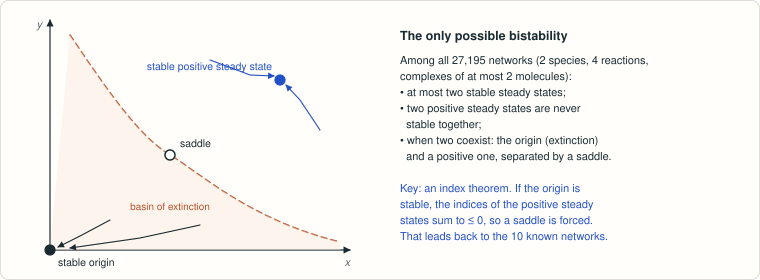

# Banaji–Boros–Hofbauer: further bimolecular (2, 4, 2) networks with two stable equilibria?

<!-- plain-words:start -->
**The question.** Banaji, Boros and Hofbauer found 10 small bimolecular networks (2 species, 4 reactions) with two stable steady states. Are there any others?

**The answer.** No. Moreover, at most two steady states are ever stable, and then one of them is the origin.

**How.** All 27,195 networks are enumerated; boundary cases are handled by hand, the rest with exact polynomial certificates and a new index theorem that forces a saddle between the two stable states.

<p align="center"></p>

<p align="center"><sub>When two stable states coexist, one is the origin (extinction) and a saddle separates their basins.</sub></p>

<!-- plain-words:end -->

**Status: solved. Complete proof, partly computer-assisted with exact arithmetic; verified; see [verification.md](verification.md).**

**Attribution.** Solver: Claude Opus 5.5 (effort xhigh), 25 Oct 2026, covering the novelty check, proof, scripts
and manuscript. Verification: GPT-6-Astra (effort xhigh), 25 October 2026; [report](verification.md).

## Problem

M. Banaji, B. Boros, J. Hofbauer, *Bifurcations in planar, quadratic mass-action networks with few reactions and low
molecularity*, Nonlinear Dynamics 112 (2024) 21425–21448, doi:10.1007/s11071-024-10068-1, arXiv:2406.13451. The
statement is in Section 7 (Conclusions), last paragraph: p. 22 of arXiv v1 and p. 21446 of the published version
(the text is identical in both):

> "We have identified 10 bimolecular (2, 4, 2) networks (those marked with an orange bullet in Table 1) that admit
> multiple nonnegative asymptotically stable equilibria. It is an open problem whether there are any further
> bimolecular (2, 4, 2) mass-action networks with the same property, and which are not dynamically equivalent to any
> of the 10 we have found. Answering this question requires studying boundary equilibria."

Definitions are those of the paper. Bimolecular means every complex has molecularity at most two; a (2, 4, 2)
network has 2 species, 4 reactions and rank 2 (§2.1). Two networks are dynamically equivalent if they give the same
set of mass-action ODEs, perhaps after permuting species and reactions (§2.2). Asymptotic stability of a boundary
equilibrium is meant relative to the closed quadrant, as in the proof of their Lemma 27.

## Result

**No: there are no further networks.** A bimolecular (2, 4, 2) network has, for some rate constants, two distinct
equilibria in the closed quadrant that are asymptotically stable relative to the quadrant if and only if it is
dynamically equivalent (up to exchanging X and Y) to one of the ten orange networks of BBH's Table 1. Moreover, for
every network and every rate constant vector, at most two equilibria are asymptotically stable, and when there are two
they are the origin and a positive equilibrium.

The proof covers all 27 195 networks (5 716 classes) in four steps.

1. **Boundary.** Two asymptotically stable boundary equilibria never coexist. An asymptotically stable point on an
   open half-axis never coexists with an asymptotically stable positive equilibrium. Both arguments are by hand.
2. **Positive equilibria.** At most one positive equilibrium is asymptotically stable. Two or more positive equilibria
   occur only in the 30 fold networks of BBH's Table 1. This uses an exact check, for the 838 four-source classes, of
   the sign pattern of two κ-independent polynomials of degree at most 5 on (0, 1).
3. **Index of a stable origin.** If the origin is asymptotically stable relative to the quadrant, the indices of the
   positive equilibria sum to at most 0 in any quadratic mass-action system. The proof uses a half-index computation
   at the origin (Krasnosel'skii's homotopy) and the fact that F restricted to the line x + y = M is a quadratic
   curve, which turns by at most 2π. Hence a stable origin needs a second, saddle-type positive equilibrium, which
   forces Table 1.
4. **The 30 networks of Table 1.** Fifteen contain an inflow reaction, and five have an origin that is unstable for
   every κ (checked symbolically). The remaining ten have exact certificates with integer rate constants, for which
   the origin and (1, 1) are both asymptotically stable. Three of them have a singular Jacobian at the origin; there
   the linear Lyapunov function x + 3y is used.

Counted as networks rather than classes, exactly 50 of the 27 195 networks have the property; Wilhelm's (2009)
network is one of them. The orange bullets were read from the rendered Table 1, and this reading agrees with the
text of BBH's Lemma 27.

**What is computer-assisted.** The following steps use exact rational arithmetic (sympy): the enumeration, the
polynomial sign checks of step 2 (they replicate BBH's Theorem 25 and Remark 26(d)), the symbolic instability of the
origin in 5 networks, and the certificates for the 10 networks. **What is numerical only:** `explore_numeric.py`, a
floating-point sanity check that is not used in the proof. With 2·10⁴ samples per class, it finds a second stable
boundary equilibrium in exactly the ten classes and in no other.

## Reproduce

From this folder, with Python 3.12 + sympy 1.14 (run under WSL Fedora 44):

```bash
cd scripts
python networks.py              # counts: 27195 networks, 5716 classes            (< 1 s)
python positive_equilibria.py   # Proposition 7(2): 838 four-source classes, exact (~10 s)
python classify_all.py          # reason for every class, writes certificates/classes.csv (~10 s)
python certify_ten.py           # exact certificates for the 10 networks             (~10 s)
python explore_numeric.py 20000 # floating-point sanity check, not a proof (~16 min on 12 cores)
python index_sanity.py          # floating-point check of the index theorem on random quadratic fields (~1 min)
```

Each script prints PASS/FAIL per claim and exits non-zero on failure.

## Files

| File | Content |
|---|---|
| `paper.tex`, `paper.pdf`, `references.bib` | Manuscript: theorem, complete proof, tables of the 10 and of the 30 networks |
| `scripts/networks.py` | Enumeration, canonical forms under dynamical equivalence + species swap (shared module) |
| `scripts/positive_equilibria.py` | Exact certificate for Proposition 7(2) (u, v, c, Q, N for the 838 four-source classes) |
| `scripts/classify_all.py` | Assigns every one of the 5 716 classes its reason; symbolic instability of the origin for 5 networks |
| `scripts/certify_ten.py` | Exact certificates (integer rate constants) for the ten networks |
| `scripts/explore_numeric.py` | Floating-point sanity check of the classification (not part of the proof) |
| `scripts/index_sanity.py` | Floating-point sanity check of the index theorem, with a control run (not part of the proof) |
| `certificates/classes.csv` | All 5 716 classes: representative, members, number of sources, nontriviality, reason |
| `certificates/ten_networks_rates.txt` | The certified rate constants |
| `certificates/*.log` | Outputs of the scripts (all PASS) |
| `references.md` | Sources and novelty check |

`certificates/sources/` holds the arXiv and publisher PDFs and the renderings of Table 1. It is git-ignored
because the files are copyrighted.
