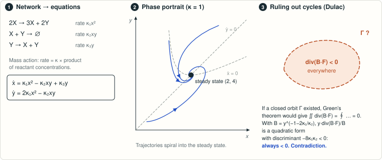

# Banaji–Boros–Hofbauer: does the three-reaction example have a limit cycle?

<!-- plain-words:start -->
**The question.** Can the three-reaction system 2X → 3X + 2Y, X + Y → 0, Y → X + Y oscillate for some rate constants?

**The answer.** Never.

**How.** Multiplying the vector field by B = y<sup>−1−2κ₁/κ₂</sup> makes its divergence a negative-definite quadratic form, which rules out closed orbits (Dulac’s criterion, from Green’s theorem).

**Overlaps.** Contained in [result 13](../bbh-cases-9-10-limit-cycles/), which proves the same for the whole class.

<p align="center"></p>

<p align="center"><sub>For κ = 1 trajectories spiral into the steady state; the Dulac function rules out a cycle for every choice of rate constants.</sub></p>

<!-- plain-words:end -->

**Status: solved: complete proof, verified (verdict CONFIRMED WITH CORRECTIONS, see `verification.md`).**
This settles the example asked about in the source and the subfamily below. The broader question (all case-9 and
case-10 networks without Andronov–Hopf bifurcation) remains open beyond this subfamily.

**Attribution.** Dulac argument (scout) and subfamily (verifier): Claude Opus 5.5 exploration agents (effort high), 17 Oct 2026. Certificate script and manuscript: Claude Opus 5.5 (effort xhigh). Verification: Claude Opus 5.5 (effort xhigh), fresh context, 18 Oct 2026 (`verification.md`).

## Problem

M. Banaji, B. Boros, J. Hofbauer, *Oscillations in three-reaction quadratic mass-action systems*, Stud. Appl. Math.
152 (2024) 249–278, doi:10.1111/sapm.12639, arXiv:2304.02303. Conclusions (§6; p. 22 of arXiv v1):

> "we leave it open whether the networks in cases 9 and 10 admitting no Andronov–Hopf bifurcations can have a limit
> cycle. For example, we do not know whether the system 2X → 3X + 2Y, X + Y → 0, Y → X + Y,
> ẋ = κ₁x² − κ₂xy + κ₃y, ẏ = 2κ₁x² − κ₂xy admits a limit cycle."

## Result

**No: the example has no periodic orbit in the closed positive quadrant for any κ > 0.** The Dulac function y^(−1−2κ₁/κ₂) turns the divergence into
a negative definite quadratic form (discriminant −8κ₁κ₂), and the axes are crossed inwards.

The same argument classifies the whole subfamily 2X → (2+c₁)X + d₁Y, X + Y → 0, Y → c₃X + Y (c₁, c₃, d₁ ≥ 1):
periodic orbits can only exist for c₁ < d₁ < 2c₁, which is exactly the Andronov–Hopf region of the authors'
Theorem 9 (arXiv numbering; Theorem 3 in the published version). In this subfamily, "no Andronov–Hopf bifurcation"
implies "no periodic orbit". The verifier added two remarks to the manuscript. (i) The bound is sharp: the Dulac
threshold Δ = 0 is exactly the Hopf curve κ₂ = κ₁(2c₁ − d₁), so there is no periodic orbit whenever tr J ≤ 0.
(ii) The admissible values c₁ ∈ {−2, −1, 0} are covered too.

## Reproduce

```bash
python scripts/certify_dulac.py              # solver's symbolic identities (sympy), < 10 s
python verification/verify_symbolic.py      # verifier's own symbolic checks, < 10 s
python verification/verify_numeric.py       # verifier's numerical sanity check (not a proof), a few minutes
```

## Files

| File | Content |
|---|---|
| `paper.tex`, `paper.pdf`, `references.bib` | Manuscript: Theorems 1–2 and their proofs |
| `scripts/certify_dulac.py` | Symbolic verification of every identity |
| `certificates/certify_dulac.log` | Output, all PASS |
| `references.md` | Sources and novelty check |
| `verification.md` | Verification report |
| `verification/` | Verifier's scripts and their logs |

## History

Found during the exploration phase (17 Oct 2026, scout and verifier); subfamily classification and write-up on
18 Oct 2026. Verification on 18 Oct 2026. It corrected the third reaction of the subfamily (c₃X + Y, not
(1+c₃)X + Y) and the theorem numbering of the published version, tightened the boundary argument, and added the
sharpness remark.
