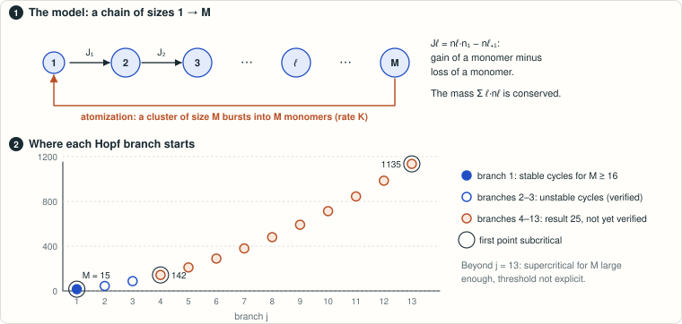

**Attribution.** Original solver, editor and verifier: Claude Opus 5.5 (effort xhigh),
with the original credits and verdict retained in [verification.md](verification.md).
All-M extension and onset-chart machinery: Claude Opus 5.5 (effort xhigh).
Completion, verification, corrections and manuscript edition: GPT-6-Astra (effort xhigh), 26 October 2026.

# Becker–Döring with atomization: complete local answer on Hopf branches 1–3

<!-- plain-words:start -->
**The question.** Clusters grow or shrink one monomer at a time, and a cluster reaching size M bursts back into monomers. Pego and Velázquez showed that oscillations appear (Hopf bifurcations) but could not tell whether they are stable.

**The answer.** For the first branch: unstable at M = 15, stable small oscillations for every M ≥ 16. Branches 2 and 3: the oscillations are unstable. No oscillation at all for M ≤ 14.

**How.** The sign of the first Lyapunov coefficient is certified with interval arithmetic: one certificate per size up to M = 160, and a cover of parameter boxes for every larger M, including the limit M → ∞.

**Overlaps.** Extended by [result 25](higher-branches/) (branches 4 to 13).

<p align="center"></p>

<p align="center"><sub>Clusters gain or lose one monomer at a time; at size M they burst into monomers. Each dot is the size where a branch of oscillations starts.</sub></p>

<!-- plain-words:end -->

## Problem and source

R. L. Pego and J. J. L. Velázquez, *Temporal oscillations in Becker–Döring equations with atomization*,
Nonlinearity 33 (2020), 1812–1846, [doi:10.1088/1361-6544/ab6815](https://doi.org/10.1088/1361-6544/ab6815),
[arXiv:1905.02605](https://arxiv.org/abs/1905.02605), §3.3, immediately after Theorem 3.3:

> "We have not managed to determine analytically whether the bifurcating solutions are stable (the supercritical
> case) or not. Many of our numerical computations, as in Fig. 1, are consistent with the presence of stable
> periodic solutions, however."

## Status: solved for branches 1–3, verified with corrections

The result holds for **every integer cluster size on each of the three branches**. Stability is within the
invariant mass hyperplane, and concerns the small periodic orbits born at the Hopf point.

| Branch | Exact integer onset | Criticality | Periodic orbits in the mass hyperplane |
|---|---|---|---|
| 1 | M = 15 | Subcritical at M = 15; supercritical for every M ≥ 16 | Unstable at 15; orbitally asymptotically stable for every M ≥ 16 |
| 2 | M = 44 | Supercritical on the centre manifold for every M ≥ 44 | Unstable |
| 3 | M = 87 | Supercritical on the centre manifold for every M ≥ 87 | Unstable |

For 3 ≤ M ≤ 14 the equilibrium is stable for every K > 0 and no Hopf bifurcation occurs.
The imaginary pair is simple, crosses transversally, and is the only spectrum on the imaginary axis after
mass restriction. The first Lyapunov coefficient is strictly negative, except at (j, M) = (1, 15).
The third onset, previously only suggested numerically, is now certified.

[Theorem D and its proof in the manuscript](paper.pdf) combine 337 direct matrix certificates for M ≤ 160
with 1,985 parameter boxes covering every M ≥ 161, including the endpoint M = infinity.
The spectral counts use Arb throughout. Separate certificates identify every adjacent pair of boxes,
join the small-M points to the same curves, and continue the curves to K = infinity at their onsets.
The limit of the rescaled discrete Lyapunov coefficient equals the closed form in Proposition B,
now by exact symbolic algebra rather than numerical agreement.

The detailed [completion and verification report](all-M/verification.md) records the corrected winding calculation,
contour geometry, exact decimal endpoint and branch identification. The earlier [verification report](verification.md)
remains the historical report for the finite-range result. These are AI checks, not human peer review.

Scope: this solves the local criticality and stability question on branches 1–3. It does not classify all
possible disconnected Hopf components, prove stability for every parameter below the first branch,
or describe cycles far from bifurcation. Higher branches retain their separate status in
[result 25](higher-branches/README.md).

## Reproduce

Use Python 3.12 or later with python-flint 0.9, SymPy, mpmath and NumPy. From the repository root:

```bash
python problems/becker-doring-atomization-hopf/all-M/scripts/recheck_all.py
python templates/build_tex.py problems/becker-doring-atomization-hopf/paper.tex
```

The complete recheck uses three independent processes and takes approximately 20–40 minutes.
It re-proves every parameter box and every small-M point; it does not sample the infinite range.
Every job must exit successfully. `--only NAME ...` is explicitly a partial check.
See [all-M/README.md](all-M/README.md) for individual commands and the exact coverage endpoint.

## Files

- [paper.tex](paper.tex), [all-M/proof.tex](all-M/proof.tex), [paper.pdf](paper.pdf): integrated manuscript.
- [all-M/result.md](all-M/result.md): detailed analytic formulas and certificate specification.
- [all-M/verification.md](all-M/verification.md): completion audit and corrections.
- `all-M/scripts/`, `all-M/certificates/`: regular formulas and the compact parameter cover.
- `all-M/verification/recheck-2026-10-25/`: current logs, onset and dense matrix certificates, manifest.
- `scripts/`, `certificates/`, `verification/`: the original finite-range construction and separate checks.
- [references.md](references.md), [all-M/references.md](all-M/references.md): sources and novelty searches.

The original six integer-sweep files retain their historical convention: the single `FAIL` row at (15, 1)
means a certified positive coefficient, the subcritical exception. It is not a failure of Theorem D.
