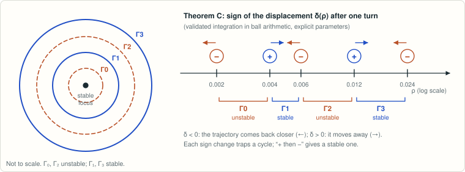

# Boros–Hofbauer: four limit cycles in a planar three-reaction mass-action system

<!-- plain-words:start -->
**The question.** Can a planar three-reaction system have a stable steady state surrounded by four nested oscillations, alternately unstable and stable? Boros and Hofbauer conjectured it.

**The answer.** Yes.

**How.** A parameter point where three “focal values” vanish and the fourth does not is certified by an interval Newton method; perturbing it step by step creates one cycle at each step. A second, independent proof follows trajectories with validated integration.

<p align="center"></p>

<p align="center"><sub>Five certified sign changes of the return displacement trap four cycles, alternately unstable and stable.</sub></p>

More detail, with every step explained: [guided reading, result 5](https://basedpolymer.eu/chemistry-open-problems#result-5) · [en français](https://basedpolymer.eu/chemistry-open-problems/fr#d5).

<!-- plain-words:end -->

**Attribution.** Solver: Claude Opus 5.5 (effort xhigh), sub-agent of the orchestrator. One nested Claude Opus 5.5 sub-agent (general-purpose, effort xhigh) was used, only for the
literature/novelty check (read-only web search). LaTeX edition: Claude Opus 5.5 (effort xhigh). Verification: Claude Opus 5.5 (effort xhigh), fresh context — **CONFIRMED WITH CORRECTIONS** (minor, editorial; see `verification.md`).

**Status: solved: complete computer-assisted proof, verified (`verification.md`).**

## Problem

B. Boros, J. Hofbauer, *Oscillations in planar deficiency-one mass-action systems*, J. Dyn. Diff. Equat. 36
(Suppl 1):175–197 (2024), doi:10.1007/s10884-021-10051-z, arXiv:2103.00972 (PMC10901957), §5.1. For the
three-reaction network with complexes (0,0), (0,−1), (a,b) and reaction vectors (0,−1), (1,−1), (−1,d), the
scaled mass-action ODE is

  ẋ = 1/y − x^a y^b,  ẏ = K(−(d−1) − 1/y + d x^a y^b)  (a > 0, b > −1, d > 1, 1 + bd > 0, K > 0).

> "we conjecture that there exist parameter values for which the unique positive equilibrium of the
> differential equation (16) is asymptotically stable, and is surrounded by four limit cycles Γ0, Γ1, Γ2, Γ3,
> which are unstable, stable, unstable, stable, respectively. Since the formulas for L2, L3, and L4 get
> complicated, we cannot handle them analytically. This is why we leave the existence of four limit cycles a
> conjecture."

Novelty check (2026-10-18): no work from 2021 to 2026 proves it (citing works via Semantic Scholar/OpenAlex,
the authors' later papers, Palomar `mmislan` repositories, web search; see `references.md`).

## Result

**The conjecture is true.** Let K = a/(1+bd) (zero trace at (1,1)) and let L_k be the focal values in the
paper's normalisation. Computer-assisted proof:

* L1…L4 are computed **exactly**: with c = 1+b and s = (d−1)/(1+bd) (= ω²/a², which removes all square
  roots), L_k = π G_k(a,c,s)/(a^{2k} c^{4k} s^{k−1/2}) with explicit polynomials G_k ∈ ℚ[a,c,s] of
  9, 48, 136, 296 terms. G_1 reproduces the paper's closed-form L1 exactly; the generic code reproduces every
  focal value printed in the paper (L1, L2, L3 of three systems).
* **Krawczyk/interval-Newton certificate (Arb):** in a box of radius 10⁻⁴⁰ there is a unique point
  a* = 1.01282199868031460006…, b* = 0.65462562110423821072…, d* = 3.28861043930993578772…
  (K* = 0.32124436039896080960…) with L1 = L2 = L3 = 0. At this point the Jacobian ∂(L1,L2,L3)/∂(a,b,d) is
  nonsingular and **L4 = −2.58012649949442448635…·10⁻⁶ < 0** (rigorous enclosure, radius 10⁻³⁴).
* A self-contained successive-perturbation argument (perturb L3 > 0, then L2 < 0, then L1 > 0, then the trace
  < 0 through K; sign of the displacement map controlled by a Lyapunov function) yields parameters, arbitrarily
  close to (K*, a*, b*, d*), for which **(1,1) is a hyperbolic stable focus surrounded by four nested limit
  cycles Γ0, Γ1, Γ2, Γ3 that are unstable, stable, unstable, stable** — exactly the conjectured picture. For
  the mass-action form (16) take κ1 = d−1, κ2 = 1, κ3 = K^{−a}; the equilibrium is (K, 1).
* **Bonus (Theorem B, rigorous):** (a*, b*, d*) is the *only* point of the whole parameter domain where
  tr J = L1 = L2 = L3 = 0 (exact resultants + Arb root enclosures). Hence (1,1) is never a centre and never a
  weak focus of order ≥ 5 in this family.
* **Second, separate proof at explicit parameters (Theorem C, rigorous):** for the exact decimal parameters
  in `certificates/explicit_params.json` (a ≈ 1.0128228, b ≈ 0.6546268, d ≈ 3.2886055, K = a/(1+bd) − 6·10⁻²³),
  validated Taylor integration in Arb of the first-return map on Σ = {(1+ρ, 1)} gives
  δ(0.002) < 0 < δ(0.004), δ(0.006) < 0 < δ(0.012), δ(0.024) < 0 (|δ| ≥ 4.6·10⁻²⁵, error radii ≤ 5·10⁻³²).
  With a Jordan-curve / Poincaré–Bendixson argument this yields four limit cycles (unstable, stable, unstable,
  stable) around the stable focus (1,1). This proof does not use the focal-value code at all.
* **Numerical illustration (not a proof):** the same kind of parameters, 60-digit floating-point integration,
  locates the four cycles at ρ ≈ 0.00401, 0.00802, 0.01614, 0.03230 on the ray {y − 1 = −(a/(1+b))(x − 1)}.

What is not proved: that there are *exactly* four small cycles and that they are hyperbolic (true by classical
Bautin theory, only cited); any statement about large-amplitude cycles.

## Reproduce

From the project root (Git Bash):

```bash
outils/wsl "cd chemistry-open-problems/problems/boros-hofbauer-four-limit-cycles && bash scripts/run_all.sh"
# ~15 s, prints PASS/FAIL for every claim (35 PASS), ends with "RUN_ALL: ALL PASS";
# add --with-illustration for the explicit four-cycle integration (~3 min, non-rigorous)
```

## Files

| File | Content |
|---|---|
| `paper.tex`, `paper.pdf` | Manuscript: Theorems A, B, C, complete proofs (sign lemma, return map, successive perturbations, Krawczyk, validated integration), formulas, enclosures, limitations |
| `scripts/focal_exact.py` | Exact focal values Ṽ_1…Ṽ_4 ∈ ℚ[a,c,w] (python-flint), < 1 s |
| `scripts/certify.py` | Interval certificate (claims C0–C5): Krawczyk, nonsingular Jacobian, L4 < 0 |
| `scripts/uniqueness.py` | Theorem B: the zero is unique in the whole domain |
| `scripts/validated_cycles.py` | Theorem C: validated (Arb) Taylor integration of the return map at explicit parameters |
| `scripts/crosscheck.py` | Exact L1 = paper's closed form; exact vs generic float code; paper's checkpoints |
| `scripts/focal_mp.py` | Generic floating-point focal values for monomial-type planar systems (validation) |
| `scripts/polar_check.py` | Separate float method (polar Poincaré-map series): u₉(2π) = π V4 at p* |
| `scripts/illustrate_cycles.py` | Numerical illustration: explicit parameters with four cycles (non-rigorous) |
| `scripts/run_all.sh` | Runs everything |
| `certificates/G_k.json` | Exact polynomials G_1…G_4 (JSON: exponents + rational coefficients) |
| `certificates/box.json` | Krawczyk box (exact rational centre, radius 1e-40, preconditioner) |
| `certificates/certificate_output.json` | Arb enclosures of a*, b*, d*, K*, ω, G4, L4, det J |
| `certificates/explicit_params.json`, `certificates/validated_cycles_output.json` | Theorem C: exact parameters, test radii, certified displacement enclosures |
| `certificates/run_all.log`, `certificates/illustrate_cycles.log` | Outputs of the scripts |
| `references.md` | Sources (what was read) and novelty check |
| `PROGRESS.md` | Work log |
| `verification.md` | Verification report (verdict, what was recomputed, corrections) |
| `verification/` | Verifier's own scripts and logs: `v1_focal_real_exact.py` (exact focal values, different algorithm), `v2_focal_numeric.py` (normalisation vs the paper's printed values), `v3_polar_validated.py` (separate validated integrator), `v4_krawczyk_mpmath_iv.py` (Krawczyk with mpmath.iv), `v5_msolve_uniqueness.py` (Theorem B with msolve), `v6_misc_checks.py` |
