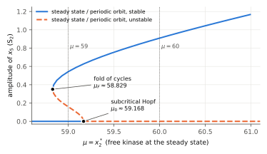

# Conradi–Mincheva–Shiu: local stability does not imply global stability in mixed-mechanism phosphorylation

<!-- plain-words:start -->
**The question.** A substrate with two phosphorylation sites is phosphorylated by a kinase in one encounter
(processive) and dephosphorylated by a phosphatase in two encounters (distributive). For this network every
compatibility class (fixed totals of kinase, phosphatase and substrate) has exactly one steady state, which loses
stability only through Hopf bifurcations. Conradi, Mincheva and Shiu asked whether a locally stable steady state is
always globally stable in its class.

**The answer.** No. For integer rate constants the Hopf bifurcation can be subcritical. A class whose steady state is
locally stable can then still contain sustained oscillations: an unstable periodic orbit and a stable one. We prove
this at an explicit rational class, and on an open set of parameters.

**How.** A positive first Lyapunov coefficient is certified in ball arithmetic along the source's monomial
parametrisation of the steady states. The periodic orbits at an explicit rational class are proved with the CAPD
library: a rigorous Poincaré map and a Krawczyk operator. Local stability there is checked in exact rational arithmetic.

<p align="center"></p>

<p align="center"><sub>Rate constants (1,1,1,1,300,1,3,1,1,100): unstable orbits born at the Hopf point fold back into stable orbits. Between the fold and the Hopf point a stable steady state coexists with a stable oscillation (floating-point continuation, illustration only).</sub></p>

<!-- plain-words:end -->

**Status: solved (preliminary)**: complete argument, not yet independently verified. Theorem numbers below are those of `paper.pdf`.

**Attribution.** Solver: Claude Opus 5.5 (effort xhigh). Verification: pending.

## Problem

C. Conradi, M. Mincheva, A. Shiu, *Emergence of oscillations in a mixed-mechanism phosphorylation system*,
Bull. Math. Biol. 81 (2019) 1829–1852, [doi:10.1007/s11538-019-00580-6](https://doi.org/10.1007/s11538-019-00580-6),
[arXiv:1809.02886](https://arxiv.org/abs/1809.02886). Network (1): processive phosphorylation, distributive
dephosphorylation; 9 species, 3 conservation laws (K_tot, P_tot, S_tot).

Section 6, arXiv v2 p. 20 (journal p. 1849), unnumbered question:

> "Finally, we consider the dynamics in compatibility classes that contain a locally stable steady state. Our
> simulations suggest that such a steady state is in fact globally stable. Accordingly, we pose the question, Consider
> the mixed-mechanism network, and any choice of rate constants and total amounts. If the unique steady state x\* in
> 𝒫 is locally stable, does it always follow that x\* is globally stable? In the Michaelis-Menten limit, this is true [36]."

Section 6, arXiv v2 p. 18 (journal p. 1848), numbered **Conjecture 6.1** in both the arXiv and the journal version
(Conjecture 6.2 is a different statement, about large K_tot):

> "Conjecture 6.1. Consider the mixed-mechanism network, and any choice of rate constants and total amounts. If the
> unique steady state in 𝒫 is unstable, then 𝒫 contains a stable periodic orbit."

## Result

Rate constants k\* = (k1, …, k10) = (1, 1, 1, 1, 300, 1, 3, 1, 1, 100) (so k2 = k6 = k9, the setting of the source's
Proposition 4.1, and inequality (13) holds). Along the steady states x\*(μ) = φ(1/3, μ, 1/4) =
(1/3, μ, μ/6, μ/6, 2μ/675, 1/4, μ/18, 101μ/150, μ/600), whose classes have totals
T(μ) = (4μ/3, 1/4 + 103μ/1800, 1/3 + 5761μ/5400):

* **Theorem 4 (subcritical Hopf).** At μ0 = 59.16769751409043… (isolated in a rational interval of width < 10⁻⁶¹)
  the reduced 6×6 Jacobian has a simple pair ±iω0, ω0 = 2.2415583476…, the other four eigenvalues have negative real
  part, the crossing speed is positive and the first Lyapunov coefficient is **positive**. Hence for every μ slightly
  below μ0 the steady state is locally asymptotically stable and its class contains an unstable periodic orbit.
* **Theorem 5 (explicit class).** For k\* and (K_tot, P_tot, S_tot) = (236/3, 6527/1800, 341699/5400), the steady state
  x\* = (1/3, 59, 59/6, 59/6, 118/675, 1/4, 59/18, 5959/150, 59/600) is locally asymptotically stable. The class
  contains an **orbitally asymptotically stable periodic orbit** (period ≈ 2.96982) and a second periodic orbit
  (period ≈ 2.82911). Trajectories in the basin of the stable orbit, a nonempty open set, do not converge to x\*.
* **Theorem 6 (robustness).** The same conclusion (LAS steady state and an orbitally asymptotically stable periodic
  orbit in the class) holds on a nonempty open set of rate constants and totals: a relative box of width 10⁻¹² around
  (k\*, x1, x2, x6) = (k\*, 1/3, 59, 1/4), mapped to totals.

So the answer to the question is **no**.

**Conjecture 6.1** is not settled. The example is consistent with it: the unstable Hopf orbits fold (at μ_F ≈ 58.83,
numerical) into stable orbits that persist where the steady state is unstable, and at μ = 60 (totals
(80, 221/60, 5791/90)) we certify an unstable steady state together with an orbitally asymptotically stable periodic
orbit. What the result does show is that stability of the steady state does not separate convergence from
oscillation.

**Method.** (i) Exact sympy computation of the reduced Jacobian A(μ) along the line, of its characteristic polynomial
and of its Hurwitz determinants (H5 has degree 9 in μ). An exact sign change of H5 locates μ0, and ball arithmetic
(Arb, 600 bits) gives H1..H4 > 0, b6 > 0 and H5′ ≠ 0 (Liu/Yang criterion). (ii) Kuznetsov's projection formula for
l1 in ball arithmetic, with eigenvectors obtained from nonsingular 5×5 subsystems, which encloses the exact
eigenvectors. (iii) The Hopf theorem (Hassard–Kazarinoff–Wan) for Theorem 4. (iv) CAPD 6.1 rigorous C¹ Poincaré maps
with the Krawczyk operator, and a spectral-radius bound by repeated squaring, for Theorems 5 and 6; for Theorem 6 the
13 parameters are carried as constant state variables.

**What is computer-assisted.** Theorems 4–6 rest on computer-assisted checks: exact rational arithmetic, Arb ball
arithmetic and CAPD interval integration. Floating point is used only to find candidates and for the figure.

**Floating-point observations (not proofs).** For the source's Table 1 rate constants all 494 Hopf points found on a
grid are supercritical, consistent with the source's Matcont runs. In the region of the source's Theorem 4.2,
22% of 70,884 random Hopf points are subcritical. For k\* the Hopf surface contains both signs of l1, so it contains
Bautin points.

**Novelty.** No earlier Lyapunov-coefficient computation or answer for this network was found. Details are in
[references.md](references.md): OpenAlex citing works, arXiv, Zenodo (including 10.5281/zenodo.23446981, which does
not address it), GitHub code/repo search, the ipitchford and mmislan accounts, and a web search.

## Reproduce

From this directory, in WSL with the scientific Python environment (Python 3.12, sympy 1.14, python-flint 0.9) and
CAPD 6.1 built from <https://github.com/CAPDGroup/CAPD> (`cmake .. && make`; set `CAPD_CONFIG` to its
`build/bin/capd-config` if it is not at `~/opt/capd-src/build/bin/capd-config`):

```bash
python scripts/certify_subcritical_hopf.py   # Theorem 4, claims C0-C8, ~10 s
python scripts/certify_orbits.py             # Theorem 5 and Proposition 10, claims D1-D4, ~40 s
python scripts/certify_open_set.py           # Theorem 6, claims E1-E4, ~1 min
```

Each prints PASS/FAIL per claim and exits non-zero on failure. `scripts/make_hopf_point.py` regenerates
`certificates/hopf_point.json`. Manuscript, from the repository root:
`py -3 templates/build_tex.py problems/conradi-mincheva-shiu-mixed-phosphorylation/paper.tex`.

## Files

| File | Content |
|---|---|
| `paper.tex`, `paper.pdf`, `references.bib` | Manuscript: theorems, proofs, verification, limitations |
| `references.md` | Sources read and novelty search |
| `scripts/certify_subcritical_hopf.py` | Exact + ball-arithmetic certificate of the subcritical Hopf point (Theorem 4) |
| `scripts/make_hopf_point.py` | Generates the isolating interval and normalisation data in `certificates/hopf_point.json` |
| `scripts/certify_orbits.py`, `scripts/po_proof.cpp` | Exact stability checks and CAPD proofs of the periodic orbits at μ = 59, 60 (Theorem 5, Proposition 10) |
| `scripts/certify_open_set.py`, `scripts/po_proof_box.cpp` | Open-set certificate (Theorem 6) |
| `scripts/exploration/` | Floating-point model, random searches for subcritical Hopf points, orbit continuation, attractor scan, figure (not certificates) |
| `certificates/hopf_point.json`, `certificates/orbits.json` | Exact input data of the certificates |
| `certificates/po_proof_log.txt`, `certificates/open_set_log.txt` | CAPD outputs |
| `certificates/certify_*.log` | Outputs of the three certificate scripts (all claims PASS, 5 November 2026) |
| `certificates/po_branch_float.npy` | Floating-point continuation branch used for the figure |
| `figures/bifurcation.pdf`, `figures/bifurcation.svg` | Bifurcation diagram (illustration) |
