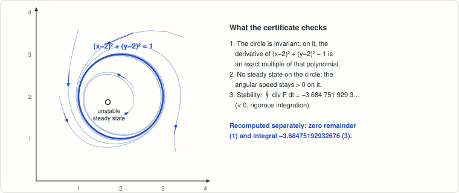

# Craciun–Erban: can a cubic weakly reversible system have an algebraic limit cycle?

<!-- plain-words:start -->
**The question.** Can a “weakly reversible” network with at most three molecules per complex sustain an oscillation whose orbit is an algebraic curve?

**The answer.** Yes: an explicit 10-reaction network with integer rate constants whose limit cycle is the circle (x−2)² + (y−2)² = 1.

**How.** Exact algebra shows the circle is invariant and carries no steady state; a rigorous integration shows that the divergence integral along it is negative, so it attracts nearby trajectories.

<p align="center"></p>

<p align="center"><sub>Computed trajectories of the 10-reaction network wind onto the circle (x−2)² + (y−2)² = 1.</sub></p>

More detail, with every step explained: [guided reading, result 3](https://basedpolymer.eu/chemistry-open-problems#result-3) · [en français](https://basedpolymer.eu/chemistry-open-problems/fr#d3).

<!-- plain-words:end -->

**Status: solved: rigorous certificate, confirmed with minor corrections by a verifier (see `verification.md`).**

**Attribution.** 17-reaction network: Claude Opus 5.5 exploration agent (effort high), 17 Oct 2026. Rigorous Arb certificate, 10-reaction integer network and manuscript: Claude Opus 5.5 (effort xhigh). Verification: Claude Opus 5.5 (effort xhigh), 18 Oct 2026.

## Problem

G. Craciun, R. Erban, *Planar chemical reaction systems with algebraic and non-algebraic limit cycles*, J. Math.
Biol. (2025), doi:10.1007/s00285-025-02221-0, arXiv:2406.05057v2. Table 2 records W^a(3) ≥ 0, where W^a(n) is the
maximal number of algebraic limit cycles of two-species weakly reversible networks with at most n reactant and n
product molecules per reaction:

> "The question of whether cubic weakly reversible two-species systems can give rise to algebraic limit cycles
> remains open, leaving us with inequality W^(a)(3) ≥ 0 in Table 2."

## Result

**Yes: W^a(3) ≥ 1.** The weakly reversible network with integer rate constants

| | | | | |
|---|---|---|---|---|
| 0 →(434) 2Y | 0 →(448) X+Y | Y →(3374) 0 | 2Y →(1728) 3Y | 3Y →(194) Y |
| 3Y →(11) 2X+Y | X+Y →(328) X+2Y | X+2Y →(250) 3Y | 2X+Y →(216) 3X | 3X →(28) X+2Y |

(all complexes of molecularity ≤ 3, one strongly connected linkage class) has the circle (x−2)² + (y−2)² = 1 as an
invariant curve carrying no equilibrium, and ∮ div F dt ∈ [−3.68475192932676 ± 3.3·10⁻¹⁵] < 0 by rigorous
ball-arithmetic integration: the circle is a hyperbolic, stable, algebraic limit cycle.

## Reproduce

```bash
python scripts/certify_cycle.py               # solver: exact identities (sympy) + Arb enclosures (python-flint), ~5 s
python verification/verify_independent.py     # verifier: separate methods (Sturm, mpmath intervals, residues), ~3 min
python verification/milp_min_support.py       # verifier: side check, 10 reactions is minimal (bounded, sampled MILP), ~20 s
```

## Files

| File | Content |
|---|---|
| `paper.tex`, `paper.pdf`, `references.bib` | Manuscript: theorem and proof |
| `scripts/certify_cycle.py` | Certificate for the 10-reaction network and for the 17-reaction network of the exploration phase |
| `certificates/certify_cycle.log` | Output, all PASS |
| `references.md` | Sources and novelty check |
| `verification.md` | Verification report (verdict, what was recomputed, corrections, reservations) |
| `verification/verify_independent.py`, `.log` | Verifier's own certificate for both networks, all PASS |
| `verification/milp_min_support.py`, `.log` | Verifier's side check on the minimal number of reactions (not used in the proof) |

## History

A 17-reaction network with rational rates was found by linear programming during exploration (17 Oct 2026); on 18 Oct
2026 the hyperbolicity integral was certified with Arb, and a mixed-integer search produced the 10-reaction network
with integer rate constants.
On 18 Oct 2026 a verifier (fresh context) re-derived every step by different methods and confirmed the
result, with minor editorial corrections to the manuscript (see `verification.md`).
