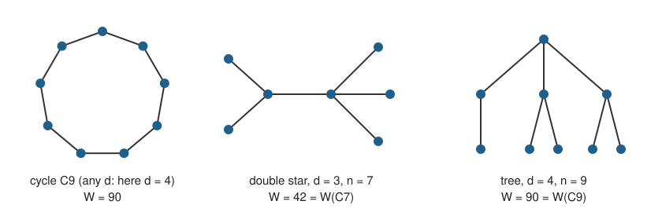

# DeLaViña–Waller: does the odd cycle maximize the Wiener index at order 2d + 1 and diameter d?

<!-- plain-words:start -->
**The question.** Among connected graphs on 2d + 1 vertices with diameter d > 2, does the cycle have the largest sum of distances between vertices (Wiener index)? DeLaViña and Waller asked this in 2008.

**The answer.** Yes, according to a preprint by Mingchang Liu posted on Zenodo on 19 August 2026, which also lists every extremal graph. It is unrefereed. This folder does not contain a new proof: it records the claim and an audit of it, which found no error.

**How.** A graph with a best possible Wiener index reduces to a cycle-like core with trees attached, or to a tree. A recurrence bounds what the trees can add, and that bound is compared with what the core loses.

<p align="center"></p>

<p align="center"><sub>Besides the cycle, exactly two graphs attain the maximum: a double star for d = 3 and a tree for d = 4.</sub></p>

<!-- plain-words:end -->

**Status: already solved (claimed in an unrefereed preprint). No manuscript here, by PROTOCOL §1.3.** The audit below found
no error, but it is the solver's own audit, not the separate verification of PROTOCOL §4.

**Attribution.** Claimed proof: Mingchang Liu, with GPT-5.6 Sol and Fable 5 according to the preprint's AI statement.
Novelty check and audit in this folder: Claude Opus 5.5 (effort not recorded). Separate verification: pending.

## Problem

E. DeLaViña and B. Waller, *Spanning trees with many leaves and average distance*, Electron. J. Combin. 15 (2008),
#R33, doi:10.37236/757, p. 14:

> "Conjecture 7. Let G be a graph with diameter d > 2 and order 2d + 1. Then W(G) ≤ W(C(2d + 1))."

Here W(C₂d₊₁) = (2d + 1)d(d + 1)/2. Before August 2026 the stated position was D. Pandey and P. S. Ravi, *On a
conjecture of DeLaViña and Waller*, arXiv:2605.24855 (24 May 2026), abstract:

> "In this context, a conjecture proposed by DeLaViña and Waller has remained open for the last 18 years."

They prove it for 0, 1, 2, 3 or n − 4 cut vertices. The conjecture is also restated by Knor, Škrekovski and Tepeh,
Ars Math. Contemp. 24 (2024) #P4.07 (Conjecture 29 in the version arXiv:2303.11405).

## Who solved it

Mingchang Liu (Georgia Institute of Technology), *The DeLaViña–Waller conjecture on the Wiener index*, working paper,
Zenodo, 19 August 2026, doi:[10.5281/zenodo.22015517](https://doi.org/10.5281/zenodo.22015517), 37 pages, with two
verification scripts. Theorem 1.2 states that W(G) ≤ (2d + 1)d(d + 1)/2 for every connected graph of order 2d + 1 and
diameter d ≥ 3, with equality exactly for C₂d₊₁, for the double star D₂,₃ (d = 3) and for one nine-vertex tree (d = 4).

The proof has five parts: a layer bound for 2-connected graphs; a rooted recurrence c₀ = 1, c₍ₕ₊₁₎ = n + cₕ − 2√cₕ bounding
what a tree of height h contributes per vertex; a breadth-first replacement showing that a maximizer is 2-connected, a
tree, or one 2-connected block with trees attached; an exact deficit inequality for that last case; and scalar
inequalities settled by exact certificates.

No refutation, erratum or later claim was found. No other full proof was found, and the arXiv does not list this paper;
see [references.md](references.md).

## What was audited here

Nothing below reuses or runs the author's scripts. They were read as text only.

| Part of the proof | Check here | Result |
|---|---|---|
| §§2–8, Appendix A: every lemma and proposition | Read line by line; algebra re-derived with SymPy (`audit_identities.py`, 28 checks) | no error found |
| Lemma 7.1, (7.2), (7.3), (7.6) on real graphs | `audit_graphs.py`: all eligible graphs for d = 3, 4 and those with at most 15 edges for d = 5 (197, 14,986 and 100,846 graphs) | PASS |
| Prop. 4.3 majorant c_h ≤ U_d | Proof re-derived by hand; exact bounds for 8 ≤ d < 400, then sampled to d = 3000 | PASS |
| Tree case (5.3) | Exact for 5 ≤ d < 400, then a polynomial estimate through U_d | PASS |
| §9 inequality (9.3), every d ≥ 8 | Rational branch and bound in (a/d, x/d, 1/d), replacing Lemmas 9.1 and B.1–B.3; needs no integrality of a | PASS, 11,625 boxes |
| §§9–11 for small d | Exact minimum of R − c̃ for all 4 ≤ d ≤ 260, 5 ≤ k ≤ 2d; matches Table 9 up to the author's rational rounding | PASS |
| §10, k = 5, 6, 7, large d | Direct estimate for d > 260 | PASS |
| The theorem itself for d = 3, 4, 5 | All 853, 261,080 and 1,006,700,565 connected graphs on 7, 9, 11 vertices (geng), including equality cases | PASS |
| Trees, 3 ≤ d ≤ 400 | Exact dynamic programming (`tree_dp.py`) | PASS |

For d = 5 the maximum 165 is attained only by C₁₁, and the next value is 160. For d = 3 and d = 4 exactly two graphs attain
the maximum, as the theorem says.

**Limits of this audit.** The hand reading was done by one model, in one session, after it had derived the same reduction
itself. The floating-point `audit_graphs.py` tests formulas and is not part of any proof. Together, the exact checks
above cover the whole of Sections 9–11, but the lemmas of Sections 2–8 rest on reading, not on a formal proof. The
preprint has not been peer reviewed.

**Corrections to the brief.** The conjecture is on p. 14 of the EJC paper, not p. 13, and the paper's DOI is
10.37236/757. The value 11/12 is not the best tree-like value: three legs of length d/2 with d/6 extra vertices at each
end give W/d³ → 23/24, and at d = 400 the exact tree maximum is 0.9588 W(C₂d₊₁).

## Reproduce

Under WSL Fedora with `~/envs/sci`, from this directory:

```bash
python scripts/audit_identities.py      # about 30 s
python scripts/audit_scalar.py          # about 4 min
python scripts/tree_dp.py               # under 1 min
bash scripts/run_enum_small.sh          # n = 5..10, about 10 s; compiles enum_stream.c into ~/dw
bash scripts/run_enum_11.sh             # n = 11, about 10 min on 4 cores
bash scripts/run_audit_graphs.sh        # about 10 min; also writes the enumeration summary
python scripts/novelty_audit.py         # needs network and gh; results change with time
python scripts/make_figure.py           # figure.svg
```

## Files

| File | Content |
|---|---|
| `references.md` | Sources read and novelty audit |
| `figure.svg` | Extremal graphs |
| `scripts/audit_identities.py`, `certificates/audit-identities.log` | Exact algebra of the proof |
| `scripts/audit_scalar.py`, `certificates/audit-scalar.log` | Scalar inequalities, by a method different from the author's |
| `scripts/audit_graphs.py`, `scripts/run_audit_graphs.sh`, `certificates/audit-graphs.log` | Formulas tested on real graphs |
| `scripts/enum_stream.c`, `scripts/run_enum_*.sh`, `scripts/enum_summary.py`, `certificates/enumeration-summary.txt` | Exhaustive enumeration up to 11 vertices |
| `scripts/tree_dp.py`, `certificates/tree-dp.txt` | Exact tree maximum |
| `scripts/novelty_audit.py`, `certificates/novelty-api.json` | API part of the novelty search |
