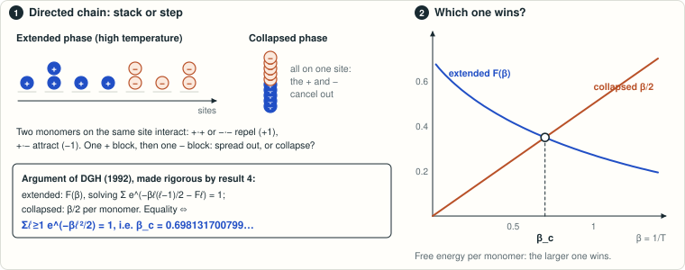

# DGH charged diblock: exact critical inverse temperature

<!-- plain-words:start -->
**The question.** A polymer carries n positive charges followed by n negative ones. Monomers either stack on the same site or step forward; equal charges on a site repel, opposite ones attract. At what temperature does the chain collapse?

**The answer.** Exactly at the root of Σ<sub>ℓ≥1</sub> e<sup>−βℓ²/2</sup> = 1, β<sub>c</sub> = 0.698131700799…, the value predicted by Derrida, Griffiths and Higgs in 1992 and now proved. (Curiously, β<sub>c</sub> − 2π/9 ≈ 1.5·10⁻¹², close but not equal.)

**How.** The 1992 prediction compares two free energies (figure). The missing step was to show that no intermediate configuration does better at high temperature, done by comparison with homogeneous charge sequences and gluing inequalities.

<p align="center"></p>

<p align="center"><sub>Extended phase: each block behaves like a chain of equal charges. Collapsed phase: all charges on one site cancel. The free energies cross at β<sub>c</sub>.</sub></p>

<!-- plain-words:end -->

**Status: solved: complete proof, verified (verdict CONFIRMED WITH CORRECTIONS, minor and editorial; see [verification.md](verification.md)).** The candidate value itself was already identified by Derrida, Griffiths and Higgs in 1992; the collapse side was argued there and proved by Poisat (Prop. 3.7). The new contribution is the matching uniform high-temperature bound. The verifier's novelty search found no earlier complete answer.

**Attribution.** Solver and internal review: GPT-6-Astra. Manuscript: Claude Opus 5.5. Verification: Claude Opus 5.5 ([verification.md](verification.md)).

## Original question

> What is the critical temperature for the di-block polymer from (3.4)?

Julien Poisat, *Variational representation and estimates for the free energy of a quenched charged polymer model*, [arXiv:2502.18964v2](https://arxiv.org/abs/2502.18964v2), Section 7, p. 21, question (3). This is the October 2026 revision; the first version has different section and equation numbers. The question gives inverse-temperature bounds \(\log\varphi\leq\beta_c\leq2\log2\).

## Result

For the deterministic balanced sequence \(+^n-^n\), in the original pair-interaction convention, the exact threshold is the unique positive solution
\[
 \boxed{\sum_{\ell\geq1}e^{-\beta_c\ell^2/2}=1},\qquad
 \beta_c=0.698131700799199439091341370180112797\ldots.
\]
Below it, every cut probability is bounded below uniformly in length and position, even for arbitrary binary charge sequences. Above it, all but a uniformly tight number of monomers occupy one site. The proof compares general charge words to homogeneous words, then uses gluing inequalities and an exact mixed-block decomposition. It also obtains the diblock free energy and the critical central-cut asymptotic \(p_{n,2n}\sim1/(3n)\). The alternative temperature convention has threshold \(\beta_c/2\). The candidate is **not exactly** \(2\pi/9\): their positive difference is about \(1.4676083\times10^{-12}\). The verifier added the analytic reason. Equation (1) is \(\vartheta_3(0,e^{-\beta/2})=3\), and Poisson summation gives \(\beta_c-2\pi/9=\frac{8\pi}{9}e^{-9\pi}(1+O(e^{-9\pi}))\). In temperature units, \(T_c=1/\beta_c=1.43239\ldots\), which is DGH's 1.43. In Poisat's notation (3.23), \(\beta_c=2\beta_0\).

Full assumptions, endpoint correction, proof, and limitations are in [paper.pdf](paper.pdf). The random-charge freezing conjecture and the companion high-temperature expansion question are not claimed solved.

## Certified computations

Integer-polynomial enumeration checks the diblock identity through 16 monomers. Rational-arithmetic checks cover all binary words through length eight. Arb interval dynamic programming reaches 100,000 monomers, with **all** omitted tails bounded analytically. These are finite-volume certificates, separate from the proof of the limiting transition.

Representative values at \(2n=100000\), rounded here for readability:

| Original \(\beta\) | \((2n)^{-1}\log Z_{2n}\) | Central cut probability |
|---|---:|---:|
| 0.65 | 0.363797404009412 | 0.026169844864688 |
| 0.698 | 0.349194843711444 | 0.000070089636462 |
| \(\beta_c\) | 0.349179093385721 | 0.000006666687416 |
| 0.6982 | 0.349196241176951 | 0.000000156558034 |
| 0.7 | 0.350063208050629 | \(1.7907772543\times10^{-68}\) |

The outward-rounded intervals, rather than these display values, are in [certificates/finite_volumes.json](certificates/finite_volumes.json).

## Reproduce

From this directory under WSL Fedora, with the supplied scientific environment activated:

```bash
source ~/envs/sci/bin/activate
OPENBLAS_NUM_THREADS=1 OMP_NUM_THREADS=1 python scripts/run_all.py
```

From PowerShell at the workspace root:

```powershell
wsl.exe -d FedoraLinux-44 --cd /path/to/chemistry-open-problems/problems/dgh-charged-polymer-diblock --exec bash -lc 'source ~/envs/sci/bin/activate; OPENBLAS_NUM_THREADS=1 OMP_NUM_THREADS=1 python scripts/run_all.py'
```

Dependencies: Python 3.10+, `python-flint`, `mpmath`. One thread, under 250 MB RAM; measured runtime around 20 seconds on this workstation. No network is required to verify the mathematical certificates. The scripts print PASS/FAIL and exit nonzero on failure. Numerical data can be regenerated separately with `python scripts/verify_intervals.py --write`; the default verifies the checked-in data.

## Files

- [paper.tex](paper.tex), [paper.pdf](paper.pdf): manuscript with the complete proof and all numerical error bounds (LaTeX edition of the solver's write-up).
- [references.md](references.md): sources, exact reading scope, novelty search and limitations.
- [verification.md](verification.md): verification report (PROTOCOL.md §4). The verifier's own script and logs are in `verification/`: `independent_check.py`, `independent_check.log`, `solver_scripts_rerun.log` and `verifier-changes.diff`.
- [verification-codex-internal.md](verification-codex-internal.md): review by a fresh-context sub-agent launched by the solver itself (same model); not the verification required by PROTOCOL.md.
- `scripts/verify_exact.py`, `scripts/verify_intervals.py`, `scripts/run_all.py`: deterministic verifiers. The solver's internal-review sub-agent added `scripts/verify_independent.py`. Despite its name, it is not the PROTOCOL.md verification.
- `certificates/parameters.json`: exact rational endpoints and computation settings.
- `certificates/exact_polynomials.json`: integer coefficient data.
- `certificates/finite_volumes.json`: forty certified finite-volume rows.
- `certificates/verification.log`: complete local check output (not the verification of PROTOCOL.md §4). `certificates/independent-verification.log` is the internal-review sub-agent's rerun of the same scripts. It is not the PROTOCOL.md verification either.
- `certificates/source_manifest.json`: SHA-256 hashes of the source PDFs and snapshots used (the files themselves are kept locally, not redistributed).

