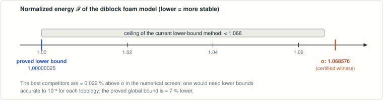

# Diblock foam model screen of the Frank–Kasper catalogue

<!-- plain-words:start -->
**The question.** Block copolymers self-assemble into sphere packings with complex crystal structures. In the “diblock foam model”, which structure has the lowest energy? The σ phase is seen in experiments.

**The answer.** σ is lowest in a numerical screen (0.022 % ahead), and its energy is certified, but its optimality is not proved. The current lower-bound method provably cannot close the gap.

**How.** Exact certificates for 121 topologies and 14 energies, a universal lower bound using Kepler’s sphere-packing theorem, and certified minimization over affine deformations. Not yet verified.

<p align="center"></p>

<p align="center"><sub>The candidate structures are within 0.02 % of each other, while the proved lower bound is about 7 % lower.</sub></p>

<!-- plain-words:end -->

**Status: partial result — global minimization remains unresolved.** The numerical screen reports its lowest
energy for σ, with a gap of about 0.022 % to its best reported competitors. Exact certificates now verify all
121 catalogue input topologies and fourteen explicit energy witnesses. They do **not** establish separating lower bounds for
the competing topology infima. Five certified witnesses lie below numbers printed in Reddy et al.'s preprint and published SI.

**Continuation, 24–25 October 2026.** [Manuscript](paper.pdf), [proof source](paper.tex),
[audit report](verification.md), [progress journal in French](JOURNAL.md). The proved global enclosure for the
catalogue infimum is **1.00000025 ≤ inf 𝓕 ≤ 1.068575909**. The lower bound is uniform even when cell volumes
or box shapes degenerate, but remains far below σ. A complete proof of σ's optimality has not been obtained.

**Attribution.** Solver: Claude Opus 5.5. Continuation, new certificate checks and manuscript: GPT-6-Astra. Review of the new
work: pending.

The continuation's checks and their scope are summarized below. The [manuscript](paper.pdf) contains
the proofs; [verification.md](verification.md) records the assumptions and the unresolved global comparison.

| Result or check | Outcome | Scope |
|---|---|---|
| Catalogue geometry | 121 PASS, 0 FAIL | Exact embedded FK realizations; standalone integer data |
| Energy witnesses | 6 PASS | Certified upper bounds, including transport to exact target boxes |
| New witnesses for the eight previously unrelaxed entries | 8 PASS | Exact admissibility and energies; auxiliary interior apices; no optimality claim |
| Necessity of the centroid-cone test | Disproved by an exact Y04 witness | 184 negative centroid cones in an embedded partition with positive auxiliary cones |
| Uniform gap above the spherical relaxation | 𝓕 > 1.00000025 | All admissible periods and positive volumes; uses Kepler's theorem; elementary version > 1.000000004 |
| Global affine minimization of stored meshes | 6 PASS | Entire affine families certified; five competitor families lie above the σ witness; not full topology classes |
| Linear divergence calibrations | 121 PASS; 34 improve the uniform bound | All internal shapes, positive volumes and box shapes of each represented topology |
| Ceiling on the preceding calibration method | < 1.066 for every catalogue entry | A limit on that proof method, not an upper bound on physical energies |
| Restricted flat A15 family | 𝓕(c) > 1.0699 for every c ≥ 0 | One-parameter formula; does not cover arbitrary curved A15 cells |
| Adversarial and invariance tests | 6 tests pass | Invalid geometry rejected; translation/scaling and box checks |
| Affine tensor and convex-bound tests | 3 tests pass | Analytic cube, shear and translation, rejection of invalid dual bounds |
| Published PNAS SI comparison | 12 DFM values and caption ratios agree with preprint inputs | Source read and checked visually; five improved witnesses confirmed |
| Symmetry-breaking restarts | 24 completed stages | Two seeds for σ, E11, H and μ through levels 0–2; numerical evidence |

The continuation adds a reproducible geometric and energy audit, a certificate for the restricted A15 formula,
a uniform gap above 1, and a convex reduction certifying all affine deformations of six fixed meshes.
The six original energy witnesses were inherited from the screen; their validation has been strengthened.
The global affine infimum for the stored σ mesh lies in [1.068575891, 1.068575910]. Deformations of its individual
cells remain outside that family. The uniform lower bound and the affine bounds do not separate the competing
topology infima, so the central global comparison remains open. No complete solution is claimed.

The new topology-wide bounds include A15 ≥ 1.008666655, H ≥ 1.008808885,
σ ≥ 1.004288649 and E11 ≥ 1.004321474. Their proof uses periodic linear divergence fields,
an area bound and the ball-moment inequality. A separate theorem shows that the best number this
construction could produce is at most 1.065253040 across the catalogue, below the current σ witness.
The integer field certificates and the proof of this limitation are included in the manuscript.

The comparison concerns the translation periods represented by the catalogue inputs, with homogeneous box
relaxation. It does not cover arbitrary larger supercells or all possible Frank–Kasper structures.
Degenerating limits have not been excluded globally.

The eight entries previously represented only by starting values now have additional certified witnesses:

| Entry | Historical starting value (floating point) | New certified upper bound | Negative cones at true centroids |
|---|---:|---:|---:|
| N55 | 1.13125 | 1.102285105 | 0 |
| N59 | 1.12760 | 1.101112653 | 0 |
| N60 | 1.20268 | 1.129410812 | 0 |
| II:Y02 | 1.13419 | 1.103468432 | 0 |
| II:Y03 | 1.13425 | 1.103507483 | 0 |
| II:Y04 | 1.62006 | 1.254466833 | 184 |
| II:Y05 | 1.56570 | 1.254006234 | 370 |
| II:Y06 | 1.61931 | 1.255816821 | 281 |

All auxiliary cone determinants are strictly positive. Negative cones at the volume centroid therefore
do not imply an invalid partition. The eight witnesses are improved feasible trials, with no claim of
convergence to a local minimum. The 48 continuation stages and their stopping diagnostics are saved in
`data/barrier_continuation.csv`; the historical screen below is retained as the record of the original runs.

## Problem

Reddy, Buckley, Arora, Bates, Dorfman, Grason, *Stable Frank–Kasper phases of self-assembled, soft matter spheres*,
PNAS 115 (2018) 10233 (arXiv:1806.01726) introduce the **diblock foam model (DFM)**: minimise
𝓕 = (𝒜² ℐ)^{1/3} over curved periodic partitions with a fixed cell topology and free cell volumes (𝒜: mean cell area,
ℐ: mean second moment of each cell about its centroid, both normalised by the sphere of the mean cell volume). For 11
Frank–Kasper (FK) phases and BCC they find:

> "Among these nearly degenerate, fully unconstrained DFM structures, the σ phase overtakes A15 (minimal for fixed,
> equal volume) as the minimal energy phase (with next lowest energy for P)" — [1], Sec. II (arXiv v1, p. 7).

The catalogue of FK structures of M. Dutour Sikirić, O. Delgado-Friedrichs, M. Deza (*Space fullerenes: a computer
search for new Frank–Kasper structures*, Acta Cryst. A 66 (2010) 602; 84 structures, 9 of them in [1]) and its part II
(Dutour Sikirić & Deza, Struct. Chem. 23 (2012) 1103; 37 structures) extends the candidate set. No prior DFM
evaluation of the full catalogue was found in the bounded literature search.
**No source states this as an open problem**: "is σ the DFM minimiser over the whole catalogue?" is our framing.
Novelty check (`references.md`): no prior DFM evaluation of catalogue structures found.

## Result in one paragraph

The curved-cell DFM minimiser uses exact polyhedral formulas evaluated in floating point; six saved meshes are
also checked with integer/rational arithmetic. A valid mesh supplies a feasible competitor, but its floating-point
energy is not by itself a certified decimal upper bound. Meshes are refined to 2.6×10⁵–6.7×10⁵ triangles and
extrapolated (observed O(h²) convergence, ratio about 3.93). The stored runs reproduce [1] for A15, C15, Z, C14 and δ within 1.6×10⁻⁶ (A15 and C15, cubic, within
4.3×10⁻⁷), the Kelvin (1.097251) and Weaire–Phelan (1.093541) foams, and the paper's flat Voronoi values; for BCC, P,
M, H and μ exact certificates give energies below the numbers printed in arXiv v1 and the published SI (gaps 3×10⁻⁶ to
1.2×10⁻⁴). For the screen we relaxed the box shape of every structure (the paper keeps metallic aspect ratios fixed,
which penalises e.g. H by 3.9×10⁻⁴ and μ by ~7×10⁻⁴). Result: **σ has the lowest reported trial energy among the 124 entries** (121 catalogue
+ P, M, BCC), 𝓕(σ) = 1.0685748 (certified upper bound 1.068575909), followed by a tie between the new catalogue entry
**E11** (I4₁/amd) and **H**, both at +0.0219 % (2.34×10⁻⁴, about 2000 times our extrapolation uncertainty), then μ and
zra-d (K₇Cs₆ type, new to the DFM) at +0.025 %, the new **N56** at +0.027 % and P at +0.028 %. Sixteen catalogue entries
are not Voronoi-realised by their supplied coordinates. Their available values are about 1.0 % or more above σ,
and eight historical rows retain only starting values after failed relaxations; the certified supplement above
now improves those rows. These values do not exclude their topology infima. The ranking is numerical:
see `result.md` §5 and `verification.md`.

## Historical main table (box-relaxed DFM, all structures)

`data/dfm_screen_boxrelaxed.csv` has every structure with all available level values. 𝓕_L is a floating-point
evaluation of the level-L partition; certified bounds come from the six original and eight new separate integer certificates. "Extrapolated" is the Richardson value
(heuristic error). Cubic A15, C15, BCC: see also the fixed-box level-4 values (identical boxes).

| # | structure | group | n | Z12/14/15/16 | L | 𝓕_L (mesh value) | 𝓕 extrapolated | Δ vs σ | min edge/R₀ |
|---|---|---|---|---|---|---|---|---|---|
| 1 | Phys26 — sigma (Cr46Fe54) | P42/mnm | 30 | 10/16/4/0 | 4 | 1.06857591 | 1.0685748 ± 8e-08 | +0.000% | 0.555 |
| 2 | E11 | I41/amd | 44 | 16/20/8/0 | 4 | 1.06880987 | 1.0688088 ± 8e-08 | +0.022% | 0.551 |
| 3 | Phys25 — H (complex) | Cmmm | 30 | 10/16/4/0 | 4 | 1.06881039 | 1.0688092 ± 8e-08 | +0.022% | 0.565 |
| 4 | Phys14 — mu (Mo6Co7) | R-3m | 39 | 21/6/6/6 | 4 | 1.06883959 | 1.0688388 ± 5e-08 | +0.025% | 0.664 |
| 5 | Phys12 — zra-d (K7Cs6) | P63/mmc | 26 | 14/4/4/4 | 4 | 1.06884046 | 1.0688396 ± 5e-08 | +0.025% | 0.664 |
| 6 | N56 | I41/amd | 76 | 24/44/8/0 | 4 | 1.06886945 | 1.0688683 ± 9e-08 | +0.027% | 0.564 |
| 7 | P — P (Mo42Cr18Ni40) |  | 56 | 24/20/8/4 | 4 | 1.06887525 | 1.0688742 ± 7e-08 | +0.028% | 0.518 |
| 8 | N16 | P63/mmc | 40 | 20/8/8/4 | 3 | 1.06892318 | 1.0689197 ± 5e-07 | +0.032% | 0.661 |
| 9 | N27 | R-3m | 60 | 30/12/12/6 | 3 | 1.06892319 | 1.0689197 ± 5e-07 | +0.032% | 0.661 |
| 10 | M — M (Nb48Ni39Al13) |  | 52 | 28/8/8/8 | 3 | 1.06892324 | 1.0689199 ± 5e-07 | +0.032% | 0.595 |
| 11 | N53 | P42/mmc | 36 | 14/14/8/0 | 3 | 1.06894210 | 1.0689380 ± 7e-07 | +0.034% | 0.549 |
| 12 | N03 | P63/mmc | 38 | 22/4/4/8 | 3 | 1.06894939 | 1.0689463 ± 5e-07 | +0.035% | 0.662 |
| 13 | N02 | P-6m2 | 19 | 11/2/2/4 | 3 | 1.06895012 | 1.0689471 ± 5e-07 | +0.035% | 0.662 |
| 14 | N09 | R-3m | 57 | 33/6/6/12 | 3 | 1.06899250 | 1.0689894 ± 5e-07 | +0.039% | 0.662 |
| 15 | N04 | P63/mmc | 38 | 22/4/4/8 | 3 | 1.06899326 | 1.0689902 ± 5e-07 | +0.039% | 0.662 |
| 16 | Phys13 — p-sigma (Th6Cd7) | Pbam | 26 | 14/4/4/4 | 3 | 1.06903229 | 1.0690289 ± 5e-07 | +0.043% | 0.593 |
| 17 | Phys27 — A15 (Cr3Si) | Pm-3n | 8 | 2/6/0/0 | 3 | 1.06904246 | 1.0690375 ± 9e-07 | +0.043% | 0.577 |
| 18 | Phys18 — Z (Zr4Al3) | P6/mmm | 7 | 3/2/2/0 | 3 | 1.06905073 | 1.0690469 ± 6e-07 | +0.044% | 0.692 |
| 19 | Phys01 — C14 (MgZn2) | P63/mmc | 12 | 8/0/0/4 | 3 | 1.06907259 | 1.0690700 ± 4e-07 | +0.046% | 0.650 |
| 20 | N12 | Cmc21 | 76 | 44/8/8/16 | 3 | 1.06907634 | 1.0690732 ± 5e-07 | +0.047% | 0.588 |
| 21 | Phys06 — 9-layer Laves | R-3m | 54 | 36/0/0/18 | 2 | 1.06913735 | 1.0691273 ± 6e-06 | +0.052% | 0.647 |
| 22 | E09 | Cmc21 | 56 | 24/20/8/4 | 2 | 1.06914828 | 1.0691327 ± 6e-06 | +0.052% | 0.511 |
| 23 | Phys03 — C36 (MgNi2) | P63/mmc | 24 | 16/0/0/8 | 2 | 1.06916599 | 1.0691559 ± 6e-06 | +0.054% | 0.645 |
| 24 | Phys04 — 6-layer Laves (MgCuNi) | P63/mmc | 36 | 24/0/0/12 | 2 | 1.06919517 | 1.0691851 ± 6e-06 | +0.057% | 0.645 |
| 25 | II:N18 | Cmmm | 42 | 18/16/4/4 | 2 | 1.06921896 | 1.0692035 ± 6e-06 | +0.059% | 0.564 |
| 26 | II:N04 | Amm2 | 42 | 18/14/8/2 | 2 | 1.06925503 | 1.0692398 ± 6e-06 | +0.062% | 0.546 |
| 27 | Phys02 — C15 (MgCu2) | Fd-3m | 24 | 16/0/0/8 | 2 | 1.06925392 | 1.0692438 ± 6e-06 | +0.063% | 0.673 |
| 28 | N40 | P-4m2 | 20 | 10/5/2/3 | 2 | 1.06927122 | 1.0692573 ± 6e-06 | +0.064% | 0.547 |
| 29 | N48 | I41/amd | 68 | 32/20/8/8 | 2 | 1.06928605 | 1.0692715 ± 6e-06 | +0.065% | 0.547 |
| 30 | N54 | P42/mmc | 36 | 14/16/4/2 | 2 | 1.06929771 | 1.0692814 ± 6e-06 | +0.066% | 0.561 |
| 31 | N17 | Imma | 40 | 20/8/8/4 | 2 | 1.06929690 | 1.0692832 ± 6e-06 | +0.066% | 0.594 |
| 32 | II:E04 | Cmca | 84 | 36/24/24/0 | 2 | 1.06935781 | 1.0693423 ± 6e-06 | +0.072% | 0.566 |
| 33 | E06 | I-4m2 | 28 | 12/10/4/2 | 2 | 1.06938861 | 1.0693732 ± 6e-06 | +0.075% | 0.541 |
| 34 | N05 | Cmmm | 38 | 22/4/4/8 | 2 | 1.06939413 | 1.0693820 ± 6e-06 | +0.076% | 0.600 |
| 35 | N13 | P42/mmc | 32 | 18/4/4/6 | 2 | 1.06942367 | 1.0694112 ± 6e-06 | +0.078% | 0.602 |
| 36 | E01 | Cmmm | 26 | 14/4/4/4 | 2 | 1.06944081 | 1.0694277 ± 6e-06 | +0.080% | 0.595 |
| 37 | N46 | I41/amd | 68 | 32/16/16/4 | 2 | 1.06945525 | 1.0694410 ± 6e-06 | +0.081% | 0.605 |
| 38 | E04 | Cmca | 56 | 24/16/16/0 | 2 | 1.06950866 | 1.0694928 ± 6e-06 | +0.086% | 0.568 |
| 39 | N32 | Cmcm | 80 | 40/16/16/8 | 2 | 1.06961242 | 1.0695985 ± 6e-06 | +0.096% | 0.569 |
| 40 | N35 | Pmna | 40 | 20/12/0/8 | 2 | 1.06966427 | 1.0696496 ± 6e-06 | +0.101% | 0.534 |
| 41 | N08 | Pmma | 38 | 22/4/4/8 | 2 | 1.06967229 | 1.0696599 ± 6e-06 | +0.102% | 0.610 |
| 42 | Phys20 — delta (MoNi) |  | 56 | 24/20/8/4 | 2 | 1.06968163 | 1.0696649 ± 7e-06 | +0.102% | 0.464 |
| 43 | II:E03 | C12/m1 | 42 | 18/12/12/0 | 2 | 1.06968543 | 1.0696691 ± 6e-06 | +0.102% | 0.554 |
| 44 | N14 | P42/mmc | 20 | 10/4/4/2 | 2 | 1.06970110 | 1.0696872 ± 6e-06 | +0.104% | 0.606 |
| 45 | N51 | Pmna | 28 | 12/12/0/4 | 2 | 1.06982096 | 1.0698043 ± 7e-06 | +0.115% | 0.530 |
| 46 | E02 | Cmcm | 52 | 28/8/8/8 | 2 | 1.06983971 | 1.0698263 ± 6e-06 | +0.117% | 0.577 |
| 47 | E10 | P212121 | 56 | 24/20/8/4 | 2 | 1.06986923 | 1.0698526 ± 7e-06 | +0.120% | 0.532 |
| 48 | E03 | Cmca | 28 | 12/8/8/0 | 2 | 1.07004795 | 1.0700306 ± 7e-06 | +0.136% | 0.540 |
| 49 | N10 | P3221 | 57 | 33/6/6/12 | 2 | 1.07013772 | 1.0701245 ± 7e-06 | +0.145% | 0.556 |
| 50 | N23 | Pnma | 40 | 20/8/8/4 | 2 | 1.07023909 | 1.0702239 ± 7e-06 | +0.154% | 0.481 |
| 51 | N34 | Cccm | 40 | 20/12/0/8 | 2 | 1.07024309 | 1.0702273 ± 7e-06 | +0.155% | 0.504 |
| 52 | N26 | Pmc21 | 40 | 20/8/8/4 | 2 | 1.07026081 | 1.0702458 ± 7e-06 | +0.156% | 0.508 |
| 53 | N20 | Pmna | 40 | 20/8/8/4 | 2 | 1.07031147 | 1.0702959 ± 7e-06 | +0.161% | 0.516 |
| 54 | II:N16 | Pmc21 | 42 | 18/16/4/4 | 2 | 1.07037077 | 1.0703538 ± 8e-06 | +0.166% | 0.490 |
| 55 | N18 | Cmcm | 40 | 20/8/8/4 | 2 | 1.07037170 | 1.0703560 ± 7e-06 | +0.167% | 0.533 |
| 56 | N06 | Immm | 38 | 22/4/4/8 | 2 | 1.07046771 | 1.0704544 ± 7e-06 | +0.176% | 0.563 |
| 57 | E07 | P21212 | 28 | 12/10/4/2 | 2 | 1.07055289 | 1.0705346 ± 8e-06 | +0.183% | 0.498 |
| 58 | N11 | Cmcm | 76 | 44/8/8/16 | 2 | 1.07056204 | 1.0705487 ± 7e-06 | +0.185% | 0.538 |
| 59 | N43 | Pmc21 | 40 | 20/10/4/6 | 2 | 1.07060091 | 1.0705854 ± 7e-06 | +0.188% | 0.529 |
| 60 | II:N01 | Pmc21 | 42 | 18/14/8/2 | 2 | 1.07066051 | 1.0706432 ± 8e-06 | +0.194% | 0.464 |
| 61 | N49 | I4122 | 68 | 32/20/8/8 | 2 | 1.07067951 | 1.0706623 ± 7e-06 | +0.195% | 0.426 |
| 62 | N41 | Pmn21 | 40 | 20/10/4/6 | 2 | 1.07069905 | 1.0706828 ± 7e-06 | +0.197% | 0.511 |
| 63 | N50 | Cmma | 28 | 12/12/0/4 | 2 | 1.07085999 | 1.0708412 ± 9e-06 | +0.212% | 0.480 |
| 64 | II:N23 | Cmca | 84 | 36/32/8/8 | 2 | 1.07092840 | 1.0709101 ± 9e-06 | +0.219% | 0.417 |
| 65 | II:N19 | C12/m1 | 42 | 18/16/4/4 | 2 | 1.07093063 | 1.0709123 ± 9e-06 | +0.219% | 0.435 |
| 66 | II:N09 | Cmc21 | 84 | 36/28/16/4 | 2 | 1.07097400 | 1.0709564 ± 7e-06 | +0.223% | 0.451 |
| 67 | II:N25 | Cmc21 | 84 | 36/32/8/8 | 2 | 1.07097748 | 1.0709600 ± 8e-06 | +0.223% | 0.492 |
| 68 | II:N07 | Cmc21 | 84 | 36/28/16/4 | 2 | 1.07111833 | 1.0711011 ± 8e-06 | +0.236% | 0.462 |
| 69 | BCC — BCC |  | 2 | 0/2/0/0 | 4 | 1.07110781 | 1.0711023 ± 7e-07 | +0.237% | 0.720 |
| 70 | N25 | Pmc21 | 40 | 20/8/8/4 | 2 | 1.07137378 | 1.0713578 ± 8e-06 | +0.260% | 0.516 |
| 71 | N44 | Cmc21 | 80 | 40/20/8/12 | 2 | 1.07138839 | 1.0713722 ± 8e-06 | +0.262% | 0.484 |
| 72 | N47 | I41/amd | 68 | 32/16/16/4 | 2 | 1.07141758 | 1.0713995 ± 8e-06 | +0.264% | 0.488 |
| 73 | N42 | Pmn21 | 40 | 20/10/4/6 | 2 | 1.07144420 | 1.0714282 ± 8e-06 | +0.267% | 0.452 |
| 74 | II:N06 | Cmc21 | 84 | 36/28/16/4 | 2 | 1.07151771 | 1.0714999 ± 8e-06 | +0.274% | 0.505 |
| 75 | E08 | Cmc21 | 56 | 24/20/8/4 | 2 | 1.07154520 | 1.0715276 ± 8e-06 | +0.276% | 0.483 |
| 76 | N21 | Pbam | 40 | 20/8/8/4 | 2 | 1.07156671 | 1.0715496 ± 9e-06 | +0.278% | 0.461 |
| 77 | II:E05 | Cmcm | 84 | 36/24/24/0 | 2 | 1.07162287 | 1.0716059 ± 7e-06 | +0.284% | 0.524 |
| 78 | II:E01 | Pmmn | 42 | 18/12/12/0 | 2 | 1.07186553 | 1.0718479 ± 8e-06 | +0.306% | 0.497 |
| 79 | N15 | P12/m1 | 20 | 10/4/4/2 | 2 | 1.07191618 | 1.0718983 ± 9e-06 | +0.311% | 0.444 |
| 80 | N24 | Pmma | 40 | 20/8/8/4 | 2 | 1.07195428 | 1.0719365 ± 9e-06 | +0.315% | 0.445 |
| 81 | E05 | Cmcm | 56 | 24/16/16/0 | 2 | 1.07203875 | 1.0720206 ± 8e-06 | +0.322% | 0.533 |
| 82 | N37 | Cmcm | 80 | 40/12/24/4 | 2 | 1.07204323 | 1.0720267 ± 8e-06 | +0.323% | 0.528 |
| 83 | N22 | Ima2 | 40 | 20/8/8/4 | 2 | 1.07230500 | 1.0722881 ± 9e-06 | +0.348% | 0.393 |
| 84 | N01 | Pmmn | 38 | 22/2/8/6 | 2 | 1.07231112 | 1.0722961 ± 8e-06 | +0.348% | 0.526 |
| 85 | II:N15 | Pmc21 | 42 | 18/16/4/4 | 2 | 1.07233277 | 1.0723153 ± 8e-06 | +0.350% | 0.499 |
| 86 | II:N13 | Pmmn | 42 | 18/16/4/4 | 2 | 1.07245108 | 1.0724327 ± 8e-06 | +0.361% | 0.505 |
| 87 | N31 | Cmcm | 80 | 40/16/16/8 | 2 | 1.07246801 | 1.0724513 ± 8e-06 | +0.363% | 0.497 |
| 88 | II:N08 | Cmc21 | 84 | 36/28/16/4 | 2 | 1.07251942 | 1.0725013 ± 9e-06 | +0.367% | 0.430 |
| 89 | N36 | Pmma | 40 | 20/12/0/8 | 2 | 1.07268637 | 1.0726700 ± 8e-06 | +0.383% | 0.476 |
| 90 | N19 | Pmna | 40 | 20/8/8/4 | 2 | 1.07276086 | 1.0727431 ± 9e-06 | +0.390% | 0.359 |
| 91 | N33 | Cmc21 | 80 | 40/16/16/8 | 2 | 1.07278302 | 1.0727659 ± 9e-06 | +0.392% | 0.435 |
| 92 | N52 | Cmcm | 56 | 24/24/0/8 | 2 | 1.07285176 | 1.0728326 ± 9e-06 | +0.398% | 0.525 |
| 93 | N07 | Pmmn | 38 | 22/4/4/8 | 2 | 1.07292324 | 1.0729076 ± 8e-06 | +0.405% | 0.497 |
| 94 | N29 | P3221 | 60 | 30/12/12/6 | 2 | 1.07328586 | 1.0732675 ± 1e-05 | +0.439% | 0.465 |
| 95 | N38 | Cmc21 | 80 | 40/12/24/4 | 2 | 1.07361401 | 1.0735956 ± 1e-05 | +0.470% | 0.424 |
| 96 | II:N14 | Pmn21 | 42 | 18/16/4/4 | 2 | 1.07395398 | 1.0739348 ± 1e-05 | +0.502% | 0.468 |
| 97 | N45 | Cmc21 | 80 | 40/20/8/12 | 2 | 1.07406982 | 1.0740521 ± 1e-05 | +0.513% | 0.467 |
| 98 | II:N26 | Cmc21 | 84 | 36/32/8/8 | 2 | 1.07475293 | 1.0747315 ± 1e-05 | +0.576% | 0.319 |
| 99 | II:N12 | Pmma | 42 | 18/16/4/4 | 2 | 1.07622339 | 1.0762020 ± 1e-05 | +0.714% | 0.419 |
| 100 | II:N21 | Imm2 | 42 | 18/16/4/4 | 2 | 1.07622359 | 1.0762022 ± 1e-05 | +0.714% | 0.415 |
| 101 | II:N10 | P12/m1 | 21 | 9/8/2/2 | 2 | 1.07625850 | 1.0762371 ± 1e-05 | +0.717% | 0.415 |
| 102 | II:N11 | Pnnm | 42 | 18/16/4/4 | 2 | 1.07625892 | 1.0762376 ± 1e-05 | +0.717% | 0.415 |
| 103 | N39 | C2221 | 80 | 40/12/24/4 | 2 | 1.07627804 | 1.0762558 ± 1e-05 | +0.719% | 0.356 |
| 104 | II:N02 | Pmc21 | 42 | 18/14/8/2 | 2 | 1.07692853 | 1.0769059 ± 1e-05 | +0.780% | 0.300 |
| 105 | II:N24 | Cmca | 84 | 36/32/8/8 | 2 | 1.07804933 | 1.0780264 ± 2e-05 | +0.885% | 0.376 |
| 106 | II:N20 | C12/m1 | 42 | 18/16/4/4 | 2 | 1.07804937 | 1.0780264 ± 2e-05 | +0.885% | 0.376 |
| 107 | II:E02 | P21212 | 42 | 18/12/12/0 | 2 | 1.07850417 | 1.0784818 ± 1e-05 | +0.927% | 0.397 |
| 108 | N30 | Fmmm | 80 | 40/16/16/8 | 2 | 1.07966133 | 1.0796378 ± 2e-05 | +1.035% | 0.358 |
| 109 | II:N05 | Cmm2 | 42 | 18/14/8/2 | 1 | 1.07984700 | — | +1.055% | 0.343 |
| 110 | II:N22 | P6122 | 126 | 54/48/12/12 | 1 | 1.08291338 | — | +1.342% | 0.236 |
| 111 | II:N17 | P3121 | 63 | 27/24/6/6 | 1 | 1.08291342 | — | +1.342% | 0.235 |
| 112 | II:N03 | P64 | 63 | 27/21/12/3 | 1 | 1.08437759 | — | +1.479% | 0.166 |
| 113 | N28 | P6222 | 60 | 30/12/12/6 | 2 | 1.08511608 | 1.0850916 ± 2e-05 | +1.546% | 0.156 |
| 114 | II:Y01 | P63/mcm | 42 | 20/16/0/6 | 1 | 1.08864670 | — | +1.878% | 0.285 |
| 115 | N58 | P42/mnm | 18 | 6/8/4/0 | 2 | 1.09922814 | 1.0991726 ± 5e-05 | +2.863% | 0.017 |
| 116 | N57 | P42/mnm | 32 | 12/12/8/0 | 2 | 1.10303259 | 1.1029829 ± 6e-05 | +3.220% | 0.024 |
| 117 | N59 (frustrated) | Pccn | 36 | 12/16/8/0 | start | 1.12760 (historical start; see supplement) | — | +5.5% | — |
| 118 | N55 (frustrated) | P43212 | 60 | 28/16/8/8 | start | 1.13125 (historical start; see supplement) | — | +5.9% | — |
| 119 | II:Y02 (frustrated) | P41212 | 84 | 44/16/8/16 | start | 1.13419 (historical start; see supplement) | — | +6.1% | — |
| 120 | II:Y03 (frustrated) | P43212 | 84 | 44/16/8/16 | start | 1.13425 (historical start; see supplement) | — | +6.1% | — |
| 121 | N60 (frustrated) | P6422 | 54 | 18/24/12/0 | start | 1.20268 (historical start; see supplement) | — | +12.6% | — |
| 122 | II:Y05 (frustrated) | P43 | 84 | 20/40/24/0 | start | 1.56570 (historical start; see supplement) | — | +46.5% | — |
| 123 | II:Y06 (frustrated) | P41 | 84 | 20/40/24/0 | start | 1.61931 (historical start; see supplement) | — | +51.5% | — |
| 124 | II:Y04 (frustrated) | P42/m | 42 | 10/20/12/0 | start | 1.62006 (historical start; see supplement) | — | +51.6% | — |

## Milestone 1 — reproduction of [1] (`scripts/check_milestone1.py`: 0 FAIL)

Detailed source numbers were transcribed from **arXiv v1** and checked against the published SI, Figs. S3–S14.
These are stored fixed-box runs, levels 0–4 (up to 4.9×10⁵ triangles), Richardson-extrapolated
(heuristic error estimate ≤ 1×10⁻⁷ except BCC 7×10⁻⁷). Certified comparisons use the separate witnesses in `verification.md`.

| structure | ours (extrapolated) | published [1] | difference | status |
|---|---|---|---|---|
| A15 | 1.0690374 | 1.069037 | +3.8×10⁻⁷ | reproduced |
| C15 | 1.0692434 | 1.069243 | +4.3×10⁻⁷ | reproduced |
| Z | 1.0692501 | 1.069250 | +9.5×10⁻⁸ | reproduced |
| C14 | 1.0690704 | 1.069071 | −5.6×10⁻⁷ | reproduced |
| δ | 1.0696755 | 1.069677 | −1.5×10⁻⁶ | reproduced |
| pσ | 1.0690656 | 1.069068 | −2.4×10⁻⁶ | lower |
| σ (a/c = 1.9) | 1.0685789 | 1.068583 | −4.1×10⁻⁶ | lower; box ambiguous (paper's CVP row fits a/c ≈ 1.93) |
| BCC | 1.0711023 | 1.071111 | −8.7×10⁻⁶ | certified: published value not minimal |
| H (Z12 at 2a+4f) | 1.0692035 | 1.069219 | −1.6×10⁻⁵ | certified: not minimal |
| P | 1.0688810 | 1.068909 | −2.8×10⁻⁵ | certified: not minimal |
| M | 1.0689983 | 1.069038 | −4.0×10⁻⁵ | certified: not minimal |
| μ | 1.0695330 | 1.069662 | −1.3×10⁻⁴ | certified: not minimal |

Also: Kelvin foam (equal-volume minimal area, BCC) 1.0972512 vs 1.097251; Weaire–Phelan 1.0935413 vs 1.093541;
A15 equal-volume DFM 1.069742 vs 1.069743; flat "Initial Voronoi" (𝒜, ℐ) rows of [1] reproduced to 6 decimals for
BCC, A15, C15, H, P, δ, pσ, M. Details and diagnostics: `result.md` §3.

## How to reproduce

Environment: Python 3.12+ with numpy, scipy, numba, gemmi and python-flint; one thread (enforced by
`scripts/dfm/__init__.py`). Catalogue data: Zenodo 10.5281/zenodo.13691342 (`SpaceFullerene.tar.gz`, md5
582371cee665c62e01a2f47a73dd2c9d) unpacked into `certificates/sources/dutour2010/` (git-ignored).

```bash
cd problems/frank-kasper-dfm-screening/scripts
python3 audit_certificates.py        # 6 topology/energy/exact-box audits; ~1 min
python3 certify_catalogue.py         # 121 exact embedded FK complexes; no external inputs needed
python3 check_a15_family.py          # restricted flat A15 family: certified F > 1.0699
python3 check_uniform_gap.py         # exact constants: uniform F > 1.00000025, all topologies
python3 check_affine_orbits.py       # 6 GLOBAL affine-family bounds; saved metrics, no optimizer rerun
python3 test_affine_orbits.py        # 3 analytic and rejection tests for tensor/convex bounds
python3 check_topology_calibrations.py # 121 topology-wide lower bounds and the method's ceiling
python3 test_topology_calibrations.py  # 4 analytic and rejection tests; no optimizer
python3 check_barrier_witnesses.py     # 8 auxiliary-apex witnesses; exact energy and centroid tests
python3 test_barrier.py                # 3 derivative, boundary and true-centroid tests
python3 check_source_comparison.py   # SI transcription / preprint data / certificate thresholds
python3 test_audit_certificates.py   # rejection/invariance tests for the new checker
python3 check_certificates.py        # 6 exact certificates, ~1 min: PASS x6
python3 check_catalogue.py           # 121 catalogue files: valid embedded FK tilings, ~5 min: 121 PASS
python3 check_milestone1.py          # Milestone 1 (uses data/dfm_fixedbox_paper_structures.csv), ~5 min: 0 FAIL
# Regenerate the new proposals (verification above does not require this):
python3 check_topology_calibrations.py --build --fresh  # requires cvxpy and CLARABEL
python3 run_barrier.py --maxiter 5000 # all eight entries; writes final meshes and the 48-stage CSV
python3 check_barrier_witnesses.py --build # round the new meshes, then verify exactly
# regenerate the runs (hours on a loaded machine; resumable, results in ../work/runs)
python3 run_dfm.py BCC A15 C15 Z C14 sigma psigma H mu M P delta --box fixed --maxlev 4
python3 screen_pipeline.py ../data/screen_order.txt --win3 5e-4 --win4 3e-4   # resumes from ../work/runs checkpoints
python3 analyze.py --box fixed --out ../data/dfm_fixedbox_paper_structures.csv
python3 make_tables.py
```

## Files

| path | content |
|---|---|
| `paper.tex`, `paper.pdf`, `references.bib` | proofs, certificate method, numerical comparison and unresolved global step |
| `verification.md`, `JOURNAL.md` | audit verdicts and tracked continuation log |
| `scripts/audit_certificates.py` | separate exact integration, topology and affine-box verification |
| `scripts/check_a15_family.py` | certified polynomial inequality for the restricted flat A15 formula |
| `scripts/check_uniform_gap.py`, `certificates/uniform_gap_report.json` | uniform gap proof constants, checked with rational arithmetic |
| `scripts/check_affine_orbits.py`, `certificates/affine_orbits_report.json` | convex affine minimization, exact moment tensors and global interval bounds |
| `scripts/check_topology_calibrations.py`, `certificates/topology_calibrations.json` | 121 integer divergence fields, full-topology lower bounds and ceiling on the method |
| `scripts/run_barrier.py`, `scripts/check_barrier_witnesses.py` | continuation with auxiliary interior apices; separate exact verification |
| `certificates/meshes/barrier/`, `certificates/barrier_witness_report.json` | eight additional dyadic partitions and their certified energies |
| `data/barrier_continuation.csv` | all 48 new stages, positive-cone diagnostics, gradients and stopping reasons |
| `data/pnas_si_crosscheck.json`, `scripts/check_source_comparison.py` | published SI provenance, visual transcription and consistency check |
| `scripts/certify_catalogue.py`, `certificates/catalogue_topology.npz` | standalone exact topology certificates for 121 entries |
| `scripts/check_restarts.py`, `data/symmetry_breaking_restarts.csv` | additional numerical restarts without imposed crystal symmetry |
| `result.md` | method, validation (Milestone 1), screen, caveats |
| `references.md` | sources (what was read) and novelty check |
| `NEEDS.md` | received sources and optional remaining crystallographic references |
| `scripts/dfm/` | engine: `topology.py` (periodic Delaunay, foam), `mesh.py` (periodic triangulated foam, refinement), `energy.py` (exact geometry, 𝓕, gradient, virial), `relax.py` (restricted motion, smoothing, box strain, embeddedness check), `lbfgs.py`, `constrained.py` (equal-volume problems), `cvp.py` (Lloyd), `cgd.py` (catalogue reader), `embed.py` (spring re-embedding), `registry.py` (structures), `structures.py` |
| `scripts/run_dfm.py` | resumable relaxation driver (levels, checkpoints, JSON results) |
| `scripts/screen_pipeline.py` | adaptive screen (L2 all, L3/L4 near σ) |
| `scripts/analyze.py`, `scripts/make_tables.py` | extrapolation and tables |
| `scripts/certify_upper_bound.py`, `scripts/check_certificates.py`, `scripts/make_certificates.py` | exact certificates (integer arithmetic) |
| `scripts/check_milestone1.py`, `scripts/check_catalogue.py` | PASS/FAIL checks |
| `scripts/diagnostics/se_quadrature_bias.py` | one-point quadrature diagnostic for Eq. (B2) of [1] |
| `data/published_reddy2018.csv` | tables of Figs. 7–18 of [1] |
| `data/dfm_fixedbox_paper_structures.csv` | fixed-box runs (levels 0–4) of the 12 structures of [1] |
| `data/dfm_screen_boxrelaxed.csv` | screen: every structure, all levels, extrapolation |
| `data/catalogue_checks.csv` | per-file topology checks of the catalogue |
| `data/screen_order.txt` | the list of runs of the screen |
| `certificates/meshes/*.npz`, `certificates/claims.json` | integer partitions (2⁻⁴⁴ grid) certifying upper bounds |
| `certificates/logs/` | logs of the checks |
| `data/frustrated_start_values.csv`, `data/nonvoronoi.txt` | frustrated (non-Voronoi) entries: valid starting values |
