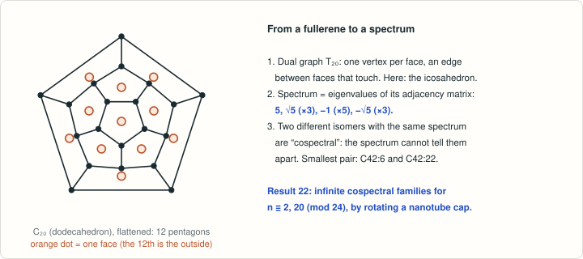

# Cospectral fullerene duals: Conjecture 1 of Bille–Buchstaber–Spodarev

<!-- plain-words:start -->
**The question.** Does the spectrum of a fullerene’s dual graph identify the isomer? Bille, Buchstaber and Spodarev conjectured how far it does.

**The answer.** Infinite families of different fullerenes with identical dual spectra are proved for n ≡ 2, 20 (mod 24); several conjectures are checked up to n = 138; one claim is false in its literal form.

**How.** Exhaustive exact enumeration, plus a construction that rotates a cap on the thinnest nanotube. Not yet verified.

<p align="center"></p>

<p align="center"><sub>From a fullerene to the spectrum of its dual graph, and what “cospectral” means.</sub></p>

<!-- plain-words:end -->

**Attribution.** Solver: Claude Opus 5.5 (effort xhigh), sub-agent
of the orchestrator. No helper agents. Not yet verified.

**Status (work paused on 24 Oct 2026, 12:31).**
- arXiv Conjecture 1(a) (the dual's spectrum determines the isomer, n ≠ 44): **false — already corrected in print
  by the authors themselves** (journal version, Nov 2020, Table 1); smallest counterexample, separately
  certified here: **C42:6 / C42:22** (n = 42; none for n < 42).
- Published Conjecture 1(b) (T_n-cospectral isomers exist for every n ≥ 60): **partial result** — exact
  exhaustive verification for 60 ≤ n ≤ N and a **proof for the infinite classes n ≡ 2, 20 (mod 24)**
  (cap rotation on the thinnest nanotube; this also proves Fowler's 2005 announcement of infinite families).
- Published Conjecture 1(a) (T_n^6 determined by its spectrum): **false in the literal sense** (C34:2, T^6 = C6 ∪ K1);
  in the restricted sense (within C_n isomers) finite verification n ≤ N.
- Published 1(c), 1(d): **finite verification** n ≤ N (no counterexample).
- Conjecture 3 of arXiv:2410.19322 (J. Chem. Inf. Model. 2025, Open Problem 4: (α,β)-characters determine the dual):
  **false for α = β** (C44:72 / C44:80, signless-Laplacian-cospectral duals) — solved (preliminary), pending a
  check of the JCIM wording (NEEDS.md).

**N = 138**: the exhaustive scan covers every even n with 20 ≤ n ≤ 138 (it was stopped during
n = 140; the authors claim a check up to 150). Resume with
`DUALSPEC_BIN=dualspec16 nice -n 10 python3 scripts/scan_driver.py 140 150 7 16 >> certificates/scan/scan_log.txt`,
then `make_certificates.py` and `verify_pairs.py`.

## Problem

A. Bille, V. Buchstaber, E. Spodarev, *Spectral clustering of combinatorial fullerene isomers based on their
facet graph structure*, J. Math. Chem. 59 (2021) 264–288, doi:10.1007/s10910-020-01193-4; preprint
arXiv:1910.00846v1. T_n = dual graph of a fullerene C_n (a triangulation with n/2 + 2 vertices, twelve of degree 5),
T_n^5, T_n^6 = subgraphs induced by the pentagons / hexagons, spectra = adjacency spectra.

arXiv v1, Section 3, p. 9 (verbatim):
> "Conjecture 1. a) For all feasible n ≠ 44 two Cn–isomers are isomorphic iff they are cospectral with respect
> to Tn. b) For all feasible n ≥ 54 two Cn–isomers are isomorphic iff they are cospectral with respect to Tn6.
> c) For any feasible n at least one of the spectra σ(Tn), σ(Tn5), σ(Tn6) is unique for all Cn–isomers."

Journal version, Section 3, p. 275 (verbatim; the conjecture was changed):
> "(a) For all feasible n the graph Tn6 is uniquely determined by its spectrum. (b) For all feasible n ≥ 60 at
> least two Cn–isomers exist having the same spectrum with respect to Tn. (c) For all feasible n ≥ 54 two
> Cn–isomers are isomorphic iff they are cospectral with respect to Tn6. (d) For any feasible n at least one of
> the spectra σ(Tn), σ(Tn5), σ(Tn6) is unique for all Cn–isomers."

P. W. Fowler (CMS Winter Meeting 2005 abstract) had announced that "many pairs of fullerenes with cospectral duals
have now been found (P. W. Fowler and M. Duncan, to be published)" and "a construction for (infinite) families";
no publication was found, and no pair is given.

## Result (one paragraph)

An exact exhaustive scan of all isomers C_n, 20 ≤ n ≤ N (buckygen; complete trace hashing mod 2^w, which cannot
miss a cospectral pair; every collision settled with integer characteristic polynomials from python-flint and
nauty canonical forms) shows: duals of non-isomorphic isomers are cospectral for the first time at **n = 42**
(C42:6, C42:22), then at n = 44 (the authors' pair C44:37/38), 50, 54, 60 and **at every even n from 60 to N**
(16 classes at n = 100), so the arXiv Conjecture 1(a) is false, as the authors' journal version already
acknowledged. For the journal's Conjecture 1(b) we prove more than the finite check: if the C3v cap I of the
thinnest zigzag nanotube (9 faces, 6 pentagons) is rotated by 60°, the characteristic polynomial of the dual does
not change, whatever the rest of the molecule (Schur-complement lemma plus an exact identity for the cap); with
two of the five caps of that tube this yields non-isomorphic cospectral pairs for every n = 44 + 24j and
n = 50 + 24j. No two isomers with 54 ≤ n ≤ N have cospectral T_n^6 (Conjecture 1(c)), and 1(d) holds for n ≤ N;
the literal reading of 1(a) fails at n = 34 (T^6 = C6 ∪ K1 is cospectral with the subdivided claw). Finally the
duals of C44:72 and C44:80 have the same signless-Laplacian spectrum, which refutes the authors' 2024 conjecture
that the characters tr exp(αA + βD) separate fullerene duals, for every α = β ∈ (0, 1). Full statements, proofs and
caveats: `result.md`.

## How to reproduce

Build the third-party tools in `certificates/sources/` (git-ignored; see PROGRESS.md): buckygen 1.1 from
https://caagt.ugent.be/buckygen/ (`gcc -O3 buckygen.c -o buckygen`), nauty 2.8.8 (from the pynauty 2.8.8.1
sdist: `./configure && make labelg geng`). Then

```bash
gcc -O3 -march=native -DWORD32 -o certificates/sources/build/dualspec32 scripts/dualspec.c
gcc -O3 -march=native -DWORD16 -o certificates/sources/build/dualspec16 scripts/dualspec.c
gcc -O3 -o certificates/sources/build/pcselect scripts/pcselect.c
python3 scripts/scan_driver.py 20 104 31 20                               # exhaustive scan (types A, A6, A5, 2A+D, A+D)
DUALSPEC_BIN=dualspec16 python3 scripts/scan_driver.py 106 122 23 16      # A, A6, A5, A+D
DUALSPEC_BIN=dualspec16 python3 scripts/scan_driver.py 124 150 7 16       # A, A6, A5 (hours)
python3 scripts/make_certificates.py 70                                   # certificate files (Atlas numbers for n <= 70; the stored files were made with 44)
python3 -I scripts/verify_pairs.py --exhaustive-small                      # PASS/FAIL re-check from graph6 codes
python3 scripts/tube_family.py 12                                          # Theorem 2: cap rotation families
python3 -I scripts/describe_pairs.py                                       # headline pairs, fullerene graphs
python3 scripts/t6_ds_all_graphs.py 24 38 certificates/t6_ds_all_graphs_n24-38.json   # literal 1(a)
python3 scripts/scan_exact_small.py certificates/sources/tools/bg/buckygen-1.1/buckygen 20 60  # Table 1 (exact)
```

## Files

| File | Content |
|---|---|
| `result.md` | exact statements, results R1–R6, Theorem 2 with proof, method, assumptions |
| `references.md` | sources, what was read, novelty check |
| `NEEDS.md` | documents that could not be obtained |
| `scripts/dualspec.c` | complete spectral hashing of all isomers (traces mod 2^w) |
| `scripts/pcselect.c` | extracts graphs by index from a planar-code stream |
| `scripts/scan_driver.py` | per-n pipeline: buckygen → hash → exact settlement → `certificates/scan/nNNN.json` |
| `scripts/scan_exact_small.py` | purely exact (no hashing) scan for small n; reproduces Table 1 |
| `scripts/make_certificates.py` | collects classes, spirals, Atlas numbers, counts table |
| `scripts/verify_pairs.py` | separate PASS/FAIL re-check of every claimed pair from its graph6 code |
| `scripts/tube_family.py` | Theorem 2: construction, exact cap identity, symmetry prediction vs nauty |
| `scripts/find_caps.py` | caps of the 6-row zigzag tube in all fullerenes up to C52/C64 |
| `scripts/classify_pairs.py`, `scripts/classify_pairs_general.py`, `scripts/search_rotation_caps.py` | which pairs are cap rotations; search for other rotation caps |
| `scripts/describe_pairs.py` | headline pairs: spirals, duals and fullerene graphs, polynomials |
| `scripts/t6_ds_all_graphs.py` | literal Conjecture 1(a): T^6 versus all graphs (geng) |
| `scripts/planarcode.py`, `scripts/spiral.py` | planar code / graph6 I/O; face spirals and Atlas numbering |
| `certificates/counts_per_n.csv` | per n: isomers (= OEIS A007894), numbers of cospectral classes for A(T), A(T6), A+D, 2A+D, T5 |
| `certificates/cospectral_pairs_T.json` | every A(T)-cospectral class, 890 classes for n ≤ 138 (graph6, canonical spirals, Atlas numbers for n ≤ 44, polynomial) |
| `certificates/cospectral_pairs_signless_laplacian.json`, `certificates/cospectral_pairs_2A_plus_D.json` | same for A+D and 2A+D |
| `certificates/T6_cospectral_classes.json` | T^6-cospectral classes (n = 32, 36, 40, 52) |
| `certificates/headline_pairs.json` | C42 pair, C44 pair, C44 A+D pair: duals, fullerene graphs, polynomials |
| `certificates/tube_family_members.json` | members of the Theorem 2 families, k ≤ 12 |
| `certificates/caps_6row_tube_n52.json` | caps of the 6-row tube |
| `certificates/t6_ds_all_graphs_n24-38.json` | T^6 graphs with cospectral mates among all graphs |
| `certificates/scan/` | per-n scan records and `scan_log.txt` |
| `certificates/verify_pairs_log.txt` | output of `verify_pairs.py` on the final data (ALL PASS, 150 s; V8 `--exhaustive-small` not re-run at the end, it passed in development via `scan_exact_small.py`) |
| `certificates/table1_exact_n20-60.json` | exact recomputation of Table 1 (rows T, T5, T6) of the source |
| `scripts/scan_fullerene_graphs.py`, `certificates/fullerene_graph_scan.json` | side check: no two fullerene graphs C_n themselves are cospectral, n ≤ 100 |
| `scripts/counts_table_md.py` | prints the counts table in markdown |
