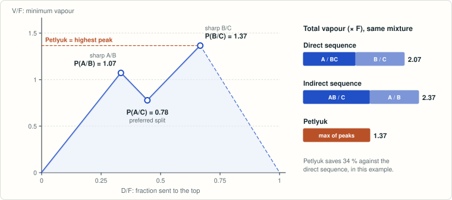
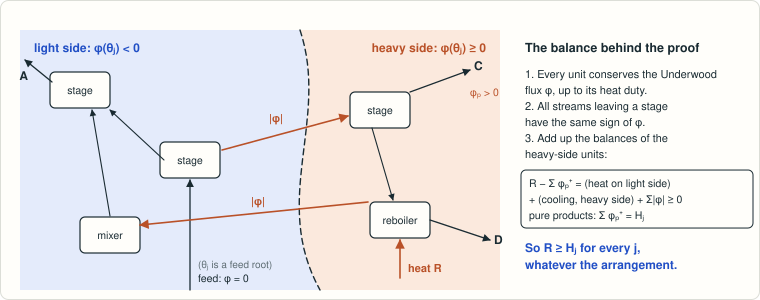

# Halvorsen–Skogestad conjecture: the generalized Petlyuk arrangement minimizes total vaporization

<!-- plain-words:start -->
**The question.** Distillation separates a mixture by boiling it, and the energy bill is the vapour produced. With N components, columns can be arranged in thousands of ways. In 2003 Halvorsen and Skogestad conjectured that the fully thermally coupled “Petlyuk” arrangement always needs the least vapour, namely the highest peak of their minimum-vapour diagram.

**The answer.** True, for every number of components, in the ideal model (constant relative volatilities and molar flows, no heat exchange between process streams).

**How.** An invariant attached to every stream (the Underwood flux) has the same sign on everything leaving a stage. Adding up the heat balances of all “heavy-side” units shows that any arrangement needs at least each peak. A forced Petlyuk design with enough stages then gets within any margin of the highest peak.

**Overlaps.** Implies the weak form of [result 26](../kaibel-petlyuk-energy-gap/) (the Kaibel column needs at least as much vapour).

<p align="center"></p>

<p align="center"><sub>Minimum vapour for an equimolar A/B/C feed (volatilities 4 : 2 : 1). A conventional sequence pays one peak per column; the Petlyuk pays only the highest one.</sub></p>

<p align="center"></p>

<p align="center"><sub>The proof of the lower bound: the sign of the Underwood flux splits any network into a light and a heavy side; the heat balance of the heavy side gives R ≥ H<sub>j</sub>.</sub></p>

<!-- plain-words:end -->

**Attribution.** Orchestration, lower bound, finite-stage attainment, Underwood model, simulation and literature:
Claude Opus 5.5 agents. Isolated-prefractionator theorem: GPT-6-Astra. Verification: Claude Opus 5.5
([DL](attainment/verification-DL/verification.md), [A](attainment/verification-A/verification.md)).

**Status: solved** — conjecture proved for every number of components N in the class 𝒜; verified, with
minor corrections (two verifiers for the attainment proof and its interface with the lower bound: every claim
CONFIRMED or CONFIRMED WITH CORRECTIONS, no gap of substance).
- **Lower bound.** Every steady state of every arrangement of the class 𝒜 with purities ≥ 1 − ε has
  R ≥ H_j − c_j ε for every j; hence R*(𝒮) ≥ max_j H_j for every family 𝒮 ⊆ 𝒜 (separate checks:
  `total/verification-early/verification-lower-bound.md`, and the re-derivation in
  `attainment/verification-A/verification.md`).
- **Attainment.** For every δ, ε > 0 there is n_0 such that, for all section lengths ≥ n_0, the generalized Petlyuk
  arrangement has an operating specification with R = max_j H_j + δ and a steady state with all mole fractions
  positive and all purities ≥ 1 − ε. Hence R*(𝒮_Petlyuk) = max_j H_j (N = 2: `total/sections/sections.md`
  Proposition 10; every N ≥ 3: `attainment/theorem.md`).
- **Conjecture.** No arrangement of 𝒜 needs less total vaporization, in the infinite-stage pure-product limit, than
  the generalized Petlyuk arrangement, whose minimum is exactly HS's value max_j H_j (`attainment/theorem.md`,
  Corollary 2).
- Manuscript: `paper.tex` / `paper.pdf` (complete proofs of the lower bound and of attainment, numerical
  illustration, literature review; verified results only).

## Problem

I. J. Halvorsen, S. Skogestad, *Minimum energy consumption in multicomponent distillation. 3. More than three
products and generalized Petlyuk arrangements*, Ind. Eng. Chem. Res. 42 (2003) 616–629, doi:10.1021/ie0108651.

Verbatim open statements:
- Abstract: "We also conjecture that the minimum energy requirement for the generalized extended Petlyuk arrangement
  is lower than the minimum-energy requirement for any distillation configuration when we consider conventional
  adiabatic sections and no internal heat exchange."
- §6.3 (p. 626): "We assume constant relative volatilities, constant molar flows, constant pressure, and no internal
  heat integration. Then the generalized adiabatic Petlyuk arrangement has the lowest need for vaporization compared
  to any other adiabatic distillation arrangement for separation of an arbitrary feed mixture into its pure
  components. We have not presented a complete proof, so the above conclusion is a conjecture."
- §5.3 (p. 624), on the Petlyuk arrangement itself: "We have not carried out a detailed proof for the general
  N-component M-product case for other than the far left and right peaks."

Setting: ideal N-component feed (constant relative volatilities α₁ > … > α_N, composition z, liquid fraction q),
constant molar overflow, constant pressure, infinitely many stages, sharp separation into pure products; objective =
total vaporization (heat input). With θ_j the roots of Σ α_p z_p/(α_p − θ) = 1 − q, the Petlyuk value is
V_Petlyuk = max_j H_j, H_j = Σ_{p>j} α_p z_p/(θ_j − α_p) (the highest peak of the V_min diagram, referred to the
reboiler).

## Result

### Model: the class 𝒜

`total/foundations/class.md`: every finite network of constant-molar-overflow equilibrium stages, single-phase
splitters and mixers, total condensers and total vaporizers, with one process feed (split, preheated, precooled or
pre-flashed at will), heat duties at any stage, recycles, and products of either phase; R = total heat supplied.
"Infinitely many stages and pure products" is the limit R*(𝒮) = lim_{ε→0} inf{R : steady state with purity ≥ 1 − ε}
over a family 𝒮 of arrangements (all stage numbers of a configuration, or all of 𝒜). Every device of the
arrangements HS consider (columns, thermal couplings, side draws, dividing walls, Kaibel columns, several feed stages,
stream splitters, remixing, bypasses, intermediate exchangers) and Murphree trays decompose into these units
(`total/network/network.md` §1.2); 𝒜 even contains non-adiabatic sections with external utilities.

### Lower bound

**Theorem (stage-level lower bound).** At every steady state of every arrangement of 𝒜, with any numbers of stages
and any purities, and for every j,

  R − Σ_P max(0, φ_P(θ_j)) = (heat supplied to light-side units) + (heat removed from heavy-side units)
                              + Σ_{streams between the two sides} |φ_e(θ_j)| ≥ 0,

where φ_e(θ) = v_e − Σ_i α_i n_{e,i}/(α_i − θ) is the Underwood flux of a stream (v_e vapor flow, n_e component flows)
and a unit is heavy-side if its outflows have φ ≥ 0. With purity ≥ 1 − ε: R ≥ H_j − c_j ε,
c_j = max(α_j/(α_j − θ_j), α_{j+1}/(θ_j − α_{j+1})). Hence every arrangement needs R*(𝒮) ≥ max_j H_j.

*Proof idea.* (1) CMO and component balances give, at every unit, Σ_out φ − Σ_in φ = Q_u (+ feed term, zero at θ_j).
(2) A liquid of composition x has φ = −l G_x(θ) and the vapor in equilibrium with it φ = −(θ v/S(x)) G_x(θ),
G_x(θ) = Σ_i α_i x_i/(α_i − θ): all streams leaving a stage have the same sign of flux (single-phase units trivially).
(3) Summing (1) over the heavy-side units gives the identity. No section physics, no Underwood roots of sections, no
assumption on topology, net-flow signs, distributions or numbers of stages. Complete proofs in `class.md` §5,
`total/sections/sections.md`, `total/network/network.md`; checked by four separate solvers and in exact rational
arithmetic.

**Consequences.** The excess over the bound is three nonnegative "pinch losses" (heating on the light side, cooling on
the heavy side, flux across the hyperplane G_x(θ_j) = 0 through the feed-flash liquid); approaching max_j H_j forces
Underwood's active-root pinches; degenerate points, reverse flows, several feed stages, splitters and recycles need no
separate treatment; the five-component point of the permissive Underwood model below cannot be approached by physical
operation (it has a light-to-heavy sign path C → CDE → BCDE → BCD → D, impossible at a steady state); with heat
exchange between process streams the external heat can drop below max_j H_j only by moving heat from light-side to
heavy-side units, which is why HS exclude it.

### Attainment

**Theorem (finite-stage attainment, every N).** For every δ, ε > 0 there is n_0 such that, for all section lengths
≥ n_0 (equal or not), the generalized Petlyuk arrangement has an operating specification with R = max_j H_j + δ and a
steady state with all mole fractions positive and every product of purity ≥ 1 − ε. With the lower bound this proves
the conjecture (`attainment/theorem.md`, Theorem 1 and Corollary 2; N = 2: `total/sections/sections.md` Prop. 10).

Idea: start from HS's preferred-split point (every column with ≥ 3 components at its preferred split), give every
such column a small slack in the direction that keeps its internal common Underwood roots
(`total/attainment-astra/attainment.md`), let the margin δ enter through the reboiler only, and **force** every binary
column: a small net flow η_p of one key is sent into the adjacent side product. Forcing pins the binary junction
compositions (without it the infinite-stage limit has a free composition front, the neutral mode of
`total/network/network.md` §10.4). In the infinite-stage limit every section is then singly pinched, and the limit
system, in junction compositions and column splits, has an invertible Jacobian: block triangular, with a top-down
block for the major variables (Underwood interpolation and a Cauchy-type matrix per column) and one triangular
M-matrix per trace component (`attainment/limit/limit.md`, Theorem L). The finite-stage equations differ from the
limit system by terms of size ρ^{n+1} in C¹, so a quantitative inverse-function step gives a unique steady state near
the limit for all section lengths ≥ n_0 (`attainment/analysis/analysis.md`); its stage profiles have S(x) > 0
everywhere, and the M-matrix structure of the component balances (`total/network/network.md` Theorem 10.1) makes
every mole fraction positive. Limits: n → ∞, then η → 0, then δ → 0. The design and its limit configuration:
`attainment/design/design.md` (Theorem D).

Numerical evidence (not used in the proofs): 61 of 62 cases pass for N = 3..8 with a separate solver at up to
about 1500 digits (`attainment/computation/REPORT.md`); the failing case lies outside the design's parameter region on
purpose and shows that this region is needed. N = 3, n = 256: impurities of products 1 and 3 of 5.6e-49 and 4.3e-54.

### Underwood's infinite-stage model

In Underwood's infinite-stage model (Tumbalam Gooty et al.'s formulation), for networks of two-section columns with
interval streams (containing Agrawal's regular-column space, 8/152/6128 configurations for N = 3/4/5), without reverse
flows: in the strict model R ≥ max_j H_j for every N; in the permissive model, true for N ≤ 4, for extreme peaks, for
merge-free mixed networks and for the FTC itself, **false for N = 5** (configuration 161, j = 3, R/V_FTC ≈ 0.99946,
interval-certified); the FTC attains max_j H_j (`archive/paper-underwood-model.tex`, Theorem `achieve`). The permissive point is not
physical (lower bound above). Verified, with corrections: `verification.md`.

## Reproduction

From the project root (Git Bash), with `outils/wsl` running WSL Fedora with the scientific Python environment; paths
below are relative to `chemistry-open-problems/problems/halvorsen-skogestad-petlyuk-minimum-vapor/`.

```
# lower bound
outils/wsl "cd chemistry-open-problems/problems/halvorsen-skogestad-petlyuk-minimum-vapor/total/network/scripts && python unit_identities_exact.py && python section_identity_exact.py"   # exact, seconds
outils/wsl "cd chemistry-open-problems/problems/halvorsen-skogestad-petlyuk-minimum-vapor/total/foundations/scripts && python unitnet.py"            # ~30 s, ALL PASS
outils/wsl "cd chemistry-open-problems/problems/halvorsen-skogestad-petlyuk-minimum-vapor/total/sections/scripts && python check_stage_cut.py 25 2"   # minutes
outils/wsl "cd chemistry-open-problems/problems/halvorsen-skogestad-petlyuk-minimum-vapor/total/simulation/scripts && python test_stage_bound.py"   # see header
# attainment
outils/wsl "cd chemistry-open-problems/problems/halvorsen-skogestad-petlyuk-minimum-vapor/attainment/design/scripts && python check_design.py"         # design hypotheses on random data, minutes
outils/wsl "cd chemistry-open-problems/problems/halvorsen-skogestad-petlyuk-minimum-vapor/attainment/limit/scripts && python check_limit_jacobian.py"   # Theorem L checks, ~1 min
outils/wsl "cd chemistry-open-problems/problems/halvorsen-skogestad-petlyuk-minimum-vapor/attainment/computation/scripts && python paper_tables.py"   # finite-stage tables, ~5 min
# Underwood's infinite-stage model
outils/wsl "bash chemistry-open-problems/problems/halvorsen-skogestad-petlyuk-minimum-vapor/theory/scripts/run_theory_checks.sh"          # ~2 min
outils/wsl "bash chemistry-open-problems/problems/halvorsen-skogestad-petlyuk-minimum-vapor/computation/scripts/run_certificates.sh"      # ~40 s
py -3 templates/build_tex.py problems/halvorsen-skogestad-petlyuk-minimum-vapor/paper.tex   # from chemistry-open-problems/
py -3 templates/build_tex.py problems/halvorsen-skogestad-petlyuk-minimum-vapor/archive/paper-underwood-model.tex
```

## Files

| Path | Content |
|---|---|
| `paper.tex`, `paper.pdf`, `references.bib` | The manuscript: proof of the conjecture (lower bound, attainment, numerical illustration) |
| `archive/` | Earlier manuscript of the Underwood-model results (`paper-underwood-model.tex`, `.pdf`, `references-underwood-model.bib`) (strict and permissive models, Theorem `achieve`), as verified. The working notes under `theory/`, `total/` and `attainment/` cite it as "`paper.tex`" (Theorem `achieve`, Proposition `cut`) |
| `novelty.md` | Full literature and novelty review (citing works of HS 2003, closest prior art, statements of the result as already proved) |
| `references.md` | Sources and earlier novelty checks |
| `attainment/` | Finite-stage attainment: `theorem.md` (integrated proof), `FINAL-REPORT.md`; `design/`, `limit/`, `analysis/`, `computation/` (one agent each); verifications `verification-DL/` (design, limit system) and `verification-A/` (analysis, integrated proof) |
| `total/foundations/` | Class 𝒜 (`class.md`), integration of the lower bound (`total-result.md`), checks (`scripts/unitnet.py`, `scripts/petlyuk_attain.py`) |
| `total/sections/` | `sections.md` (proofs, section and junction lemmas, two-component attainment), scripts |
| `total/network/` | `network.md` (unit graph, device decomposition, cut identity, ties, sign potential, permissive sign path, existence for prescribed flows), exact scripts |
| `total/simulation/` | Separate MESH solver, bound tests, attainment study (`runs/`) |
| `total/literature/` | Targeted novelty search of the stage-level argument (`novelty.md`) |
| `total/attainment-astra/` | GPT-6-Astra: isolated-prefractionator attainment theorem (`attainment.md`, `FINAL-REPORT.md`), checks |
| `total/verification-early/` | Early check of the lower bound |
| `theory/`, `computation/`, `general/` | Underwood-model work (theory, certificates, general N) |
| `verification.md`, `verification/` | Verification of the Underwood-model results |
| `certificates/sources/` | Third-party PDFs (not distributed) |
