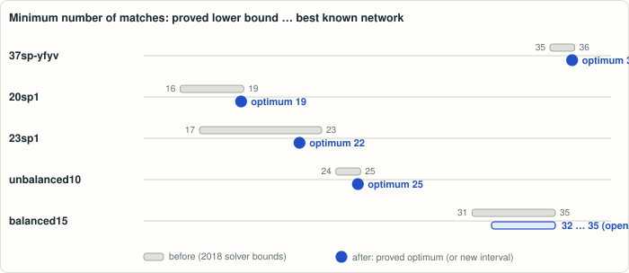

# Minimum number of matches: exact values on the Letsios–Kouyialis–Misener heat-recovery benchmarks

<!-- plain-words:start -->
**The question.** Once utility use is fixed, a heat-recovery network should use as few hot–cold exchanger pairings (“matches”) as possible. This is an NP-hard integer program; in 2018, 25 benchmark instances had no proved optimum.

**The answer.** Four instances closed (37sp-yfyv = 36, 20sp1 = 19, 23sp1 = 22 with a new network, unbalanced10 = 25) and a better lower bound (32) for the balanced15 family.

**How.** Explicit networks checked in exact arithmetic give upper bounds; a combinatorial “block lemma”, or an exact branch-and-bound proof with a VIPR certificate, gives matching lower bounds. Along the way, the VIPR checker turned out to accept invalid certificates; a patch is included.

<p align="center"></p>

<p align="center"><sub>Grey: the gap left by solvers in 2018. Blue: proved optimum, or the new interval.</sub></p>

More detail, with every step explained: [guided reading, result 15](https://basedpolymer.eu/chemistry-open-problems#result-15) · [en français](https://basedpolymer.eu/chemistry-open-problems/fr#d15).

<!-- plain-words:end -->

**Attribution.**
- Solver (exact networks, block lemma and its enumeration, strengthened MILP and its validity proofs, first exact
  SCIP runs; 24 Oct 2026): Claude Opus 5.5 (effort xhigh), sub-agent of the orchestrator.
- Solver (VIPR closure of unbalanced10, hardening patch of VIPR's checker, separate VIPR checker, check of the
  networks against the original 2018 model, manuscript; 25 Oct 2026): Claude Opus 5.5 (effort xhigh), sub-agent of
  the orchestrator.
- No helper agents. Verification: GPT-6-Astra (effort xhigh), 25 October 2026; [report](verification.md).

**Status: solved for four instances — 37sp-yfyv = 36, 20sp1 = 19, 23sp1 = 22, unbalanced10 = 25 —
and partial result (record lower bound) for the balanced15 family; verified on 25 October 2026.**
Of the 25 benchmark instances left without matching bounds in 2018, four are now closed by exact certificates: an
explicit network checked in exact rational arithmetic (upper bound) and either a combinatorial lower bound proved by
exhaustive exact enumeration (37sp-yfyv, 20sp1, 23sp1; the last with a new upper bound, previously 23) or a VIPR
certificate of an exact branch-and-bound proof, accepted by VIPR's checker and by a separately written checker
(unbalanced10). The lower bound of the four balanced15 instances improves from 31 to 32. Manuscript: `paper.pdf`.

## Problem

D. Letsios, G. Kouyialis, R. Misener, *Heuristics with performance guarantees for the minimum number of matches
problem in heat recovery network design*, Comput. Chem. Eng. 113 (2018) 57–85, doi:10.1016/j.compchemeng.2018.03.002,
arXiv:1709.04688. Instances, models and logs: github.com/dimletsios/min_matches_heuristics.

Given hot and cold streams (utilities included, with loads fixed by the minimum-utility-cost step) and their heat in
each shifted temperature interval, find a feasible heat exchange (heat goes only to the same or colder intervals)
using the fewest hot–cold stream pairs ("matches"). This is the NP-hard MILP of the sequential HEN synthesis method
(transshipment model of Papoulias–Grossmann 1983, transportation model of Cerdá–Westerberg 1983).

**Open statement (arXiv v2, Sec. 9.2, p. 30), verbatim:** *"Observe that state-of-the-art approaches cannot, in
general, solve moderately-sized problems with 30-40 streams to global optimality. For example, none of the test cases
in the Grossmann (2017) or large scale test sets is solved to global optimality within the specified time limit."*
The runs used *"absolute gap 0.99, relative gap 4%"* (same section; the repository code sets only the 4 % relative
gap), so instances reported as solved may stop with a one-unit gap; from the repository logs, 37sp-yfyv (36 vs bound
35) and unbalanced10 (25 vs bound 24) are such cases: all six runs of each stopped at the tolerance.

## Results

Previous values: best upper bound / best lower bound over the 6 runs per instance (CPLEX 12.6.3 and Gurobi 6.5.2 on
three formulations) in `data/mip_solutions/` of the repository ("LKM18"), re-derived from the `.sol`/`.log` files
(lower bounds rounded up); FS04 = Furman–Sahinidis 2004, Table 3 (CPLEX 7.0; all four values marked there as "did not
converge"). These lower bounds are floating-point solver output, not certificates.

| instance | previous UB / LB | new UB / LB | status | UB certificate | LB certificate |
|---|---|---|---|---|---|
| 37sp-yfyv | 36 / 35 (LKM18; FS04 36) | **36 / 36** | **optimal = 36**, solved | exact network (36) | Lemma 1, c_max = 2 (exact enumeration) |
| 20sp1 | 19 / 16 (LKM18; FS04 19) | **19 / 19** | **optimal = 19**, solved | exact network (19) | Lemma 1, c_max = 2 |
| 23sp1 | 23 / 17 (LKM18; FS04 23) | **22 / 22** | **optimal = 22**, solved, new UB | exact network (22) | Lemma 1, c_max = 2 |
| unbalanced10 | 25 / 24 (LKM18) | **25 / 25** | **optimal = 25**, solved | exact network (25) | VIPR certificate (0.54 GB), viprchk + separate checker: PASS |
| unbalanced15 | 36 / 35 (LKM18) | 36 / 32 certified | open | exact network (36) | Lemma 1 |
| 22sp1 | 25 / 23 (LKM18; FS04 25) | 25 / 23 certified | open | exact network | Lemma 1, c_max = 1 |
| balanced12 | 28 / 26 | 28 / 26 certified | open | exact network | Lemma 1, c_max = 1 |
| balanced12_random0 / 1 / 2 | 28 / 26, 29 / 27, 28 / 26 | 28 / 26, 29 / 26, 28 / 26 certified | open | exact networks | Lemma 1, c_max = 1 |
| balanced15 | 35 / 31 | **35 / 32** | open, **record LB** (partial result) | exact network | Lemma 1, c_max = 1 |
| balanced15_random0 / 1 / 2 | 35 / 31 each | **35 / 32** each | open, **record LB** (partial result) | exact networks | Lemma 1, c_max = 1 |
| unbalanced17, _random0 / 1 / 2 | 43 / 39, 43 / 39, 43 / 40, 43 / 40 | UB reproduced exactly | open | exact networks | – |
| unbalanced20, _random0 / 1 / 2 | 50 / 45, 51 / 45, 51 / 45, 50 / 45 | UB reproduced exactly | open | exact networks | – |
| large_scale0 / 1 / 2 | 175 / 135, 219 / 123, 239 / 131 | not attempted | open | – | – |

"certified" means: proved by an exact argument here (for balanced12_random1 the certified bound 26 is below the
uncertified solver bound 27). Lemma 1 (block lemma, `result.md` Sec. 2): every connected component of a feasible
match graph is heat-balanced and cascade-feasible, so #matches ≥ (number of streams) − c_max, where c_max, the
largest number of such blocks partitioning the streams, is computed by exhaustive exact enumeration. Every network is
also checked as a feasible point of the original 2018 transshipment MILP with the three big-M files of the 2018
repository (`check_network_lkm18.py`), so the four optima are also the optima of that MILP.

**unbalanced10 ≥ 25 (VIPR).** The strengthened transshipment MILP of `result.md` Sec. 3 (every row proved valid)
with the row Σ y ≤ 24 is infeasible. Certificate: exact SCIP 10.0.2 / SoPlex 8.0.2, no presolving, no cutting
planes, no conflict analysis; 10 233 nodes; 540 587 890 bytes, sha256 `17967e67e607271c…` (kept outside the
repository; regenerated deterministically by `run_vipr_certificate.sh`). `verify_vipr.sh` (7 min 40 s): LP file
regenerated identically; every LP row re-derived from the data; certificate problem = relaxation of the LP model;
patched `viprchk` accepts the raw and the `viprcomp`-completed certificate; a second checker written from the VIPR
specification (`vipr_check_independent.py`, 199 s) accepts it; four corrupted copies are rejected by both checkers
(`vipr_mutation_tests.sh`). Details: `certificates/vipr/unbalanced10_le24_certificate.txt`.

Other instances (25 Oct 2026, not certified, exploration only): with floating-point SCIP 10.0.2 (cuts on, 1800 s
limit) on the strengthened model, unbalanced15 ≤ 35 (final dual bound 33.9), 22sp1 ≤ 24 (21.5) and the balanced12
family (≤ 27, ≤ 28 for _random1; dual bounds 24.7–25.0) were not decided; the cut-free root LP bounds of the strengthened model (28.9 for unbalanced15 vs 36
needed, 18.2 for 22sp1 vs 25, 22.2 for balanced12 vs 28) are far weaker than for unbalanced10 (21.1 vs 25), so the
certified (cut-free) pipeline was not attempted on them.

Side findings:
- **VIPR's reference checker accepts invalid inferences.** `viprchk` (commit 30f2951, and current master 99eec19)
  does not reject a rounding step whose combination has nonzero coefficients on continuous variables, nor an
  unsplit step whose branching disjunction a x ≤ β | a x ≥ β + 1 has fractional β. The two toy certificates in
  `certificates/vipr/viprchk_tests/` "prove" feasible problems infeasible and are accepted by the unpatched checker;
  `certificates/viprchk_harden.patch` adds both checks (plus index range checks that the original does only in debug
  builds). The unbalanced10 certificate does not use either pattern (it is accepted by the unpatched checker too).
- The 36-match network found by floating-point SCIP for 37sp-yfyv is infeasible in exact arithmetic (deficit 0.1),
  and every CPLEX/Gurobi match list in the repository for it needs 37 pairs exactly; an exact 36-match network
  exists (two spanning trees on a 2-block partition, `certificates/solutions/37sp-yfyv.json`).
- SCIP 10.0.2 exact-mode certificates failed VIPR verification when Gomory cuts were used (also root-only) and when
  conflict analysis was on (a conflict row valid only under local bounds was marked as globally derivable); only
  cut-free, conflict-free runs are usable. `viprchk` needed a canonicalisation patch (GMP reads "5/5"
  non-canonically and then compares it wrongly).

## Reproduce

```bash
cd problems/hen-minimum-matches
git clone https://github.com/dimletsios/min_matches_heuristics certificates/sources/min_matches_heuristics
python3 scripts/check_solutions.py      # exact check of all 22 networks (upper bounds), ~2 s, ALL PASS
python3 scripts/check_network_lkm18.py  # the same networks as points of the 2018 MILP (3 big-M files), ~2 s, ALL PASS
bash scripts/run_block_bounds.sh        # Lemma 1 lower bounds (exact enumeration), ~40 s, ALL PASS
python3 scripts/side_findings.py        # 37sp-yfyv floating-point findings, ~17 s, ALL PASS
# unbalanced10 >= 25:
SCIP=.../scip bash scripts/run_vipr_certificate.sh unbalanced10 24 <dir>          # 5-10 min, 0.54 GB
VIPRCOMP=.../viprcomp VIPRCHK=.../viprchk bash scripts/verify_vipr.sh unbalanced10 24 <dir>/unbalanced10_le24.vipr   # ~8 min, ALL PASS
VIPRCHK=.../viprchk bash scripts/vipr_mutation_tests.sh <dir>/unbalanced10_le24.vipr <scratch>        # ~6 min, ALL PASS
```

Build (25 Oct 2026): zlib 1.3.1, SoPlex 8.0.2 (tag v8.0.2, cfadddc; `-DPAPILO=off`), SCIP 10.0.2 (tag v10.0.2,
b8eaf98; `-DEXACTSOLVE=on -DLPS=spx -DPAPILO=off -DZIMPL=off -DIPOPT=off -DREADLINE=off -DAMPL=off`), all with GMP
6.3, MPFR 4.2, Boost 1.90, gcc 16.2; VIPR from github.com/scipopt/vipr at commit 30f2951 with
`git apply certificates/viprchk_canonicalize.patch` and then `git apply certificates/viprchk_harden.patch` in
`code/` (resulting `viprchk.cpp` sha256 `33e74f3d07f887be…`); its CMake build downloads oneTBB 2021.7, which needs
`CMAKE_POLICY_VERSION_MINIMUM=3.5` with CMake 4. Python: gmpy2 makes `vipr_check_independent.py` fast (standard
library fallback).

## Files

- `paper.tex`, `references.bib`, `paper.pdf` — manuscript (all instances closed or bounded here).
- `result.md` — definitions, Lemmas 1–3, validity proofs of every MILP row, certification pipeline, assumptions.
- `scripts/hen_instance.py` (exact parser, consistency checks), `hen_exact.py` (exact max-flow, exact solution
  checker), `block_bound.py` (Lemma 1 enumeration, PASS/FAIL), `check_solutions.py` (PASS/FAIL per network),
  `check_network_lkm18.py` (second, separate network check against the 2018 MILP), `hen_cuts.py`,
  `hen_models.py`, `hen_lpfile.py` (strengthened MILP; exact LP files), `check_lp_model.py` (separate re-derivation
  of every LP row), `check_vipr_model.py` (certificate problem = LP model), `run_vipr_certificate.sh` (exact SCIP run),
  `verify_vipr.sh` (steps 1–5), `vipr_check_independent.py` (second VIPR checker), `vipr_mutation_tests.sh`
  (negative tests), `build_solution.py`, `side_findings.py`, `run_block_bounds.sh`.
- `certificates/solutions/*.json` — exact rational networks; `claimed_upper_bounds.json`.
- `certificates/block_bounds.log`; `certificates/side/` — 37sp-yfyv floating-point side findings and log.
- `certificates/vipr/` — LP model `unbalanced10_le24.lp`, SCIP settings, logs of the certified run
  (`unbalanced10_le24_certified_run.log`, `unbalanced10_le24_verify.log`, `mutation_tests.log`), certificate
  description (`unbalanced10_le24_certificate.txt`), logs of the earlier runs (24 Oct: `unbalanced10_le24_scip.log`,
  same 10 233 nodes; `run1_*` conflict analysis on, VIPR FAIL; `run2_*` root Gomory cuts, VIPR FAIL),
  `viprchk_tests/` (two invalid toy certificates).
- `certificates/viprchk_canonicalize.patch`, `certificates/viprchk_harden.patch` — the patches to VIPR's checker.
- `references.md` (sources, novelty check), `NEEDS.md`.
