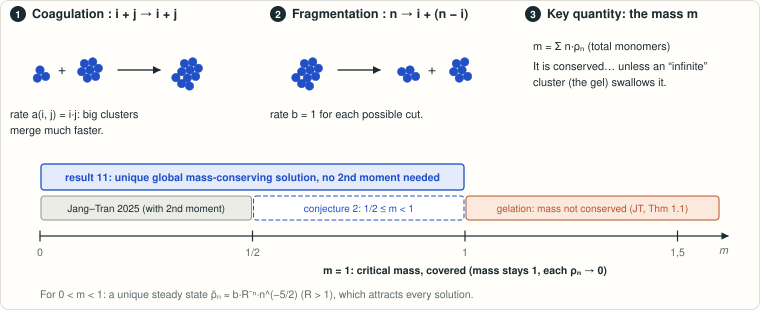

# Jang–Tran Conjecture 2: discrete critical coagulation–fragmentation (multiplicative coagulation, constant fragmentation)

<!-- plain-words:start -->
**The question.** Clusters merge and break. Total mass is conserved unless it escapes into an infinite cluster (a “gel”). Jang and Tran proved mass conservation for small masses (m < 1/2) and conjectured it up to the critical mass m = 1.

**The answer.** True, and more: for every mass 0 < m ≤ 1 there is exactly one solution, it is classical and conserves mass, without the extra moment assumption. Below m = 1 it converges to a unique steady distribution.

**How.** The generating function of the cluster distribution solves a Hamilton–Jacobi equation. A new invariant keeps its characteristics from crossing, so a global smooth solution exists and no mass can leak.

<p align="center"></p>

<p align="center"><sub>Clusters merge at rate i·j and break at rate 1. Result 11 covers every total mass from 0 to the critical value 1.</sub></p>

More detail, with every step explained: [guided reading, result 11](https://basedpolymer.eu/chemistry-open-problems#result-11) · [en français](https://basedpolymer.eu/chemistry-open-problems/fr#d11).

<!-- plain-words:end -->

**Status: solved: complete proof of both parts, confirmed by a verifier (verdict CONFIRMED WITH
CORRECTIONS, see `verification.md`; the corrections concern the wording of the claims, not the proofs). Not
refereed.**

**Attribution.** Time-dependent problem (part (ii), extended to every mass 0 < m ≤ 1 and to finite-mass data),
part (i) as a corollary of the evolution, integration and final manuscript: Claude Opus 5.5 (effort xhigh)
(`part-ii-opus/`). Novelty audit, singularity analysis of the stationary state (decay theorem), stationary-identity and
Arb scripts, first manuscript draft, and three refinements adopted in the evolution proof (x-variable form of the
boundary estimate, upper curvature bound, discrete Scheffé argument): GPT-6-Astra (effort xhigh).
Verification: Claude Opus 5.5 (effort xhigh) (`verification.md`, `verification/`).

## Problem

J. Jang and H. V. Tran, *Discrete coagulation-fragmentation equations with multiplicative coagulation kernel and
constant fragmentation kernel*, Adv. Contin. Discrete Models **2025**, paper 86, doi:10.1186/s13662-025-03946-4,
arXiv:2409.17974. System (1.1) for cluster densities ρ(n,t), n ∈ ℕ, with kernels (1.2) a(i,j) = ij, b(i,j) = 1:

ρ̇ₙ = ½ Σ_{i<n} i(n−i) ρᵢ ρ_{n−i} − n ρₙ Σⱼ j ρⱼ − (n−1)/2 · ρₙ + Σ_{j>n} ρⱼ,

assumption (1.3): Σ n² ρ₀(n) < ∞. Conjecture 2 (arXiv v1, printed p. 7, end of Section 1.4), notation typeset
equivalently:

> "Conjecture 2. Consider (1.1) with kernels (1.2) and initial data satisfying (1.3).
> (i) For 1/2 < m < 1, (1.1) admits a unique stationary solution ρ̃ : ℕ → [0,∞) such that m₁(ρ̃) = m. Further,
> ρ̃ satisfies the recursive formula (1.9).
> (ii) For 1/2 ≤ m₁(ρ₀) < 1, (1.1) admits a unique mass-conserving solution ρ for all time. This solution ρ is in
> fact a classical solution."

The published version (Adv. Contin. Discrete Models 2025, article 86) states the same Conjecture 2, slightly
reworded, at the end of its Section 1.4. Jang and Tran's Conjecture 1 (Section 1.2), for data satisfying (1.3), reads:
"The critical mass of the initial data should be m = m₁(ρ₀) = 1. For m > 1, there is gelation. For 0 < m ≤ 1, (1.1)
has a unique mass-conserving solution for all time."

Jang and Tran had proved part (ii) for m < 1/2 (under (1.3)) and the stationary statement for m ≤ 1/2. T.-S. Van,
arXiv:2607.02293 (July 2026, preprint), extended existence to the whole window for the continuous-size analogue and
wrote (Section 1.2, p. 4): "so the discrete analogue of the window 1/2 ≤ m ≤ 1 remains open as of this writing." The
novelty audit (`references.md`) found no earlier solution; the verifier repeated it on 20 October 2026 with the same
outcome.

## Result

* **Theorem 1 (part (ii), extended; Theorem 4 in `paper.pdf`).** For every nonnegative initial datum with finite mass m ∈ (0,1] (no second
  moment assumed) there is exactly one mass-conserving solution; it is classical (every component is C^∞ in time,
  ρ ∈ C([0,∞); ℓ¹₁) ∩ C¹([0,∞); ℓ¹), the weak form holds for all bounded test functions). With Jang–Tran's
  Theorem 1.1 (no global mass-conserving solution for m > 1) this settles their Conjecture 1 (critical mass m = 1)
  in the discrete setting, "gelation for m > 1" being understood as in their Theorem 1.1: no solution conserves
  mass for all time (this also follows from the explicit number of clusters, which would vanish in finite time).
  The existence of global weak solutions that lose mass when m > 1 is not addressed.
* **Theorem 2 (part (i); Theorem 5 in `paper.pdf`).** For every m ∈ (0,1) the recursion (1.9) gives strictly positive numbers with
  Σ ρ̃ₙ = m(1−m) and Σ n ρ̃ₙ = m; this is the unique stationary solution of mass m, and every mass-conserving
  solution of mass m converges to it in ℓ¹₁. For m = 1 the components tend to 0 while the mass stays 1.
* **Theorem 3 (Theorem 6 in `paper.pdf`).** ρ̃ₙ = b/(2√π) · R^{−n} n^{−5/2} (1 + O(1/n)) with R = R(m) > 1 and
  b² = ((R−1)²(m+½) + 3R/2)/(R²−1).

**Key ideas.** The zeroth-order coefficient of Jang–Tran's Hamilton–Jacobi equation (1.7) is
1/2 + 1/(eˣ−1) = 1/τ(x) with τ(x) = 2 tanh(x/2), so (1.7) is Tran–Van's continuous equation with x replaced by τ in
the term F/x. The discrete half-slope invariant W = τ(m + F_x) − 2F ≥ 0 holds for every nonnegative sequence of mass
m (identity τ j(1+zʲ) − 2(1−zʲ) = 2(1−z)/(1+z) Σ_{i<j} (1−zⁱ)(1−z^{j−i})) and propagates along characteristics
with a nonnegative source; it gives the curvature barrier τF_xx > −1 for all m ≤ 1 (Jang–Tran's barrier needed
m < 1/2). Characteristics exit through x = 0 and never cross, so the Hamilton–Jacobi equation has a global
classical solution, with slope m at x = 0 (an ODE inequality along characteristics). Finite truncations of the
system are positive and conserve mass; their transforms are supersolutions; transport comparison puts them above
the characteristic solution, which excludes any mass loss in the limit. No viscosity-solution theory is used. With
constant mass the system is lower triangular: uniqueness, convergence to the recursion (1.9) as t → ∞ (hence
positivity), and, with the uniform boundary slope, the mass identity, i.e. part (i).

**Verification** (`verification.md`). The verifier re-derived every step from the source (transform
equation and 1/τ, the half-slope identity and its propagation, the invariant region, the curvature barrier and
J > 0, coverage by characteristics, comparison, both parts of the boundary-slope lemma, the truncation identity,
compactness/tightness/limit equation, the closed triangular system, relaxation and the stationary mass identity, and
the singularity analysis), re-ran every script, and added separate numerical checks in `verification/`. No
mathematical gap was found. Corrections concern the statement of the Conjecture 1 consequence (meaning of
"gelation" for m > 1), a citation, and documentation.

## Reproduce

From this folder, in the WSL scientific environment (`outils/wsl "<command>"` from the project root):

```bash
python scripts/check_evolution_identities.py   # exact sympy checks of all evolution identities, ~10 s
python scripts/check_identities.py             # exact stationary identities (writes certificates/algebra.json), ~5 s
python scripts/check_coefficients_arb.py       # Arb enclosures, 256 coefficients at 6 masses (finite check), ~5 s
python scripts/numerics_evolution.py           # floating-point evidence only (not part of the proof), ~4-6 min
python scripts/novelty_audit.py                # re-runs the read-only novelty queries (network access)
python verification/verifier_stationary.py     # verifier: exact/Arb recursion, separate R(m), Theorem 3 constant, ~20 s
python verification/verifier_dynamics.py       # verifier: RK4/Radau checks, infinite-second-moment data, m = 0.9 and 1, ~7 min
```

Status of the runs (verification, 20 October 2026): all exact scripts print PASS (certificates regenerated
byte-identical). `numerics_evolution.py` now completes with **59 PASS, 0 FAIL in about 4 minutes**
(`certificates/numerics_evolution.log`): checks N1–N6, including the long-time truncation check (m = 0.6, T = 30),
the m = 1 checks and the heavy-tail comparison. In the solvers' session and in a first verifier rerun, the original
script stalled at the long-time check, where LSODA switches to its stiff mode and spends over half an hour on dense
1600 × 1600 Jacobians (52 PASS before it was stopped; `certificates/numerics_evolution_partial.log`,
`verification/numerics_evolution_lsoda_stopped.log`); the verifier switched that single integration to the explicit
DOP853 method (30 s, same check). Both verifier scripts print ALL PASS (`verification/*.log`). None of the numerics
is used in the proofs.

Build the manuscript from `chemistry-open-problems/`:
`py -3 templates/build_tex.py problems/jang-tran-discrete-coagulation-fragmentation/paper.tex`.

## Files

| File | Content |
|---|---|
| `paper.tex`, `paper.pdf`, `references.bib` | manuscript (11 pages): statements, complete proofs, limitations; Theorems 4–6 of the PDF are Theorems 1–3 above |
| `part-ii-opus/part-ii.md` | self-contained Markdown version of the time-dependent proof (and part (i)) |
| `part-ii-opus/PROGRESS.md`, `PROGRESS.md` | logs of the two agents |
| `part-ii-opus/scripts/` | working copies of the evolution scripts (the top-level `scripts/` versions are canonical) |
| `scripts/check_evolution_identities.py` | exact checks (sympy) for Sections 1–3 of the paper |
| `scripts/check_identities.py`, `scripts/check_coefficients_arb.py` | exact stationary identities; Arb coefficient enclosures |
| `scripts/numerics_evolution.py` | numerical evidence: characteristics, truncations, comparison, long time, m = 1 |
| `scripts/explore_recursion.py`, `scripts/novelty_audit.py` | exploratory rational coefficients; novelty queries |
| `certificates/algebra.json`, `certificates/coefficients-arb.json` | outputs of the exact/Arb scripts |
| `certificates/numerics_evolution.log` | complete output of `numerics_evolution.py` (59 PASS, 0 FAIL) |
| `certificates/numerics_evolution_partial.log` | output of the solvers' stopped run of the earlier version (52 PASS, 0 FAIL) |
| `certificates/sources/` | third-party PDFs and API responses (git-ignored) |
| `references.md` | sources, what was read, novelty audit (and the verifier's re-check) |
| `verification.md` | verification report: verdict, re-derivations, re-runs, corrections, caveats |
| `verification/` | the verifier's own scripts and logs |
| `FINAL-REPORT.md` | final report (French) |
| `BRIEF-codex.md`, `part-ii-opus/BRIEF.md` | the agents' briefs |
