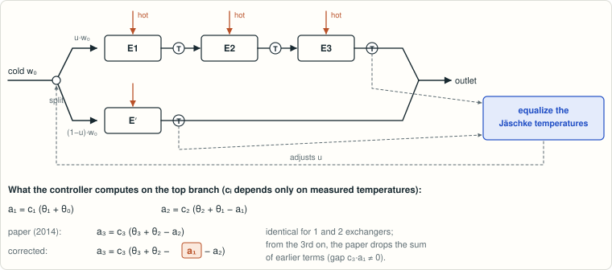

# Jäschke–Skogestad "Jäschke temperature" conjecture (heat exchanger networks with stream splits)

<!-- plain-words:start -->
**The question.** A cold stream is split between parallel branches of heat exchangers. Jäschke and Skogestad (2014) proposed to choose the split from temperature measurements alone, with a formula proved for up to two exchangers per branch and conjectured beyond.

**The answer.** The formula is wrong from the third exchanger on (it forgets a term), and so is a case the paper reports as proved. A corrected formula is proved for any number of exchangers, so the idea of steering with thermometers stands.

**How.** Each exchanger acts as an affine map on temperature; an energy balance and the chain rule give the exact sensitivity in half a page. Exact rational counterexamples show the published version picks a suboptimal split.

<p align="center"></p>

<p align="center"><sub>The controller equalizes temperatures computed by a recursion. The published recursion drops the term a₁ at the third exchanger.</sub></p>

More detail, with every step explained: [guided reading, result 6](https://basedpolymer.eu/chemistry-open-problems#result-6) · [en français](https://basedpolymer.eu/chemistry-open-problems/fr#d6).

<!-- plain-words:end -->

**Attribution.** Solver: Claude Opus 5.5 (effort xhigh), sub-agent of the orchestrator. One read-only nested Claude Opus 5.5 sub-agent (effort xhigh) did the citing-works search; its findings are marked [sub] in references.md. LaTeX edition: Claude Opus 5.5 (effort xhigh). Verification
and corrections: Claude Opus 5.5 (effort xhigh), fresh context, verdict CONFIRMED WITH CORRECTIONS (`verification.md`).

**Status: solved (verified): the published recursion is wrong for every \(M_j \ge 3\), so the conjecture
is FALSE, and so is the \(M_j = 3\) constant-hot-temperature case that the paper reports as proved. A corrected formula
is proved for every \(M_j\).**

## Problem

J. Jäschke, S. Skogestad, *Optimal operation of heat exchanger networks with stream split: Only temperature
measurements are required*, Comput. Chem. Eng. 70 (2014) 35–49, doi:10.1016/j.compchemeng.2014.03.020.

**Setting.**
- A cold feed is split into parallel branches. Branch \(j\) has \(M_j\) heat exchangers in series and heat-capacity
  flow rate \(w_j\).
- The model assumes an arithmetic-mean temperature difference (AMTD), and shifted temperatures \(\theta = T - T_0\).
- Theorem 2 / Theorem 3 assert that the marginal cost of branch \(j\) is \(\partial J/\partial w_j = \sum_i p_{i,j}a_{i,j}\),
  with
  \[ a_{i,j} = \frac{(\theta_{i,j}-\theta_{i-1,j})(\theta_{i,j}+\theta_{i-1,j}-a_{i-1,j})}{\theta_{hi,j}-\theta_{i-1,j}}, \quad a_{0,j}=0 . \]

**The open statement, verbatim (p. 39):**
> "In Appendix A we provide a proof of Theorem 2 for Mj = 1 and Mj = 2. Moreover, we prove the case Mj = 3 for heat
> exchangers with constant hot stream temperatures (this corresponds to very large hot stream heat capacities). For
> Mj ≥ 4 we conjecture that the Theorem is true."

See also A.3–A.4 (p. 47): "we conjecture that it is true for the case with a finite heat capacity", and "we conjecture
the general formula for the case with more than three heat exchangers on a line".

## Result

1. **Corrected theorem, proved for all \(M_j\).** \(\partial Q_{i,j}/\partial w_j = a_{i,j}/2\), with the cumulative
   recursion
   \[ a_{i,j} = c_{i,j}\Big(\theta_{i,j}+\theta_{i-1,j}-\sum_{l<i}a_{l,j}\Big), \qquad c_{i,j} = \frac{\theta_{i,j}-\theta_{i-1,j}}{\theta_{hi,j}-\theta_{i-1,j}} . \]
   Hence \(\partial J/\partial w_j = -\tfrac12\sum_i p_{i,j}a_{i,j}\). The branch total obeys the affine recursion
   \(A_i = (1-c_i)A_{i-1} + c_i(\theta_i+\theta_{i-1})\).
   - The proof takes half a page: each exchanger is an affine map \(\theta_i = (1-c_i)\theta_{i-1}+c_i\theta_{hi}\) with
     \(c_i = 2/(1+w(2/UA_i+1/w_{hi}))\) and \(w\,\partial c_i/\partial w = -c_i(2-c_i)/2\); add the cumulative energy
     balance \(\sum_{l\le i}Q_l = w\theta_i\) and the chain rule.
   - Equal corrected Jäschke temperatures are therefore exactly the optimality condition under AMTD.
   - So the paper's qualitative claim (under AMTD, temperature measurements suffice) holds for every \(M_j\); what is
     false is the specific recursion (18)/(A.15) that the authors conjectured.
2. **The conjecture is false for every \(M_j \ge 3\).** The paper's recursion agrees for \(i \le 2\), but
   \(a^{paper}_3 - a_3 = c_3a_1 \ne 0\).
   - An exact rational counterexample (\(M_1=3\), \(M_2=1\), physical operating point): the paper's controlled
     variable is exactly 0, but the gradient is \(-4972391424/1518467647 \ne 0\), and a nearby split recovers strictly
     more heat.
   - For \(M_1 \ge 4\): the same construction (branch 2's hot inlet tuned so that the paper's controlled variable is
     exactly 0) works for any branch 1 on which the two recursions differ. Explicit exact instances for \(M_1 = 4, 5\)
     are in `verification/v2_exact.py`, and the paper's own Appendix B data are an \(M_1 = 4\) instance (item 3).
   - The case the paper reports as proved (\(M_j = 3\), constant hot temperatures) is also wrong as printed. The raw
     Maple output in the first line of the paper's (A.12) equals the corrected \(a_3\); the hand "simplification" in
     the next line drops \(a_1\).
3. **The paper's own validation case (Appendix B, \(M_1=4\)).**
   - The AMTD optimum is \(u = 0.714119\), which agrees with the paper.
   - The paper's controlled variable vanishes at \(u = 0.716706\) (certified by exact root isolation), where the
     gradient is nonzero: an exact \(M_1 = 4\) counterexample on the paper's own data.
   - So the published recursion by itself produces a split error of 0.0026; the discrepancy that the paper attributed
     to "the flatness of the optimum and numerical round-off errors" cannot be blamed on round-off. The paper's reported
     0.7152 could not be reproduced: the AMTD model at \(u = 0.7152\) does give the reported \(T_{end} = 158.7741\), but
     neither the paper's nor the corrected controlled variable vanishes there, so the origin of that number is unknown.
4. **Side results.**
   - (16) and (19) carry a common normalisation slip \(-\tfrac12\), from a mis-solved (A.5) and a sign dropped in
     (A.6). It does not affect the controlled variables, but taken literally (16) and (19) are false for every
     \(M_j\), including \(M_j = 1, 2\).
   - For general exchanger laws, including LMTD, the exact marginal cost is
     \((1+\varphi_i/\varepsilon_i)\Delta_i + \varepsilon_i(\theta_{i-1}-\sum_{l<i}\partial Q_l/\partial w)\). With LMTD
     it is still a function of temperatures, but it needs the hot outlet temperatures.

Practical impact: losses are small because the optimum is flat (0.066 % in our counterexample). But the split error is
first-order: about 5 % of \(w_0\) in the counterexample, and 0.0026 in Appendix B. The fix costs nothing.

Novelty: see `references.md` (literature check of citing works).

## Reproduce

These run from Git Bash at the project root. Scripts are deterministic, print PASS/FAIL per claim, and exit non-zero on
failure.

```
outils/wsl "cd chemistry-open-problems/problems/jaschke-skogestad-temperature-conjecture/scripts && \
  python -I verify_symbolic.py && python -I counterexample_exact.py ../certificates/counterexample.json && \
  python -I reproduce_appendixB.py && python -I random_fd_tests.py"
```

Note: `counterexample_exact.py` builds the counterexample from its hard-coded parameters, checks it, and (re)writes
the JSON file given as argument (deterministically, so the content does not change). The JSON is checked from its raw
parameters alone by the verifier's script below.

Verifier's scripts (no code shared with `scripts/`; about 6 minutes in total, mostly `v1_symbolic.py`):

```
outils/wsl "cd chemistry-open-problems/problems/jaschke-skogestad-temperature-conjecture/verification && \
  python -I v1_symbolic.py && python -I v2_exact.py ../certificates/counterexample.json && \
  python -I v3_paper_formulas.py && python -I v4_appendixB.py"
```

## Files

| File | Content |
|---|---|
| `paper.tex`, `paper.pdf` | Manuscript: statement (verbatim), model, Theorem A / Corollary B / Proposition C, full proofs, counterexample, Appendix B analysis, verification summary, limitations |
| `scripts/verify_symbolic.py` | python-flint exact rational-function check of the raw AMTD model with generic symbols: finite hot capacities for M = 1..5, constant hot temperatures for M = 1..8, plus the exchanger-equivalence lemma L1 covering finite capacities up to M = 8, and the paper's (A.12). About 65 s |
| `scripts/counterexample_exact.py` | Exact rational counterexample (Fractions + exact dual numbers, standard library only) |
| `scripts/reproduce_appendixB.py` | The paper's M1 = 4 validation case with exact root isolation (sympy) |
| `scripts/random_fd_tests.py` | 60-digit finite-difference tests, M = 1..8, prices, plus the LMTD Proposition C (numerical evidence only) |
| `certificates/` | `counterexample.json` (exact data) and the logs of all runs |
| `verification.md` | Verification report (verdict, what was recomputed, corrections made) |
| `verification/` | Verifier's own scripts `v1`–`v4` with their logs, and logs of the re-run of `scripts/` |
| `references.md`, `references.bib` | Sources and literature/novelty check; bibliography of the manuscript |
| `PROGRESS.md` | Work log |
