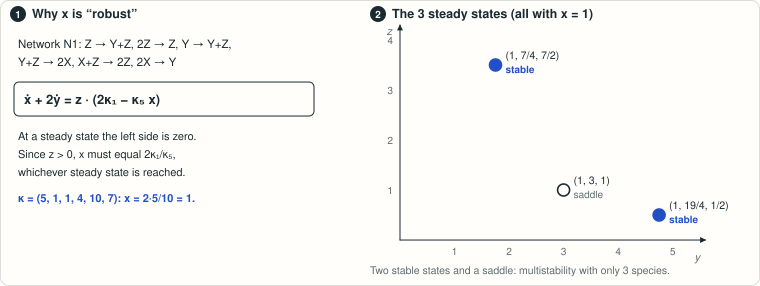

# The exact minimum is five reactant complexes

<!-- plain-words:start -->
**The question.** Result 27 left a gap: how few distinct reactant complexes can a bimolecular network have if it combines absolute concentration robustness with two stable steady states in one class? The answer could be 4, 5 or 6.

**The answer.** Exactly five. Four reactant complexes never suffice, and an explicit 4-species, 6-reaction network achieves five.

**How.** With four reactant complexes the steady states form an explicit toric set, so robustness becomes linear algebra. An exhaustive exact enumeration leaves 19 normal forms, and in each one two steady states have Jacobian determinants of opposite signs.

**Overlaps.** Extends [result 27](../), whose dimension-two theorem it uses. Both are merged in [one manuscript](../paper.pdf).

<p align="center"></p>

<p align="center"><sub>The setting of results 27 and 29: one concentration is fixed at every steady state, yet two stable states coexist.</sub></p>

<!-- plain-words:end -->

**Status: solved; lower and upper bounds confirmed with corrections by a fresh-context verifier
([verification.md](verification.md)).** This folder's `paper.pdf` is the text that verifier checked; it is now merged
with result 27 in [../paper.pdf](../paper.pdf), which awaits its own verification.

**Attribution.** New lower bound, five-source construction, certificates and manuscript: GPT-6-Astra (effort xhigh), 31 October 2026.
Verifier: Claude Opus 5.5 (effort not recorded), 31 October 2026.
The previous dimension-two theorem, source structures and six-reactant upper example are due to the
earlier Claude Opus 5.5 work in [the parent folder](../README.md).

## Precise question

What is the exact minimum number of distinct reactant complexes of an at-most-bimolecular mass-action
network having absolute concentration robustness (ACR) and two exponentially stable positive equilibria
in the same stoichiometric compatibility class, allowing any numbers of species and reactions?

This was left unresolved in [the earlier report, Section 4](../examples/report.md): three source structures
(S3, S7, S9) were excluded numerically only. It is a follow-up to the minimum-size problem in
Kaihnsa, Nguyen and Shiu, *European Journal of Applied Mathematics* 35 (2024), 566–600,
[DOI 10.1017/S0956792523000335](https://doi.org/10.1017/S0956792523000335), Section 6.
The source's exact open-direction sentence is quoted in [the manuscript](paper.pdf).
The exact-minimum question is our refinement of that direction, not a verbatim conjecture in the source.

## Result

**Exactly five.** In stoichiometric dimension three, four-reactant bimolecular systems with ACR have at most two
nondegenerate positive steady states per class. If there are two, their restricted Jacobian determinants
have opposite signs, so at most one is exponentially stable.

Combining this theorem with the earlier dimension-two obstruction gives **at least five reactant complexes**.
The following four-species, six-reaction network attains this bound:

```text
0   -> C       rate 64
A+B -> 2B      rate 3
A+C -> B+C     rate 5
B+C -> A       rate 64
0   -> R       rate 1
R   -> 0       rate 1
```

The five reactant complexes are `0, A+B, A+C, B+C, R`. Every positive equilibrium has `r=1`,
across all compatibility classes. In the class `a+b=9` its complete equilibrium list is:

| (a,b,c,r) | Stability relative to the class |
|---|---|
| (4,5,1/5,1) | Exponentially stable |
| (6,3,1/3,1) | Saddle |
| (8,1,1,1) | Exponentially stable |

All assertions are certified exactly. A variant coupling the regulator to the C equation retains
the same five sources, equilibria and stability. Thus the previous alternatives 4, 5 or 6 are closed.

The proof covers all positive rate constants, including exceptional parameter values, and any number of
outgoing reactions. Both reactants **and products** must have molecularity at most two. The zero complex
counts as a reactant complex, as it does in the source (Example 4.13 there).

## Proof and exact computation

1. Four sources and a nondegenerate rank-three equilibrium force a toric positive equilibrium set.
   ACR becomes an exact linear-algebra condition on the source exponents.
2. Exhaustive integer enumeration gives 26 four-species source types, eight five-species types, one
   six-species type, and none with seven or eight species. Inert species can be removed.
3. Five source types need a stoichiometric check: **40,385 possible rank-three reaction spans** are generated
   from scratch. Exact cone, injectivity and rank tests leave 140 spans, equivalent to **19 normal forms**.
4. Each normal form reduces to a quadratic, a linear equation, or a strictly log-concave scalar equation
   on a connected positive interval. Exact determinant identities prove that two equilibria cannot both be stable.

The proof and all normal forms are in [paper.pdf](paper.pdf) and [paper.tex](paper.tex).
The earlier floating-point lists are not inputs to the certificates.

## Reproduce

Python 3.12+, NumPy, SymPy 1.14; run from this directory:

```bash
python scripts/certify_sources.py
python scripts/certify_subspaces.py
python scripts/certify_normal_forms.py
python scripts/certify_five_example.py
# Or run all four with retained logs and source hashes:
python scripts/run_all.py
```

Expected total runtime: under one minute. Every certificate prints PASS/FAIL and exits nonzero on failure.
Outputs are `certificates/sources.json`, `subspaces.json`, `normal-forms.json` and `five-example.json`.
The runner also writes logs and `certificates/execution.json`.
The public API novelty audit is separate: `python scripts/novelty_audit.py`.
The verifier's reimplementation runs with `python verification/run_verification.py`.

Build from the repository root:

```bash
python templates/build_tex.py problems/kaihnsa-acr-multistability/four-reactants/paper.tex
```

## Limits and verification

The rank-three theorem is proved here without using the old dimension-two theorem. The global lower bound
five uses that earlier theorem as a cited result. Five is attained by the exact example above. There is
no claim about larger products and no human review of this follow-up. The verifier's report, with every
correction, is [verification.md](verification.md); its code and logs are in [verification/](verification/). The
author's own self-checks are kept in [self-check.md](self-check.md).

`explore.py`, `classify.py`, `hard_S*.json`, `search_five.py`, `search_module.py` and
`five-candidate.json` are exploratory files; none is an input to the proof certificates.
