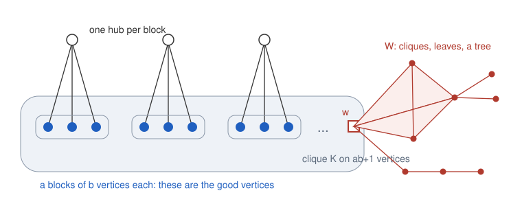

# β-Kirchhoff Šoltés graphs for every β < 1

<!-- plain-words:start -->
**The question.** Remove a vertex from a graph: can the Kirchhoff index (the sum of all electrical resistances between pairs of vertices) stay the same? Call such a vertex “good”. Gottwald, Majstorović Ergotić and Došlić asked for infinite families in which at least a fraction β of the vertices are good. Known families stopped at 2/3.

**The answer.** Every rational fraction below 1 is reached, and reached exactly, by infinitely many graphs. This also answers the authors' two related questions about which fractions can occur. β = 1 is a separate problem and stays open.

**How.** Take a large clique, attach one extra vertex to each of many small groups of clique vertices, and glue a small graph at one more clique vertex. The formulas for this family are explicit, so the small graph can be chosen to make the equation exact. First concrete graphs: 1772 vertices, more than 2/3 good; 2277 vertices, exactly 2/3 good.

<p align="center"></p>

<p align="center"><sub>The blue block vertices are exactly the good vertices. The red part W is chosen to make the goodness equation exact.</sub></p>

<!-- plain-words:end -->

**Attribution.** Solver: Claude Opus 5.5 (effort not recorded). Verification: pending.

**Status: solved (preliminary).** Complete proof with exact certificates, not yet checked by a separate verifier. This folder
completes [result 23](../): Problem 4 of the source for every rational β < 1. It also settles Problems 5 and 17 of the source. The manuscript is [paper.pdf](paper.pdf).

## Problem

K. K. Gottwald, S. Majstorović Ergotić, T. Došlić, *Šoltés problem for the Kirchhoff index of a graph*, Appl. Math.
Comput. 510 (2026) 129694, [doi:10.1016/j.amc.2025.129694](https://doi.org/10.1016/j.amc.2025.129694),
[arXiv:2609.13751](https://arxiv.org/abs/2609.13751). With K(G) = {v : Kf(G) = Kf(G − v)}, a graph is β-Kirchhoff Šoltés if
|K(G)| ≥ β|V(G)| (journal pp. 3 and 11):

> "**Problem 4.** For a fixed rational number β ∈ (0, 1] construct an infinite series of β-Kirchhoff Šoltés graphs."
>
> "**Problem 5.** Given a fixed γ ∈ (0, 1], construct an infinite series of graphs where the proportion of good vertices
> increases and asymptotically approaches γ as the order of the graph grows."
>
> "**Problem 17.** Which (rational or irrational) numbers γ ∈ (0, 1] appear either as exact or as limiting values of proportions
> of good vertices with respect to the Kirchhoff Šoltés problem for simple undirected graphs?"

The source's best limiting proportion is 2/3. The earlier stage of result 23 found no graph other than C₅ with proportion ≥ 2/3
up to 10 vertices, and proved that splices of bounded branches stop at 2/3 (branches with at most 9 vertices).

Novelty check of 31 October 2026, details in [references.md](references.md): no citing work, and nothing on arXiv, Zenodo or the
AI campaigns of ipitchford and mmislan. Zenodo was listed in full for Soltes and Šoltés; the Semantic Scholar keyword search was rate-limited.

## Result

**Theorem 1.** For every rational β ∈ (0, 1) there are connected graphs G of arbitrarily large order with |K(G)| = β|V(G)|.

**Corollary 2.**
- Problem 4 holds for every rational β < 1.
- Problem 5 holds for every real γ ∈ (0, 1]: strictly increasing proportions tending to γ.
- Problem 17: the exact proportions are exactly the rationals in (0, 1], and every real in (0, 1] is a limiting proportion.

**The graphs.** H_{a,b}: a clique on ab + 1 vertices, split into a blocks of size b and one further vertex w, with one extra
vertex (hub) adjacent to the b vertices of each block. G = H_{a,b} ⊕ W, where the rooted graph W is glued at w.

**The proof in five lines.**
1. Hubs can be eliminated: the class is closed under deletion, and Kf depends only on N, the number of hubs, the number of
   blocks and Σ1/bᵢ (Lemmas 4, 5). The equation Kf(G) = Kf(G − v) for a block vertex v reads Rt_W(w) = mρ − δ, with m = |V(W)| − 1.
2. δ and ρ are explicit, with δ ≈ −2a/(b(b − 1)) and ρ ≈ 1/(b(b − 1)). Their denominators divide b³(b − 1)·a·(ab + 1)(ab + 2) (Lemma 6).
3. Take ab = x(x² − 3x + 1). Then ab + 1 = (x − 1)(x² − 2x − 1) and ab + 2 = (x − 2)(x² − x − 1), so for x a multiple of b(b − 1) the denominators split into pairwise coprime numbers of
   size O(x²), much smaller than |δ| ≈ x³ (Lemma 9).
4. A clique K_{2q} with j pendant leaves adds any residue j/q to the transmission. Cliques K_{2b(b−1)} only add vertices. A tree then fixes the
   integer part. So W exists with exactly the required order and transmission (Lemma 8, Section 4).
5. Hubs and the vertices of W have Δ > 0, so K(G) is exactly the set of block vertices, and |K(G)|/|V(G)| = p/r by the choice of m.

**Explicit graphs.** Direct means Kf(G) and Kf(G − v) computed exactly from the actual Laplacian, without any formula of the paper.

| | a, b | gadgets (c, j) at w | tree (l, t) | n | proportion | direct check |
|---|---|---|---|---|---|---|
| E1 | 396, 3 | (5,2) (7,6) (11,7) (17,8) (29,18) (41,10) | (32,94) | 1772 | 297/443 ≈ 0.6704 | one vertex per class |
| E2 | 506, 3 | (4,0) (9,2) (5,3) (49,3) (11,9) (19,10) (23,6) (31,23) | (53,133) | 2277 | exactly 2/3 | one vertex per class |
| E3 | 1116, 4 | (64,30) (27,6) (5,3) (7,6) (11,3) (19,12) (29,4) (31,12) (47,2) | (62,114) | 5952 | exactly 3/4 | block vertex, hub, root |
| E4 | 705, 4 | (4,0) (9,0) (7,2) (13,9) (17,3) (31,25) (47,34) | (15,43) | 3735 | 188/249 ≈ 0.7550 | one vertex per class |

**Not proved or not done.**
- β = 1 (Problem 3 of the source) is not addressed.
- The threshold "s large" in the proof is not made explicit; `check_construction.py` confirms each step on 78 parameter sets.
- The smallest graph with proportion above 2/3 is unknown; nothing was searched systematically above n = 10.
- All graphs have a cut vertex, and a 2-connected family with proportion above 2/3 is not known.

## How to reproduce

From this folder, under Fedora 44 / WSL. Requirements: Python 3.12, sympy 1.14, python-flint 0.6, networkx 3.

```bash
cd scripts
python check_formulas.py                 # Lemmas 3-9: symbolic identities and brute force      (1 min)
python check_construction.py             # the proof, 13 values of beta, 78 parameter sets      (1 min)
python check_examples.py                 # complete K(G) of E1-E4                               (1 min)
python check_direct.py small             # K(G) vertex by vertex, 8 graphs, n = 24 to 400       (3 min)
python check_direct.py family            # graph built by the proof: beta = 1/100, n = 2000     (5 min)
python check_direct.py E1                # n = 1772, one vertex per class                       (8 min)
python check_direct.py E2                # n = 2277, one vertex per class                       (20 min)
python check_direct.py E4                # n = 3735, one vertex per class                       (1.5 h)
python check_direct.py E3quick           # n = 5952, block vertex, hub, root                    (25 min)
cd ../../../..
py -3 templates/build_tex.py problems/kirchhoff-soltes-beta-families/all-beta/paper.tex
```

## Files

- `paper.tex`, `references.bib`, `paper.pdf`: manuscript.
- `references.md`: sources and novelty check.
- `figures/construction.svg`: the figure above.
- `scripts/hubgraph.py`: closed forms, explicit graphs, and the construction of Theorem 1 (exact arithmetic).
- `scripts/check_*.py`: PASS/FAIL certificates, exit code 1 on failure.
- `scripts/novelty_check*.py`: the API queries of the novelty check (not certificates).
- `scripts/exploration/`: the search tools that found E1-E4 (not certificates).
- `certificates/*.log`: outputs of the scripts. `certificates/exploration/`: logs of the searches.
- The certificates also use `../scripts/kfexact.py` (exact Kirchhoff index, earlier stage).
