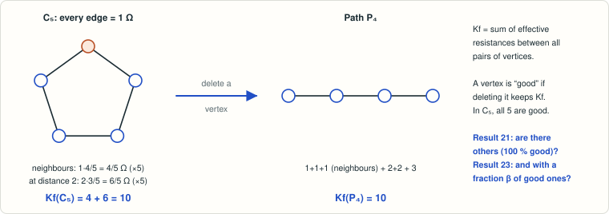

# Kirchhoff Šoltés problem: graphs whose Kirchhoff index survives the removal of any vertex

<!-- plain-words:start -->
**The question.** Find all graphs whose Kirchhoff index (the sum of electrical resistances between all pairs of vertices) does not change when any single vertex is deleted. Only the 5-cycle is known.

**The answer.** Still only C₅: several classes of graphs are excluded and the exhaustive searches are extended (all graphs up to 11 vertices, vertex-transitive graphs up to 39).

**How.** A lemma on chains of degree-2 vertices, spectral bounds and exact searches.

**Overlaps.** Same paper as [result 23](../kirchhoff-soltes-beta-families/) (whose case β = 1 is this problem). Not yet verified.

<p align="center"></p>

<p align="center"><sub>C₅ has Kirchhoff index 10, and so does the path left after deleting any vertex.</sub></p>

<!-- plain-words:end -->

**Attribution.** Solver: Claude Opus 5.5. Verification: pending.

**Status: partial result** (not yet verified). No new Kirchhoff Šoltés graph; C₅ is still the
only known one. Non-existence is proved for several classes, and the exhaustive searches are extended
from 9 to 11 vertices (all graphs) and from 23 to 39 vertices plus odd n ≤ 47 (vertex-transitive graphs).
Work was paused before the census files n = 40, 42, 44, 46 and the regular-graph,
bicirculant and large floating-point scans were run (see result.md §13 for how to resume).

## Problem

K. K. Gottwald, S. Majstorović Ergotić, T. Došlić, *Šoltés problem for the Kirchhoff index of a graph*,
Appl. Math. Comput. 510 (2026) 129694, doi:10.1016/j.amc.2025.129694; arXiv:2609.13751 (12 Sep 2026),
p. 5:

> **Problem 3.** Find all graphs G so that the equality Kf(G) = Kf(G − v) holds for all v ∈ V(G).

and p. 9: "Our numerical studies failed to identify any additional Kirchhoff Šoltés graphs. We
investigated connected graphs with up to 9 vertices. [...] we examined all vertex-transitive graphs with up
to 23 vertices [...]. None of these graphs were Kirchhoff Šoltés." The conclusion (p. 21) adds that "the
existence of other solutions has not been ruled out". Here Kf(G) = Σ_{u<w} r(u,w) (effective resistances)
= n Σ 1/μ_i (non-zero Laplacian eigenvalues). As in the source, a cut vertex is never good, so a
Kirchhoff Šoltés (KS) graph is 2-connected.

Novelty check (24 Oct 2026; details in references.md): no citing work, no later paper, no AI-campaign
repository or Zenodo record answers the problem; the only follow-up (Majstorović Ergotić–Gottwald, Bol. Soc.
Mat. Mex. 2025) treats a relaxed version.

## Result (see result.md for statements and complete proofs)

* **Thread lemma** [proof]: along a path of degree-2 vertices, Kf(G − v_i) is a strictly convex quadratic
  in the position i (leading coefficient n_R − 1 − r_R(x,y) > 0). So a KS graph other than C₅ has no
  three consecutive degree-2 vertices. Hence, for cyclomatic number c, a KS graph has n ≤ 8(c − 1), and a
  kernel enumeration shows **there is none with c ≤ 5** besides C₅ (no bicyclic, tri-, tetra- or pentacyclic
  KS graph).
* **Expander bound** [proof]: every KS graph satisfies a(G)·(n − 1)·Σ_v d_v^{−1} ≤ 2Kf(G), in particular
  a(G)² ≤ 2n/Σ_v d_v^{−1}. This excludes, for example, all graphs with minimum degree
  > (n − 2 + √(2(n−1)))/2, all Johnson graphs and all Paley graphs P(q) with q ≥ 9. A **dense bound**
  Δ_v ≥ 1 − Σ (n − μ_i)/(μ_i(μ_i − 1)) is also proved; it is sharp on the source's graphs with half the
  vertices good.
* **Local deletion formula** for Kf(G − v) in terms of L⁺ and (L⁺)² on the closed neighbourhood of v. Its
  distance-regular version gives Kf(G − v) exactly from the intersection array and the spectrum of the
  local graph.
* **Complete multipartite graphs** [proof]: Kf(G) − Kf(G − v) = φ(n_j) − S with φ strictly increasing.
  Hence good vertices fill the parts of one size, and no complete multipartite graph is KS.
* **Strongly regular graphs** [proof + exact computation]: **C₅ is the only KS strongly regular graph**.
  For Moore graphs of diameter 2, Kf(G) − Kf(G − v) = k(k − 2)(k + 1)/(k² + 1), which also covers the
  hypothetical 57-regular graph.
* **Triangle-free distance-regular graphs** [proof; uses the Markowsky–Koolen resistance bound and the
  classification of DRGs of valency 3 and 4]: at every vertex
  Kf(G) − Kf(G − v) = [(k−1)(n−1)² − 2k(n−k−1)Kf(G)/n] / [k((k−2)n+2)]. **C₅ is the only KS
  triangle-free DRG and the only KS DRG of valency ≤ 4.** Hypercubes and all Hamming graphs H(d,q)
  are excluded for every d by self-contained arguments. Any DRG with a(G) ≥ 2(1 + 94/101) ≈ 3.86 is not
  KS. Closed forms valid for all parameters also cover incidence graphs of symmetric designs and of
  GQ(q,q) and GH(q,q). Exact values for many families (odd graphs, Johnson graphs, the 13 cubic DRGs,
  etc.) are in Proposition 13.
* **Exhaustive exact searches**: C₅ is the only KS graph on ≤ 11 vertices (910 914 360 2-connected graphs
  with 3 ≤ n ≤ 11). No vertex-transitive KS graph exists on n vertices for 6 ≤ n ≤ 39 and n ∈ {41, 43, 45, 47} (Holt–Royle
  census, 4 685 508 graphs; files n = 40, 42, 44, 46 not run). The extra regular-graph and bicirculant
  searches were prepared but not run.

A KS graph other than C₅, if one exists, therefore has ≥ 12 vertices, cyclomatic number ≥ 6, no three
consecutive degree-2 vertices, small algebraic connectivity, and if it is vertex-transitive n ≥ 40 with n ∉ {41, 43, 45, 47}.
It is neither strongly regular nor triangle-free distance-regular, nor complete multipartite.

## How to reproduce

From this folder (python 3.13, python-flint 0.9, numpy, sympy, gcc; nauty 2.8.9 built in
`certificates/sources/nauty/nauty2_8_9`, see below):

```bash
gcc -O3 -march=native -o scripts/kscheck scripts/kscheck.c
gcc -O3 -march=native -o scripts/kscheck_fast scripts/kscheck_fast.c
python3 scripts/test_kscheck_modular.py      # modular filter vs exact rationals      (5 s)
python3 scripts/test_kscheck_modular.py scripts/kscheck_fast 268435399   # same for the fast variant
python3 scripts/check_thread_lemma.py        # Lemma 2, Corollary 3                   (5 s)
python3 scripts/check_deletion_formula.py    # Proposition 9                          (10 s)
python3 scripts/check_drg_formula.py         # Proposition 10                         (20 s)
python3 scripts/check_expander_dense.py      # Lemma 5, Theorems 6, 8                 (1 min)
python3 scripts/check_multipartite.py        # Theorem 11                             (30 s)
python3 scripts/check_srg_theorem.py         # Theorem 12                             (30 s)
python3 scripts/drg_families.py              # Proposition 13                         (20 s)
python3 scripts/check_drg_symbolic.py        # Proposition 13'                        (30 s)
python3 scripts/check_triangle_free_drg.py   # Theorem 13''                           (30 s)
python3 scripts/exact_small_cases.py         # C5, theta graphs, K_{4,3}              (1 s)
scripts/run_geng_search.sh 3 11              # Theorem 14 (n = 11: about 1-2 h)
for c in 2 3 4 5; do python3 scripts/kernel_enum.py $c | scripts/kscheck; done   # Theorem 4
scripts/run_census.sh 10 11 ... 47           # Theorem 15 (done: 10-39, 41, 43, 45, 47; to do: 40 42 44 46)
scripts/run_regular_search.sh k n            # regular graphs (COMPL=1: also complements)
python3 scripts/fourier_families.py validate # exploration tool (floating point)
```

nauty: `curl -O https://users.cecs.anu.edu.au/~bdm/nauty/nauty2_8_9.tar.gz`, `./configure && make geng
multig complg` inside `certificates/sources/nauty/`.

## Files

* `result.md`: theorems, proofs, search ranges and counts, exact filter, limitations.
* `references.md`: sources and the novelty check. `NEEDS.md`: paywalled papers requested.
* `scripts/kscheck.c`: exact modular filter (graph6 in, survivors out), used for n ≤ 11 and the kernels;
  `scripts/kscheck_fast.c`: same criterion with primes < 2²⁸ and vectorised loops, used for the census,
  regular graphs, families and bicirculants.
* `scripts/kflib.py`: exact Kf (two methods).
* `scripts/kernel_enum.py`, `run_geng_search.sh`, `run_census.sh`, `census_member.sh`,
  `run_regular_search.sh`: search drivers.
* `scripts/deletion_formula.py`, `drg_formula.py`: local formula, DRG closed form.
* `scripts/check_*.py`, `test_kscheck_modular.py`, `exact_small_cases.py`, `drg_families.py`: PASS/FAIL
  certificates.
* `scripts/fourier_families.py` (floating-point exploration), `modular_check.py` (exact test for large
  graphs).
* `certificates/search/summary.md`: tables of all completed searches (from `scripts/summarize_logs.py`).
* `certificates/search/*.log`: per-n / per-file counts of every search. The `.out` files hold survivors and
  are empty except `geng_C_n5.out` (C₅).
* `certificates/small_cases.txt`, `drg_families.log`, `check_*.log`: exact values and script outputs.
* `certificates/sources/` (git-ignored): source PDF, nauty, census tar files.
