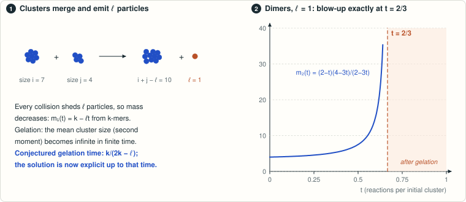

# Klobusicky–Rakauskas: exact gelation time for coagulation with particle emission

<!-- plain-words:start -->
**The question.** Clusters merge two at a time, and every merger sheds a fixed number ℓ of particles. Starting from identical clusters of size k, the mean cluster size becomes infinite in finite time (gelation). Klobusicky and Rakauskas proved existence only for short times and conjectured the gelation time k/(2k − ℓ), in particular 2/3 for dimers shedding one particle.

**The answer.** True for every k > ℓ ≥ 1. The solution is explicit up to that time, unique, and its second moment blows up exactly at t = k/(2k − ℓ).

**How.** Removing ℓ from every size turns the reaction into an additive one. The equations then become triangular, and a generating function solved by Lagrange inversion gives every concentration in closed form.

<p align="center"></p>

<p align="center"><sub>For dimers emitting one particle, the second moment of the size distribution is (2−t)(4−3t)/(2−3t), infinite at t = 2/3.</sub></p>

<!-- plain-words:end -->

**Status: solved, verified.**

**Attribution.** Solver and manuscript: GPT-6-Astra. Verification: GPT-6-Astra, in a fresh context
([verification.md](verification.md)).

## Problem

J. Klobusicky and M. Rakauskas, *Coagulation equations with particle emission*,
[arXiv:2604.14076](https://arxiv.org/abs/2604.14076) (v1, 15 April 2026). The reaction is
S_i + S_j → S_{i+j−ℓ} with an emission size ℓ ≥ 1; time counts reactions per initial cluster. For clusters larger
than ℓ the deterministic equations (their equation (37)) read

u̇ₙ = m₁⁻² Σ_{i=ℓ+1}^{n−1} i(n+ℓ−i) uᵢ u_{n+ℓ−i} − 2n uₙ / m₁,  m₁ = Σ_{n>ℓ} n uₙ,

where the denominator m₁ is the actual first moment. The authors prove local existence and, in Section 7, p. 21,
conjecture the threshold 2/3 for dimers emitting one particle and state the general proposal:

> "Formula (96) suggests that under monodisperse k-mer initial conditions (94), t_gel = k/(2k − ℓ)."

Gelation means the first time the second moment becomes infinite (their Definition 1 and p. 6).

## Result

Let k > ℓ ≥ 1 be integers and u_n(0) = δ_{n,k}. Put d = k − ℓ, n_j = ℓ + dj, p = (2k − ℓ)/ℓ, M(t) = 1 − ℓt/k.

* **Theorem (gelation time).** The first divergence of the second moment is exactly t_g = k/(2k − ℓ).
* **Explicit solution.** For 0 ≤ t < t_g, the unique pre-gelation solution (nonnegative, componentwise C¹, second
  moment uniformly convergent on compact intervals) is

  u_{n_j}(t) = M(t)^{2n_j/ℓ} · ℓ^{j−1} k^j / (j n_j) · C(pj, j−1) · (t/k²)^{j−1},  j ≥ 1,

  with the generalized binomial coefficient C, and u_n = 0 at every other size. It is positive at reachable sizes for
  t > 0.
* **Moments.** m₀ = 1 − t, m₁ = k − ℓt (proved by summing the coefficients, not assumed), and
  m₂ = (k − ℓt)(k² − ℓ(2k − ℓ)t)/(k − (2k − ℓ)t), finite before t_g and infinite at t_g. No pre-gelation solution
  extends across t_g.
* **Critical profile.** At t_g the mass is finite and u_{n_j}(t_g) ~ k / √(π(k − ℓ)(2k − ℓ)) · j^{−5/2}.
* **Dimers (ℓ = 1, k = 2).** u_n(t) = C(3n−3, n−2) t^{n−2} (2 − t)^{2n} / (n(n−1) 8^{n−1}) for n ≥ 2, and t_g = 2/3.

**Method.** Subtracting ℓ from every size makes the reaction additive, so only the sizes n_j are reached. With the
candidate mass k − ℓt the equations become a triangular recursion; its generating function satisfies a first-order
PDE whose solution is H = q(1 − H)^{−a}, a = 2d/ℓ, and Lagrange inversion gives the coefficients. Summing the
coefficients on the correct branch of H then proves that the actual mass equals the candidate one, which removes the
circularity. Stirling's formula gives the radius of convergence and the j^{−5/2} tail.

**What is computer-assisted.** Nothing in the proof. The exact scripts are corroboration only.

**Scope and open questions.** The theorem concerns the deterministic equations and the monodisperse data proposed
by the authors. It does not prove convergence of the finite stochastic particle system, a giant-cluster theorem for
it, or any post-gelation dynamics; general initial distributions are not treated. Uniqueness is proved in the
pre-gelation class only.

**Novelty.** The value t_g = k/(2k − ℓ) and the moment formulas are the authors'; the explicit solution and the proof
of existence, uniqueness and blow-up up to t_g are new as far as the searches in [references.md](references.md) show
(arXiv, the first author's publication list, OpenAlex, Zenodo, GitHub, including the mmislan and ipitchford
accounts; Semantic Scholar was unavailable).

## Reproduce

Python 3.12 with SymPy 1.14, from this directory:

```bash
python scripts/verify_exact.py
python verification/check_original_series.py
```

* `scripts/verify_exact.py`: 85 exact checks (recurrence against the closed form for 56 pairs (ℓ, k) up to index 40,
  generating-function and moment identities, direct substitution in 17 dimer equations, rational bounds on mass
  tails); output `certificates/exact-checks.json`. About 8 s.
* `verification/check_original_series.py` (written by the verifier, standard library only): 40 exact checks of the
  original coupled equations through Taylor order 7, with the mass denominator computed from the concentrations;
  output `verification/original-series-results.json`. About 6 s.
* `scripts/novelty_audit.py`: repeats the API part of the novelty search; output `certificates/novelty-api.json`
  (results can change with time).

Manuscript, from the repository root: `python templates/build_tex.py problems/klobusicky-rakauskas-emission-gelation/paper.tex`.

## Files

| File | Content |
|---|---|
| `paper.tex`, `paper.pdf`, `references.bib` | Manuscript (6 pages): theorem, proof, scope |
| `references.md` | Sources read and novelty search |
| `verification.md` | Verifier's report: separate derivation, checks, corrections |
| `verification/internal-audit-original.md` | The solver's internal audit before verification (historical) |
| `scripts/`, `certificates/` | Exact checks and their outputs |
| `verification/check_original_series.py`, `verification/original-series-results.json` | Verifier's exact Taylor checks |
