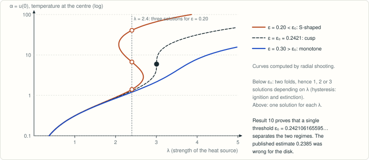

# Perturbed Gelfand equation on the disk: the critical parameter

<!-- plain-words:start -->
**The question.** In a reacting disk that heats itself (a thermal-explosion model), the steady temperature can jump abruptly (an S-shaped curve) or change smoothly. Korman, Li and Ouyang conjectured that a single value ε₀ of the activation parameter separates the two behaviours.

**The answer.** True: ε₀ = 0.2421061655952…, with exactly two folds below and none above. The published estimate 0.2385 was wrong for the disk.

**How.** A change of variables turns ε into a “stopping level”, so folds correspond to solutions of E(a) = ε. One shows that E has a single maximum: by hand for small a, by validated numerical integration in the middle range, and by a known theorem for large a.

<p align="center"></p>

<p align="center"><sub>Below ε₀ the curve is S-shaped (sudden ignition and extinction); above it is monotone. Curves computed by shooting; the dot is the certified cusp.</sub></p>

<!-- plain-words:end -->

**Solver: GPT-6-Astra (effort xhigh)**  
**Verifier: Claude Opus 5.5 (effort xhigh), verdict CONFIRMED WITH CORRECTIONS (see [verification.md](verification.md))**  
**Status: solved.**

A complete computer-assisted argument for the global conjecture is provided here. It combines the certified cusp from phase 1 with a new global reduction and a validated cover of 110 intervals. A verifier re-derived the reduction and the qualitative steps, checked the cited theorems against Korman–Li–Ouyang and the original Du–Lou paper, re-ran every certificate, and reproduced the global sign pattern, the critical value and the cusp with a separate validated integrator (Julia/IntervalArithmetic.jl, [verification/](verification/)).

## Original question

For positive solutions of

\[
\Delta u+\lambda e^{u/(1+\varepsilon u)}=0\quad\text{in }B_1\subset\mathbb R^2,
\qquad u|_{\partial B_1}=0,
\]

Korman, Li and Ouyang write on printed page 3 of [arXiv:1612.07722](https://arxiv.org/pdf/1612.07722):

> It is natural to conjecture that there is a critical ε₀ > 0, so that for ε ≥ ε₀ > 0 the solution curve is monotone, while for ε < ε₀ > 0 it is exactly S-shaped. For the one-dimensional case the same statement is known as S.-H. Wang's conjecture [16], for which we gave a computer assisted proof in [12]. Our numerical computations, for the two-dimensional case (1.2), show that remarkably ε₀ is close to 0.25, see Figures 1 and 2.

The reference numbers in this verbatim quotation belong to the source. Published reference: P. Korman, Y. Li and T. Ouyang, *A simplified proof of a conjecture for the perturbed Gelfand equation from combustion theory*, **Journal of Differential Equations 263** (2017), no. 5, 2874–2885, [DOI:10.1016/j.jde.2017.04.016](https://doi.org/10.1016/j.jde.2017.04.016). The published title refers to the small-ε result, not to a solution of the quoted global conjecture.

## Certified result

Let the following decimal centres be exact rationals:

\[
a_0=5.943243406485813,\qquad e_0=0.24210616559524695.
\]

There is an ordinary cusp with

\[
|\alpha_c-a_0|<10^{-10},\qquad |\varepsilon_c-e_0|<10^{-12},
\qquad 3.006301478866<\lambda_c<3.006301478873.
\]

The critical parameter is globally unique: **ε₀ = εc**. For every **0 < ε < ε₀**, there are exactly two simple folds on **all α > 0**, with derivative signs `+,-,+`. For **ε > ε₀**, the derivative is positive everywhere. At **ε = ε₀**, it is positive except at the unique cusp, where it has a double zero; the curve is still strictly increasing globally.

Below ε₀ there are three positive solutions between the two fold values of λ, two at either fold value, and one otherwise. Multiple solutions are strictly ordered in the disk. At or above ε₀ there is exactly one positive solution for each λ > 0.

The proof is written in [paper.tex](paper.tex) and compiled in [paper.pdf](paper.pdf). Its main steps are:

- The Du–Lou transformation gives `q'' + q'/s + exp(-1/q) = 0`, with central value `a = ε + ε²α`; ε is the stopping level. KLO's positive-kernel theorem makes the fold set a single stopping-level graph `ε = E(a)`.
- A Wronskian sign argument proves `E'(a) > 0` for `0 < a ≤ 1/2`, including arbitrarily small ε.
- Validated 160-bit Arb integration covers `a ∈ [1/2,8/5]` with 110 contiguous intervals. It proves that this graph has just one maximum, and explicitly connects it to the local cusp certificate.
- KLO's established limiting-problem theorem excludes the remaining tail. The limiting fold centre lies in `(3/2,8/5)`. The sharp exclusion is `ε + ε²α ≥ 8/5`; in particular **α ≥ 24** suffices uniformly for **ε ≥ 0.24**.

An explicit overlap threshold is **ε₁ = 0.238**. The same argument covers both `(0,ε₁]` and `[ε₁,ε₀)`. For `0 < ε ≤ 0.0078`, the escaping upper fold satisfies `(1.5−ε)/ε² < α₊ < (1.6−ε)/ε²`. There is no unquantified small-parameter gap.

Origin errors, all Taylor remainders, and the smooth extension at `q = 0` are bounded explicitly. Floating-point proposals and plots are not proof certificates. The phase-1 local rectangle remains documented as an auxiliary result.

The novelty audit found no global solution. Minamoto–Nakao's 2007 certified example is **three-dimensional**. Search coverage and limitations are in [references.md](references.md); no priority claim for local validation is made.

## Reproduction

Run from this problem folder. Scientific Python: Python 3.12, python-flint 0.9.0, SymPy, SciPy 1.18.1 and NumPy; plotting additionally uses Matplotlib. The global cover uses six single-thread numerical processes by default; `--workers` accepts 1 through 8. All other mathematical validators use one thread. Memory use is small compared with the permitted 14 GB; no large mesh or matrix is stored. The API audit uses at most four workers.

```bash
python scripts/check_analytic.py
python scripts/validated_cusp.py
python scripts/validated_reduced.py --full --workers 6
```

Observed runtimes are approximately 1, 40 and 145 seconds. Each certification assertion or completed cover block prints `PASS` or `FAIL`; failure exits nonzero. Both ODE validators recompute the enclosures from scratch and remove stale output before starting. The local input is only the rational centres/radii in `certificates/cusp-input.json`; the global partition and precision are explicit in its script. The global script uses SciPy solely to propose rational event windows, which must then pass Arb checks. The certificate's interval records are sorted deterministically. Arb/FLINT, their arithmetic dependencies, and the validator implementation belong to the trusted computing base. Successful logs are not a verification.

Verification (verifier's own code, run from `verification/`; Julia 1.13 with IntervalArithmetic.jl 1.0.12, Python 3 with SciPy):

```bash
julia -t 6 cover.jl          # separate global cover on [1/2, 8/5] + point values, about 4 minutes
julia cusp_reduced.jl        # eps0, alpha_c, lambda_c in the reduced variables, 160-bit; one thread, see log for runtime
julia crosscheck.jl          # direct-shooting folds satisfy E(a) = eps, about 10 seconds
python direct_original.py    # non-rigorous fold counts on the original equation, about 15 minutes
python dimension_check.py    # non-rigorous: max E in dimensions 2 and 3, about 1 minute
```

Optional numerical exploration and figure (approximately 30 and 10 seconds):

```bash
python scripts/explore.py
python scripts/plot_exploration.py
```

Optional public literature metadata refresh, requiring network access and GitHub CLI:

```bash
python scripts/novelty_audit.py
```

Network failures are reported as retrieval failures; they do not invalidate or support the mathematical certificate. The audit does not certify absence of prior results.

On Windows, build the PDF while keeping temporary files in this folder:

```powershell
py -3 scripts/build_paper.py
```

This invokes the prescribed repository command, from the repository root:

```powershell
py -3 templates/build_tex.py problems/perturbed-gelfand-2d-critical-epsilon/paper.tex
```

## Files

- [paper.pdf](paper.pdf), [paper.tex](paper.tex), [references.bib](references.bib): manuscript, full proof and bibliography.
- [references.md](references.md): novelty audit, queries, source-reading levels and limitations.
- [FINAL-REPORT.md](FINAL-REPORT.md): the solver's French final report.
- [verification.md](verification.md): verification report (verdict, what was recomputed, corrections, reservations).
- `verification/jets.jl`, `verification/cover.jl`, `verification/cusp_reduced.jl`: the verifier's own validated integrator, global cover and reduced-variable cusp enclosure, with logs `cover.log`, `cover-leaves.txt`, `cusp_reduced.log`.
- `verification/direct_original.py`, `direct_original.log`: non-rigorous fold counts computed directly on the original equation; `verification/crosscheck.jl`, `crosscheck.log`: those folds satisfy E(a) = ε in the validated reduced computation; `verification/dimension_check.py`, `dimension_check.log`: non-rigorous dimension-2/3 comparison.
- `scripts/validated_cusp.py`, `scripts/check_analytic.py`: mathematical validators.
- `scripts/validated_reduced.py`: complete global cover, event enclosures and explicit overlap checks.
- `scripts/explore.py`, `scripts/plot_exploration.py`: non-rigorous exploration and illustration.
- `scripts/explore_reduced.py`: non-rigorous exploration of the transformed family.
- `scripts/novelty_audit.py`, `scripts/build_paper.py`: metadata audit and confined build helper.
- `certificates/cusp-input.json`, `cusp-certificate.json`, `analytic-checks.json`, `validation.log`: certified computation inputs and outputs.
- `certificates/exploration.json`: non-rigorous fold samples.
- `certificates/reduced-cover.json`, `reduced-validation.log`: complete global certificate and successful run.
- `certificates/reduced-exploration.json`: non-rigorous transformed samples.
- `certificates/analytic-validation.log`: successful analytic-identity checks.
- `certificates/novelty-api.json`, `novelty-supplement.json`: retrieved literature metadata.
- `certificates/build.log`, `figures/exploration.png`: build report and numerical illustration.

The verification is reported in [verification.md](verification.md). The solver used the versions of the Du–Lou results stated in KLO. The verifier later compared them with the original Du–Lou paper: Theorem 3 there is stated precisely for `exp(-1/(ε+w))`, ε ≥ 0, n = 2, and Theorem 2 with Lemma 2 gives the single nondegenerate turn of the limiting curve. No discrepancy affects the argument. Source-review limitations are recorded in `references.md`.

Note on a published estimate: the author-hosted manuscript of the published KLO paper adds "(ε₀ ≈ 0.2385)" after the conjecture. That value is incompatible with the certified ε₀ ≈ 0.242106: curves with 0.2385 ≤ ε < 0.2421 are still exactly S-shaped, which direct shooting confirms at ε = 0.242. The same reduction in dimension three gives ≈ 0.238797, the three-dimensional value of Minamoto–Nakao.
