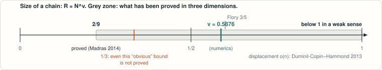

# Swelling exponent of self-avoiding walks on Z³

<!-- plain-words:start -->
**The question.** How does the size of a polymer chain grow with its length in three dimensions? R ≈ Nν with ν ≈ 0.588 numerically, but almost nothing is proved.

**The answer.** No unconditional improvement. Two conditional theorems isolate exactly what is missing.

**How.** Literature review, two proof attempts (upper and lower bound) and an exact-enumeration lab up to n = 19. Not yet verified.

Simulations give ν ≈ 0.588; proofs only give ν ≥ 2/9 and “less than ballistic”. Even ν ≥ 1/3 is unproved.

<!-- plain-words:end -->

## Contents

| Folder | Content |
|---|---|
| [`literature/`](literature/) | State of the art, open statements, novelty check |
| [`upper-bound/result.md`](upper-bound/result.md) | Conditional quantitative sub-ballisticity theorem and the unconditional inequality behind it |
| [`lower-bound/result.md`](lower-bound/result.md) | Madras’s argument reorganized; conditional improvement of the exponent |
| [`computation/report.md`](computation/report.md) | Exact enumeration to n = 19, candidate lemmas tested, pivot estimate of ν (numerics only) |

**Status: conditional results, not yet verified.** No unconditional bound is improved.
