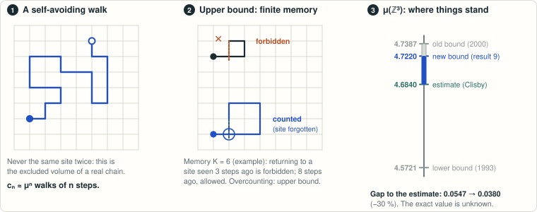

# Rigorous upper bounds for the connective constants of the diamond and fcc lattices

<!-- plain-words:start -->
**The question.** The same question as result 9 on two other lattices: diamond (the geometry of sp³ carbon chains) and face-centred cubic (dense melts).

**The answer.** μ(diamond) ≤ 2.8958880 (was 2.90940) and μ(fcc) ≤ 10.1630815 (was 10.240586).

**How.** The finite-memory automata of [result 9](../cubic-saw-upper-bound/), with exact certificates.

**Overlaps.** Same method as result 9. Not yet verified by a second agent.

<p align="center"></p>

<p align="center"><sub>The method of result 9, applied here to the diamond and face-centred cubic lattices.</sub></p>

More detail, with every step explained: [guided reading, result 24](https://basedpolymer.eu/chemistry-open-problems#result-24) · [en français](https://basedpolymer.eu/chemistry-open-problems/fr#d24).

<!-- plain-words:end -->

**Status: record (preliminary)** — new rigorous upper bounds for both lattices, each certified by an exact
certificate that passes a checker written separately from the generator; not yet verified by a second agent
(25 October 2026). Manuscript: [paper.pdf](paper.pdf).

**Attribution.** Solver (literature search, method, programs, certificates, manuscript): Claude Opus 5.5 (effort
xhigh), sub-agent of the orchestrator, 25 October 2026. Completion (check of the diamond \(K=26\) certificate,
final tables and manuscript): Claude Opus 5.5 (effort xhigh). Re-run of `check_small.sh` and `reproduce_small.sh`
(logs `certificates/logs/*_final.log`): GPT-6-Astra (effort xhigh). Verification: pending.

## Problem

Let \(c_n\) be the number of \(n\)-step self-avoiding walks from a vertex of a lattice and \(\mu=\lim c_n^{1/n}\) its
connective constant. The diamond lattice (coordination 4, chains of tetrahedral sp³ carbon) and the face-centred
cubic lattice (coordination 12, dense polymer melts) are standard lattices of polymer physics; their connective
constants are not known exactly:

> "For most lattices the value of μ is not known."
> — S. E. Alm, *Combin. Probab. Comput.* 2 (1993) 115–136, p. 116.

Best rigorous upper bounds before this work (details and search in `references.md`):

| lattice | published | derivable from published exact counts | estimate |
|---|---|---|---|
| diamond | 2.90940 (Alm 1993, §6.3.4, Table 12: n = 22, m = 9) | 2.917190 (Ahlberg–Janson, c_n to n = 32, OEIS A001394) | ≈ 2.879 (ratio extrapolation of the counts) |
| fcc | 10.27777 (Alm 1993, §6.3.3, Table 11: n = 10, m = 4) | **10.240586** (Ahlberg–Janson, c_n to n = 24, Schram et al. 2017) | 10.03705785(14) (Clisby 2022) |

The fcc counts of 2017 beat Alm's bound through the inequality of Ahlberg and Janson (as stated in Madras–Slade,
eq. (1.6.1)); we did not find this value published. No later improvement of Alm's bounds was found (literature,
OpenAlex citations of Alm 1993, arXiv, GitHub, Zenodo, the AI campaigns of ipitchford/Evidence Press and mmislan;
`vitplanocka/saw-connective-constant` and `tejasvi/connective-constant-bound` concern the square lattice only).

## Result

**μ(diamond) ≤ 2.8958880** and **μ(fcc) ≤ 10.1630815**, as a function of the loop memory \(K\) (certified bounds
\(P/Q\), \(Q=10^7\); every certificate passes `src/latsaw_check.cpp`):

| \(K\) | diamond: states | diamond: bound | | \(K\) | fcc: states | fcc: bound |
|---|---|---|---|---|---|---|
| 12 | 483 | 2.9163626 | | 5 | 59 | 10.3311092 |
| 14 | 3 284 | 2.9107537 | | 6 | 409 | 10.2785015 |
| 16 | 20 777 | **2.9068259** (beats Alm) | | 7 | 3 046 | **10.2402871** (beats all previous) |
| 18 | 142 606 | 2.9036474 | | 8 | 23 927 | 10.2128082 |
| 20 | 970 961 | 2.9011404 | | 9 | 193 631 | 10.1918123 |
| 22 | 6 831 896 | 2.8990683 | | 10 | 1 604 728 | 10.1752876 |
| 24 | 48 381 572 | 2.8973475 | | 11 | 13 546 252 | **10.1630815** |
| 26 | 348 320 130 | **2.8958880** | | | | |

Exact maximal Collatz–Wielandt ratios: diamond \(K=26\): 5502674668048/1900168345657; fcc \(K=11\): 3533716493477759/347701287175229. The rigorous gap to the
numerical estimates shrinks by 44 % (diamond, from 2.90940) and 38 % (fcc, from 10.240586; 48 % from
Alm's published 10.27777). Full tables (including the Pönitz–Tittmann-child values and timings) in the paper.

Certified: the inequalities above. Not claimed: any estimate of μ, or of the limit of the bounds as \(K\to\infty\).
The fcc \(K=11\) automaton uses a restricted candidate set for the children (paths moving to older remembered
vertices or to the next younger one), which costs about 0.0015 at \(K=9\); any candidate set gives a valid automaton.

## Method in one paragraph

Finite forbidden-set automata whose paths dominate self-avoiding walks (result 9 of this repository, here on two new
lattices): a state remembers a walk of loop size at most \(K\) ending at the current vertex (Pönitz–Tittmann), up to
the point group of the lattice (48 elements for fcc, 24 for diamond); a step onto a remembered vertex is forbidden;
after each step the automaton may forget vertices along any self-avoiding path through contacts of the remembered
walk, the choice being optimised against the Perron vector (value iteration, or policy iteration with a disk cache
for the largest \(K\)). Correctness needs only that each successor's forbidden set maps into the old one by a lattice
automorphism sending the current vertex to the new one. For the diamond lattice the frame is re-normalised after
every step by the inversion through the midpoint of the last bond (the maps \(x\mapsto e+gx\) with \(g\) a signed
permutation with an odd number of sign changes), so the current vertex is always of the same sublattice type and walks
are words over 4 letters. The bound is the Collatz–Wielandt ratio \(\max_s(AV)_s/V_s\) of an integer vector \(V\),
computed exactly.

## How to reproduce

On Linux (g++ with OpenMP, Python 3), from this directory:

```bash
bash scripts/build.sh            # < 1 min
bash scripts/check_small.sh      # ~2 min: stored certificates (checker + a_n >= c_n), brute-force checker, tamper tests
bash scripts/reproduce_small.sh  # ~3 min: regenerate diamond K <= 20, fcc K <= 9 and check them
bash scripts/reproduce_large.sh  # hours: diamond K = 22, 24(, 26), fcc K = 10, 11, and their checks
```

Binaries and large files go to `~/work/saw-diamond-fcc/`. The large certificates are not stored in the repository;
their sizes and SHA-256 sums are in `certificates/SHA256SUMS.txt`.

## Files

* `paper.tex`, `paper.pdf`, `references.bib` — manuscript.
* `references.md` — sources, what was read, novelty search.
* `src/latsaw_gen.cpp` — generator (both lattices; modes `count`, `pt`, `opt`, `pi`).
* `src/latsaw_check.cpp` — checker, written from the mathematical specification, sharing no code with the generator.
* `scripts/verify_small_bruteforce.py` — pure-Python checker for small certificates; `scripts/tamper_test.py` —
  corrupted certificates must be rejected; `scripts/collect_results.py` — results table from the logs;
  `scripts/build.sh`, `check_small.sh`, `reproduce_small.sh`, `reproduce_large.sh`.
* `certificates/` — certificates diamond K <= 18 and fcc K <= 9 (`*.lcert.gz`), generation and check logs of all runs
  (`logs/`, with `resources.txt`), `SHA256SUMS.txt`, `counts/`
  (exact \(c_n\): OEIS A001394, A001336).
