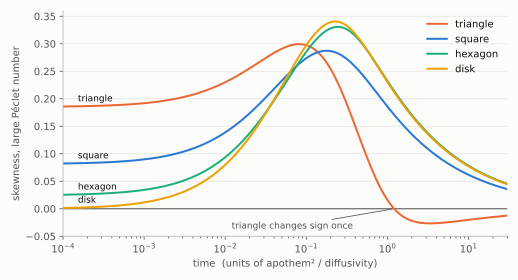

# Skewness of Taylor dispersion in regular polygonal ducts at all times

<!-- plain-words:start -->
**The question.** A tracer released in a pipe flow spreads along the pipe; its profile is skewed forward or backward. Aminian, Camassa and McLaughlin claimed that every regular polygonal pipe except the triangle keeps a positive skewness at all times, and said this could not be proved.

**The answer.** The claim is true. For every regular polygon with at least 4 sides, and for the disk, the skewness is positive at every time and every flow speed. For the triangle it changes sign exactly once.

**How.** One bound, valid on every polygon at once, covers very short times. Later times are checked by rigorous interval arithmetic for 4 to 199 sides, and by comparison with the disk from 200 sides on. Not yet verified by a second agent.

<p align="center"></p>

<p align="center"><sub>Skewness at large flow speed (numerical curves, shown for illustration). Only the triangle crosses zero.</sub></p>

<!-- plain-words:end -->

**Attribution.** Solver: Claude Opus 5.5 (effort not recorded). Verification: pending.

**Status: solved (preliminary).** Complete computer-assisted proof, not yet verified by a separate agent. This folder completes
[result 14](../): it settles the finite-time claim that the earlier stage ([../result.md](../result.md)) left open. The manuscript
[paper.pdf](paper.pdf) covers the whole of result 14.

## Original statement

M. Aminian, R. Camassa, R. M. McLaughlin, *Mass distribution and skewness for passive scalar transport in pipes with
polygonal and smooth cross sections*, Stud. Appl. Math. **141**(3) (2018) 399–417,
[doi:10.1111/sapm.12230](https://doi.org/10.1111/sapm.12230); [arXiv:1708.05097](https://arxiv.org/abs/1708.05097). Abstract of the
arXiv version (v1–v3):

> Interestingly, the equilateral triangle is the only regular polygon with this property, all other polygons possess
> positive skewness at all times, although this cannot cannot be proved on finite times due to the lack of closed form
> flow solutions for such geometries.

("This property" = positive short-time and negative long-time skewness.)

## Result

Let `u` be the mean-free Poiseuille profile (`−Δũ = 2`, `ũ = 0` on the wall, `u = ũ − ⟨ũ⟩`), `P_s` the Neumann heat semigroup,
`A(s) = ∫₀ˢ P_r u dr`. For a cross-sectionally uniform release, `μ₃(τ) = κ₃ + 3 Pe³ K(τ)`, `μ₂ > 0`, where

    K(τ) = 2 ∫₀^τ ⟨u A(s) A(τ−s)⟩ ds = 2 ∬_{a+b≤τ} (τ−a−b) ⟨u P_a u P_b u⟩ da db

and `κ₃` is the third cumulant of the longitudinal profile. So for a symmetric profile the sign of the skewness is the sign of
`K(τ)`, for every Péclet number.

* **Main theorem.** For every `n ≥ 4`, `K(τ) > 0` for all `τ > 0`: the skewness is strictly positive at all times, for every Pe. The
  same holds for the disk, where `K ~ τ⁴/72` although `⟨u³⟩ = 0`.
* **Triangle (n = 3).** `K` has exactly one zero `τ* ∈ [1.17, 1.25]` (time unit inradius²/κ), positive before, negative after.
* **The two ends (earlier stage, long-time part reproved here).** `K = 2⟨u g²⟩τ + O(1)` at long times, and `⟨u g²⟩ > 0` for `n ≥ 4`,
  `= −7101/476476000` for `n = 3`. `K = ⟨u³⟩τ³/3 + O(τ^{7/2})` at short times, and `⟨u³⟩ > 0` for all `n ≥ 3`.

What is new in the proof:

1. **Short times, for all n at once.** On any convex section,
   `K(τ) ≥ ⟨u³⟩τ³/3 + S τ⁴` on `(0, τ₀]`, with `S` given in terms of `E = ⟨ũ⟩² − ⟨u²⟩` and the wall shear (Section 3 of the paper). `E` stays near `1/24` as `n → ∞` while `⟨u³⟩ → 0`, so the window `τ₀ = 0.015` is uniform in `n`. The tools are the
   positivity of the boundary layer `Γ_s = P_s u − u + 2s` and a concave-distance barrier. For the triangle the same `E` is `9/175`, the
   coefficient in eq. (14) of the source.
2. **Working with `A`, not `P_s u`.** `A(s) = g − P_s g` has no boundary layer at leading order, so a few modes suffice:
   `‖A(s) − Ã(s)‖ ≤ Δ₀ ≈ 10⁻⁵` with 8 to 39 Ritz modes (energy estimate with explicit Poincaré and trace constants on the half-sector).
3. **`4 ≤ n ≤ 200`:** `K > 0` on `[0.015, ∞)` certified in ball arithmetic. Worst margin `(K̃ − error)/K̃` over all n: see below.
4. **`n ≥ 200`:** the same estimate with Bessel modes and closed-form disk data, all errors increasing in `t = tan(π/n)`.

Certified numbers: smallest margin over `4 ≤ n ≤ 200` is `0.29` (at `n = 21`, `τ = 0.015`), smallest short-time constant `S(0.015) = 1.3·10⁻⁴` (at `n = 4`); `n ≥ 200`: `K_D(0.0149) = 3.06·10⁻¹⁰`, error `2.06·10⁻¹⁰`.

Not proved, only observed numerically: `⟨u P_a u P_b u⟩ > 0` on the whole quadrant for `n ≥ 4`, hence `K` convex (`numerics_check.py`). In particular
`⟨u e₁²⟩ ≈ +0.023 > 0` for the first invariant eigenfunction of the square.

**Novelty check (31 October 2026).** Web searches, the arXiv API, Semantic Scholar citations of the source (8 listed works, none on this
question), Zenodo, and the GitHub accounts named in [PROTOCOL.md](../../../PROTOCOL.md) show no earlier proof. Details in
[../references.md](../references.md).

## Reproduction

From `all-times/scripts/` under WSL Fedora (Python 3.12, python-flint 0.9.0, sympy 1.14, numpy, scipy):

```sh
sh run_all.sh
```

| script | claim | runtime |
|---|---|---|
| `run_finite.py 4 200 0.015 3` (uses `finite_n.py`, `modal_lib.py`) | `K > 0` on `[0.015, ∞)` and the short-time condition, `4 ≤ n ≤ 200`; also `⟨u g²⟩ > 0` | 45 min on 3 cores |
| `uniform.py 200 12` | the same for all `n ≥ 200` | 10 s |
| `uniform.py 0 12` | the same for the disk | 10 s |
| `u3_uniform.py 40` | `⟨u³⟩ > 0` for `n ≥ 40`, elementary proof | 5 s |
| `../../scripts/sg_certify.py 4 150` | `⟨u³⟩ > 0` for `4 ≤ n ≤ 150` (earlier stage, re-run) | 15 min |
| `../../scripts/sg_uniform.py 140 6` | `⟨u³⟩ > 0` for `n ≥ 140`, second proof (re-run) | 5 s |
| `triangle.py 0.025 1.0 1.6` | exactly one zero of `K` for `n = 3` | 2 min |
| `numerics_check.py` | floating-point cross-checks; **not a certificate** | 3 min |
| `make_tables.py` | builds `table-finite.tex` from the JSON summary | 1 s |

Each certificate script prints PASS/FAIL per claim and exits non-zero on failure. Floating point only chooses coefficients.
Build the manuscript with `py -3 templates/build_tex.py problems/taylor-dispersion-polygon-skewness/all-times/paper.tex`.

## Files

* `paper.tex`, `paper.pdf`, `references.bib`, `table-finite.tex` — manuscript for the whole of result 14.
* `scripts/` — certificates, as above.
* `certificates/finite_4_200.json` — per-n summary: parameters, `ω`, `ρ`, `L₁`, `Δ₀`, short-time constants, worst margin.
* `logs/` — logs of the certified runs.
* `explore/` — floating-point exploration used to find the proof (`galerkin.py` is also used by `numerics_check.py`), and the figure script.
* `figures/skewness-all-times.svg` — figure above.
